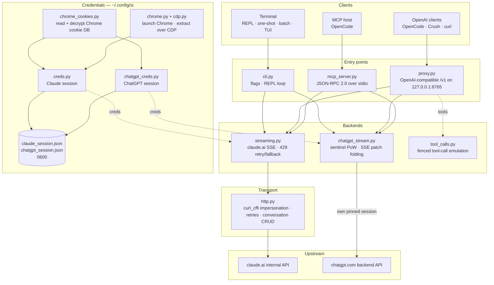

# Reclaude

Terminal client for Claude.ai and ChatGPT — replays your own browser session against their internal endpoints and streams replies token-by-token. No API key.

> Research tool. It runs under your Claude.ai account: its limits, tiers, and billing still apply. It does not bypass rate limits or paywalls.

> [!WARNING]
> **Do not use your main account.** si drives claude.ai and chatgpt.com through your own browser session — behavior that can get the account limited or banned. Use a throwaway account you can afford to lose, never one tied to your email, billing, or work.

## Demo


With the proxy running, `si/haiku` shows up in OpenCode's `/models` picker like any other provider. Pick it, ask, watch the reply stream in — all through your Claude.ai session, no API key.

## Architecture

si is three thin surfaces — a terminal client, an OpenAI-compatible proxy, and an MCP server — over one pair of streaming backends.



A request crosses four layers:

1. **Credentials** — `--from-chrome` reads the browser's cookie DB and decrypts it with the OS keyring (`chrome_cookies.py`); `--auto-fetch` launches real Chrome and pulls cookies plus the org id over CDP (`chrome.py`, `cdp.py`). Sessions land in `~/.config/si/*.json` (`0600`). The MCP server re-reads them per call (no restart after re-login); the proxy loads them at startup, so restart it after a re-login.
2. **Entry points** — `cli.py` parses flags and runs the REPL/one-shot/batch modes; `proxy.py` serves `/v1/models` and `/v1/chat/completions`; `mcp_server.py` answers `tools/call` for `claude_ask` / `chatgpt_ask`. The proxy routes on the model id (`chatgpt/…` → ChatGPT backend, everything else → Claude); the MCP server exposes one tool per backend.
3. **Backends** — `streaming.py` posts to Claude.ai's completion endpoint and folds SSE deltas, with bounded 429 retry/fallback; `chatgpt_stream.py` runs the sentinel handshake (proof-of-work + Turnstile) and folds ChatGPT's snapshot/patch SSE into text. `tool_calls.py` turns fenced `tool_call` blocks into real OpenAI `tool_calls`, because Claude.ai's native tool channel deadlocks clients that only act on finished responses.
4. **Transport** — `http.py` keeps one `curl_cffi` session pinned to a Chrome TLS fingerprint, handles retries/backoff, and owns conversation create/delete. The ChatGPT backend keeps its own pinned session so the two fingerprints never mix.

Conversation state is one server-side chat per client session: the CLI/TUI delete it on exit when stealth is on, the proxy keys it by `X-Conversation-Id` (deleting one-shot chats), and the MCP server keeps one per provider for its lifetime.

Install-time helpers: `opencode.py` registers the MCP server via `opencode mcp add`; `service.py` installs the macOS LaunchAgent that supervises the proxy.

## Install

```bash
git clone https://github.com/two35s/reclaude.git && cd reclaude
python3 -m venv .venv && source .venv/bin/activate
pip install -r requirements.txt
python -m si --opencode   # register the MCP tool with OpenCode (see below)
```

## Login (once)

```bash
python -m si --from-chrome   # steal session from your logged-in Chrome (recommended)
python -m si --auto-fetch    # or: launch Chrome, log in, auto-extract over CDP
python -m si --manual        # or: paste org_id + Cookie header by hand
```

Saves to `~/.config/si/claude_session.json` (`600`).

On Linux, cookies Chrome encrypted with the desktop keyring (`v11`) need `libsecret-tools` installed and the keyring unlocked; without them `--from-chrome` refuses the profile instead of saving garbage (use `--auto-fetch` as the fallback).

### ChatGPT credentials

```bash
python -m si --chatgpt --from-chrome   # steal chatgpt.com session from Chrome
python -m si --chatgpt --manual        # or paste the session-token cookie
python -m si --chatgpt --clear-session # delete stored chatgpt creds
```

Saves to `~/.config/si/chatgpt_session.json` (`600`). The proxy and MCP server pick these up automatically; a `chatgpt/`-prefixed model then appears alongside the claude ones. Re-run `--chatgpt --from-chrome` when requests come back `401`.

## Chat

```bash
python -m si                 # REPL
python -m si --tui           # full-screen chat
python -m si --prompt "..."  # one shot
python -m si --model haiku   # haiku | sonnet (default) | opus | fable …
```

TUI commands: `/new` `/model [name]` `/models` `/help` `/quit`.
REPL commands: same, plus `/stealth on|off` `/cleanup` `/clear-session`.

One server-side conversation per session gives multi-turn memory; stealth mode deletes it on exit so it never appears in your browser sidebar (`--no-stealth` to keep it).

## Proxy

```bash
python -m si --proxy                 # OpenAI-compatible API on :8765
python -m si --proxy --port 9000
python -m si --proxy &               # run in the background
```

The proxy must be running for clients to see the models — if it exits, every request fails with `ConnectionRefused`. On macOS, `python -m si --install-service` installs a launchd agent that starts it at login and restarts it if it exits (`--uninstall-service` removes it; logs go to `~/Library/Logs/si-proxy.log`).

Point [Crush](https://github.com/charmbracelet/crush), [OpenCode](https://opencode.ai), or any OpenAI client at `http://localhost:8765/v1`.

Streaming (`text/event-stream`) and non-streaming requests are both supported. Every streamed reply is also written to `~/.config/si/last_response.txt` — handy when a client shows you nothing. A stream that ends without its terminal event is reported as an upstream error instead of being passed off as a complete reply.

On a `429` the proxy returns the error instead of silently downgrading you to a weaker model — retries and model choice belong to the client (OpenCode retries on its own).

### ChatGPT models

With ChatGPT credentials stored (see above), `--proxy` also serves `chatgpt/<slug>` models — `chatgpt/auto`, `chatgpt/gpt-6`, `chatgpt/gpt-6-mini`, … — through the same `/v1` endpoint, alongside the claude ones. One proxy serves both providers at once; `/v1/models` lists everything.

```bash
curl http://localhost:8765/v1/chat/completions \
  -d '{"model": "chatgpt/auto", "messages": [{"role": "user", "content": "hi"}]}'
```

Multi-turn memory works the same way: send an `X-Conversation-Id` header and turns share one ChatGPT conversation (the OpenAI `user` field is not used — it identifies an end user, not a conversation). Conversation state is keyed per backend, so reusing one key across `si/` and `chatgpt/` models keeps them separate. Requests without the header are independent, and their server-side conversation is deleted afterwards. Tool calling, streaming, and the `429`-surfaces-as-error behavior all apply. Without stored ChatGPT credentials, a `chatgpt/` request returns a clear `400` instead.

Requests carry a fallback account id in the sentinel headers for sessions where the auth endpoint doesn't supply one. Set `SI_CHATGPT_ACCOUNT_ID` to your own; it is unverified for other accounts — if a fresh free account hits unexplained sentinel rejections, start there. When the sentinel doesn't mint a Turnstile token, si reads a captured one from `SI_CHATGPT_TURNSTILE` or `~/.config/si/chatgpt_turnstile.txt`; the token is session data and is not committed.

**Tool calling works.** OpenAI `tools` are emulated in text: the proxy appends the tool specs to the prompt, asks the model to emit fenced `tool_call` blocks, and converts them into real OpenAI `tool_calls` in the response. Send the results back as `tool` messages on the next request and the model continues. (Claude.ai's native tool channel keeps the stream open waiting for a result, which deadlocks clients that act only on finished responses — so the proxy doesn't use it.) For the `chatgpt/` backend the protocol block leads the prompt, since that surface otherwise answers "I can't reach that workspace" instead of emitting a fence; a tools-bearing reply that still opens with such a refusal is retried once in a fresh conversation before it is shown.

### Use as a normal OpenCode model

With the proxy running, `si/sonnet`, `si/haiku`, and `si/opus` appear in OpenCode's `/models` picker like any other provider. Select one and chat normally — tools (read/edit/bash), streaming, and multi-turn all work through your Claude.ai account.

`python -m si --opencode` prints the ready-to-paste `providers` block for your global config. Or paste it by hand:

```jsonc
{
  "providers": {
    "si": {
      "name": "si",
      "package": "@opencode/ai/providers/openai-compatible",
      "settings": { "baseURL": "http://localhost:8765/v1" },
      "models": {
        "sonnet": { "name": "Claude Sonnet", "modelID": "si/sonnet" },
        "haiku": { "name": "Claude Haiku", "modelID": "si/haiku" },
        "opus": { "name": "Claude Opus", "modelID": "si/opus" }
      }
    }
  }
}
```

## OpenCode MCP server

Expose si to [OpenCode](https://opencode.ai) as a native tool (`claude_ask`, `chatgpt_ask`) without making it your model provider — OpenCode keeps its own tool-capable model and can call Claude.ai or ChatGPT through si when you ask.

Install it with one command, run from this checkout:

```bash
python -m si --opencode
```

That calls OpenCode's own `opencode mcp add`, so your existing config (comments included) is preserved. Restart OpenCode, then check `opencode mcp list`.

Your model can then call `claude_ask(prompt, model="sonnet")`; `model` accepts aliases (`sonnet`, `haiku`, `opus`) or a full model id. `chatgpt_ask(prompt, model="auto")` does the same through ChatGPT (needs ChatGPT credentials stored; `model` takes a chatgpt.com slug like `auto`, `gpt-6`, `gpt-6-mini`).

<details>
<summary>Or add it by hand</summary>

```jsonc
{
  "mcp": {
    "servers": {
      "si": {
        "type": "local",
        "command": ["/absolute/path/to/si/.venv/bin/python", "-m", "si.mcp_server"],
        "environment": { "PYTHONPATH": "/absolute/path/to/si" }
      }
    }
  }
}
```

`PYTHONPATH` is what makes the module importable from any working directory, so no `cwd` is needed.

</details>

Check the handshake standalone:

```bash
printf '{"jsonrpc":"2.0","id":1,"method":"tools/list"}\n' | .venv/bin/python -m si.mcp_server
```

Notes:

- **Shared conversations.** All `claude_ask` calls reuse one Claude.ai conversation, and all `chatgpt_ask` calls one ChatGPT conversation, for the server's lifetime, so follow-ups keep context. Neither is stealth-deleted and both appear in the respective sidebar until you remove them.
- **Diagnostics on stderr.** si's progress/error output goes to stderr, so it never corrupts the MCP protocol stream on stdout.
- **Limitations.** Text-only passthrough — no image output, and no tool calls come back. Requests run under your own accounts, so plan limits apply. One call can take up to the HTTP timeout (120 s), longer under rate limiting. `chatgpt_ask` errors cleanly when ChatGPT credentials are missing or the turn is refused (quota, rate limit).
- **Troubleshooting.** `Session invalid or expired` → re-run `python -m si --auto-fetch` (Claude) or `--chatgpt --from-chrome` (ChatGPT); the next call picks up the new credentials (no restart needed). If the tool is missing, check OpenCode's MCP logs and that the venv path in `command` is absolute and correct.

## More flags

`--batch FILE` one prompt per line → `~/.config/si/batch_results.json` · `--jailbreak FILE` prompt from file · `--org-id/--cookie` inline creds · `--clear-session` wipe creds · `--login` save a Chrome profile without extracting · `--opencode` register the MCP tool with OpenCode and print the provider config.

## If it breaks

| Symptom | Fix |
|---|---|
| `Session invalid or expired` | re-run `--from-chrome` or `--auto-fetch` |
| ChatGPT `401` / no accessToken | re-run `--chatgpt --from-chrome` |
| ChatGPT `prepare`/`finalize` failed | the sentinel handshake changed upstream; update si |
| `429` rate limited | wait, or switch model (`/model haiku` in the CLI/TUI) |
| `ConnectionRefused` on every model | proxy not running — start `python -m si --proxy`, or `--install-service` on macOS |
| Keychain prompt | click **Always Allow**, retry |

## Security

Your `sessionKey` and ChatGPT session token are passwords: never share, upload, or commit the credential files. `--clear-session` (and `--chatgpt --clear-session`) when done; if exposed, log out in the browser to invalidate them.

The proxy listens on `127.0.0.1` with no authentication unless `SI_PROXY_TOKEN` is set. On a shared Mac, another local user or process that can reach port 8765 can spend your account's quota; set the token (and give it to the client) or keep the proxy off when not in use. The macOS LaunchAgent plist is written `600` because it carries the token when one is set.

The ChatGPT backend drives chatgpt.com's internal API with your own browser session. That is against OpenAI's terms of service and can get the account limited or banned — use a throwaway account, at your own risk.

## Dev

```bash
pip install -r requirements-dev.txt
PYTHONPATH=. .venv/bin/python -m pytest -q   # tests
.venv/bin/python -m ruff check .             # lint
.venv/bin/python -m ruff format --check .    # formatting
```

## License

Research and educational use only. No warranty.
