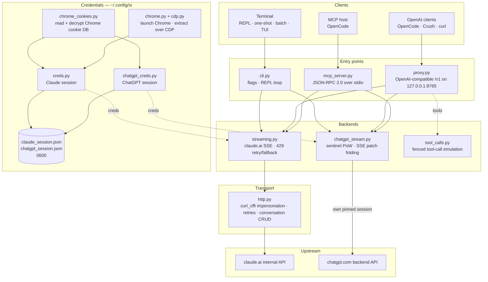

<div align="center">

[English](../../README.md) · [简体中文](README_zh.md) · [繁體中文](README_zh-TW.md) · [日本語](README_ja.md) · [한국어](README_ko.md) · [Türkçe](README_tr.md) · [Русский](README_ru.md) · [Tiếng Việt](README_vi.md) · [ไทย](README_th.md) · [Deutsch](README_de.md) · [Español](README_es.md) · [Français](README_fr.md) · [Українська](README_uk.md) · [Polski](README_pl.md) · [Português (Brasil)](README_pt-BR.md) · **العربية** · [فارسی](README_fa.md) · [Bahasa Indonesia](README_id.md) · [Italiano](README_it.md)
· [Ελληνικά](README_el.md) · [മലയാളം](README_ml.md)

# Reclaude

</div>

عميل طرفية لـ Claude.ai وChatGPT — يعيد تشغيل جلسة متصفحك الخاصة على نقاط النهاية الداخلية لديهما، ويبثّ الردود رمزًا بعد رمز. بلا مفتاح API.

> أداة بحثية. تعمل تحت حسابك في Claude.ai: تظل حدودها وباقاتها وفوترتها سارية. وهي لا تتجاوز حدود المعدّل ولا الجدران المدفوعة.

> [!WARNING]
> **لا تستخدم حسابك الرئيسي.** يشغّل si موقعَي claude.ai وchatgpt.com عبر جلسة متصفحك الخاصة — وهو سلوك قد يعرّض الحساب للتقييد أو الحظر. استخدم حسابًا مؤقتًا يمكنك تحمّل خسارته، ولا تستخدم أبدًا حسابًا مرتبطًا ببريدك أو فوترتك أو عملك.

## العرض التوضيحي


مع تشغيل الوسيط، يظهر `si/haiku` في منتقي `/models` في OpenCode مثل أي مزوّد آخر. اختره واسأل وشاهد الرد يُبثّ مباشرة — كل ذلك عبر جلسة Claude.ai الخاصة بك، دون مفتاح API.

## البنية

si ثلاث واجهات رقيقة — عميل طرفية، ووسيط متوافق مع OpenAI، وخادم MCP — فوق زوج واحد من الخلفيات البثّية.



يمرّ الطلب عبر أربع طبقات:

1. **بيانات الاعتماد** — يقرأ `--from-chrome` قاعدة بيانات ملفات تعريف الارتباط في المتصفح ويفكّ تشفيرها بمخزن مفاتيح نظام التشغيل (`chrome_cookies.py`)؛ ويشغّل `--auto-fetch` متصفح Chrome الحقيقي ويسحب ملفات تعريف الارتباط ومعرّف المؤسسة عبر CDP (`chrome.py`، `cdp.py`). تُحفظ الجلسات في `~/.config/si/*.json` (`0600`). يعيد خادم MCP قراءتها مع كل استدعاء (فلا حاجة لإعادة التشغيل بعد تسجيل الدخول مجددًا)؛ أما الوسيط فيحمّلها عند بدء التشغيل، لذا أعد تشغيله بعد تسجيل الدخول مجددًا.
2. **نقاط الدخول** — يحلّل `cli.py` الأعلام ويشغّل أنماط REPL/الطلب الواحد/الدفعة؛ ويقدّم `proxy.py` المسارين `/v1/models` و`/v1/chat/completions`؛ ويجيب `mcp_server.py` على `tools/call` لـ `claude_ask` / `chatgpt_ask`. يوجّه الوسيط حسب معرّف النموذج (`chatgpt/…` → خلفية ChatGPT، وكل ما عداه → Claude)؛ ويعرض خادم MCP أداة واحدة لكل خلفية.
3. **الخلفيات** — ينشر `streaming.py` إلى نقطة نهاية الإكمال في Claude.ai ويجمع فروق SSE، مع إعادة محاولة/تراجع محدودين عند 429؛ ويشغّل `chatgpt_stream.py` مصافحة sentinel (إثبات العمل + Turnstile) ويجمع لقطات/رقع SSE في ChatGPT إلى نص. ويحوّل `tool_calls.py` كتل `tool_call` المسيَّجة إلى `tool_calls` حقيقية بصيغة OpenAI، لأن قناة الأدوات الأصلية في Claude.ai تُبقي البثّ مفتوحًا في انتظار نتيجة، ما يجعل العملاء الذين لا يتصرفون إلا على الردود المكتملة في حالة جمود.
4. **النقل** — يحتفظ `http.py` بجلسة `curl_cffi` واحدة مثبّتة على بصمة TLS الخاصة بـ Chrome، ويتولى إعادة المحاولات/التراجع، ويملك إنشاء المحادثات وحذفها. وتحتفظ خلفية ChatGPT بجلستها المثبّتة الخاصة كي لا تختلط البصمتان أبدًا.

حالة المحادثة هي محادثة واحدة على الخادم لكل جلسة عميل: يحذفها CLI/TUI عند الخروج عندما يكون التخفي مفعّلًا، ويفهرسه الوسيط حسب `X-Conversation-Id` (ويحذف محادثات الطلب الواحد)، ويحتفظ خادم MCP بواحدة لكل مزوّد طوال عمره.

أدوات مساعدة وقت التثبيت: يسجّل `opencode.py` خادم MCP عبر `opencode mcp add`؛ ويثبّت `service.py` وكيل LaunchAgent في macOS الذي يشرف على الوسيط.

## التثبيت

```bash
git clone https://github.com/two35s/reclaude.git && cd reclaude
python3 -m venv .venv && source .venv/bin/activate
pip install -r requirements.txt
python -m si --opencode   # register the MCP tool with OpenCode (see below)
```

## تسجيل الدخول (مرة واحدة)

```bash
python -m si --from-chrome   # steal session from your logged-in Chrome (recommended)
python -m si --auto-fetch    # or: launch Chrome, log in, auto-extract over CDP
python -m si --manual        # or: paste org_id + Cookie header by hand
```

يُحفظ في `~/.config/si/claude_session.json` (`600`).

على Linux، تحتاج ملفات تعريف الارتباط التي شفّرها Chrome بمخزن مفاتيح سطح المكتب (`v11`) إلى تثبيت `libsecret-tools` وإلى فتح قفل المخزن؛ وبدون ذلك يرفض `--from-chrome` الملف الشخصي بدلًا من حفظ بيانات تالفة (استخدم `--auto-fetch` كبديل).

### بيانات اعتماد ChatGPT

```bash
python -m si --chatgpt --from-chrome   # steal chatgpt.com session from Chrome
python -m si --chatgpt --manual        # or paste the session-token cookie
python -m si --chatgpt --clear-session # delete stored chatgpt creds
```

يُحفظ في `~/.config/si/chatgpt_session.json` (`600`). يلتقط الوسيط وخادم MCP هذه البيانات تلقائيًا؛ ثم يظهر نموذج بادئته `chatgpt/` إلى جانب نماذج claude. أعد تشغيل `--chatgpt --from-chrome` عندما تعود الطلبات بـ `401`.

## الدردشة

```bash
python -m si                 # REPL
python -m si --tui           # full-screen chat
python -m si --prompt "..."  # one shot
python -m si --model haiku   # haiku | sonnet (default) | opus | fable …
```

أوامر TUI: `/new` `/model [name]` `/models` `/help` `/quit`.
أوامر REPL: نفسها، إضافةً إلى `/stealth on|off` `/cleanup` `/clear-session`.

محادثة واحدة على الخادم لكل جلسة تمنح ذاكرة متعددة الأدوار؛ ويحذفها وضع التخفي عند الخروج كي لا تظهر أبدًا في الشريط الجانبي للمتصفح (`--no-stealth` للإبقاء عليها).

## الوسيط

```bash
python -m si --proxy                 # OpenAI-compatible API on :8765
python -m si --proxy --port 9000
python -m si --proxy &               # run in the background
```

يجب أن يكون الوسيط قيد التشغيل كي يرى العملاء النماذج — فإن توقّف، فشل كل طلب بـ `ConnectionRefused`. على macOS، يثبّت `python -m si --install-service` وكيل launchd يبدأه عند تسجيل الدخول ويعيد تشغيله إذا توقّف (`--uninstall-service` يزيله؛ وتذهب السجلات إلى `~/Library/Logs/si-proxy.log`).

وجّه [Crush](https://github.com/charmbracelet/crush)، أو [OpenCode](https://opencode.ai)، أو أي عميل OpenAI إلى `http://localhost:8765/v1`.

كلٌّ من البثّ (`text/event-stream`) والطلبات غير البثّية مدعوم. ويُكتب كل رد مبثوث أيضًا في `~/.config/si/last_response.txt` — وهو مفيد عندما لا يعرض لك العميل شيئًا. ويُبلَّغ عن البثّ الذي ينتهي دون حدث الإنهاء كخطأ من المنبع بدلًا من تمريره كرد مكتمل.

عند `429` يعيد الوسيط الخطأ بدلًا من إنزالك بصمت إلى نموذج أضعف — فإعادة المحاولات واختيار النموذج من مسؤولية العميل (OpenCode يعيد المحاولة من تلقاء نفسه).

### نماذج ChatGPT

مع تخزين بيانات اعتماد ChatGPT (انظر أعلاه)، يقدّم `--proxy` أيضًا نماذج `chatgpt/<slug>` — `chatgpt/auto`، `chatgpt/gpt-6`، `chatgpt/gpt-6-mini`، … — عبر نقطة النهاية `/v1` نفسها، إلى جانب نماذج claude. وسيط واحد يخدم المزوّدين معًا؛ ويعرض `/v1/models` كل شيء.

```bash
curl http://localhost:8765/v1/chat/completions \
  -d '{"model": "chatgpt/auto", "messages": [{"role": "user", "content": "hi"}]}'
```

تعمل ذاكرة الأدوار المتعددة بالطريقة نفسها: أرسل ترويسة `X-Conversation-Id` وتتقاسم الأدوار محادثة ChatGPT واحدة (لا يُستخدم حقل `user` في OpenAI — فهو يعرّف مستخدمًا نهائيًا لا محادثة). تُفهرَس حالة المحادثة لكل خلفية على حدة، لذا فإن إعادة استخدام مفتاح واحد عبر نماذج `si/` و`chatgpt/` تُبقيها منفصلة. والطلبات بلا الترويسة مستقلة، وتُحذف محادثتها على الخادم بعد ذلك. وينطبق استدعاء الأدوات والبثّ وسلوك ظهور `429` كخطأ. وبدون بيانات اعتماد ChatGPT مخزّنة، يعيد طلب `chatgpt/` خطأ `400` واضحًا بدلًا من ذلك.

تحمل الطلبات معرّف حساب احتياطيًا في ترويسات sentinel للجلسات التي لا توفّر فيها نقطة نهاية المصادقة واحدًا. اضبط `SI_CHATGPT_ACCOUNT_ID` على معرّفك؛ وهو غير موثّق للحسابات الأخرى — إذا واجه حساب مجاني جديد رفضًا غير مفسّر من sentinel، فابدأ من هناك. وعندما لا يصدر sentinel رمز Turnstile، يقرأ si رمزًا ملتقطًا من `SI_CHATGPT_TURNSTILE` أو `~/.config/si/chatgpt_turnstile.txt`؛ والرمز بيانات جلسة ولا يُودَع في المستودع.

**استدعاء الأدوات يعمل.** تُحاكى أدوات `tools` في OpenAI نصيًا: يضيف الوسيط مواصفات الأدوات إلى الموجّه، ويطلب من النموذج إصدار كتل `tool_call` مسيَّجة، ثم يحوّلها إلى `tool_calls` حقيقية بصيغة OpenAI في الرد. أرسل النتائج مرة أخرى كرسائل `tool` في الطلب التالي ليكمل النموذج. (تُبقي قناة الأدوات الأصلية في Claude.ai البثّ مفتوحًا في انتظار نتيجة، ما يجعل العملاء الذين لا يتصرفون إلا على الردود المكتملة في حالة جمود — لذا لا يستخدمها الوسيط.) في خلفية `chatgpt/` تتصدّر كتلة البروتوكول الموجّه، لأن تلك الواجهة تجيب بدلًا من ذلك بـ «لا أستطيع الوصول إلى مساحة العمل تلك» عوضًا عن إصدار كتلة مسيَّجة؛ والرد الحامل للأدوات الذي ما زال يفتتح برفض كهذا يُعاد مرة واحدة في محادثة جديدة قبل عرضه.

### الاستخدام كنموذج OpenCode عادي

مع تشغيل الوسيط، تظهر `si/sonnet` و`si/haiku` و`si/opus` في منتقي `/models` في OpenCode مثل أي مزوّد آخر. اختر أحدها ودردش عاديًا — فالأدوات (read/edit/bash) والبثّ والأدوار المتعددة تعمل كلها عبر حسابك في Claude.ai.

يطبع `python -m si --opencode` كتلة `providers` الجاهزة للصق في إعدادك العام. أو الصقها يدويًا:

```jsonc
{
  "providers": {
    "si": {
      "name": "si",
      "package": "@opencode/ai/providers/openai-compatible",
      "settings": { "baseURL": "http://localhost:8765/v1" },
      "models": {
        "sonnet": { "name": "Claude Sonnet", "modelID": "si/sonnet" },
        "haiku": { "name": "Claude Haiku", "modelID": "si/haiku" },
        "opus": { "name": "Claude Opus", "modelID": "si/opus" }
      }
    }
  }
}
```

## خادم OpenCode MCP

اعرض si على [OpenCode](https://opencode.ai) كأداة أصلية (`claude_ask`، `chatgpt_ask`) دون جعله مزوّد النموذج لديك — فيحتفظ OpenCode بنموذجه القادر على الأدوات، ويمكنه استدعاء Claude.ai أو ChatGPT عبر si عندما تطلب ذلك.

ثبّته بأمر واحد، يُشغَّل من نسخة المستودع هذه:

```bash
python -m si --opencode
```

يستدعي ذلك أمر `opencode mcp add` الخاص بـ OpenCode، فتُحفظ إعداداتك الحالية (بما فيها التعليقات). أعد تشغيل OpenCode، ثم تحقّق بـ `opencode mcp list`.

يمكن لنموذجك حينها استدعاء `claude_ask(prompt, model="sonnet")`؛ ويقبل `model` الأسماء المستعارة (`sonnet`، `haiku`، `opus`) أو معرّف نموذج كاملًا. ويفعل `chatgpt_ask(prompt, model="auto")` الشيء نفسه عبر ChatGPT (يحتاج بيانات اعتماد ChatGPT مخزّنة؛ ويأخذ `model` اسمًا قصيرًا من chatgpt.com مثل `auto`، `gpt-6`، `gpt-6-mini`).

<details>
<summary>أو أضفه يدويًا</summary>

```jsonc
{
  "mcp": {
    "servers": {
      "si": {
        "type": "local",
        "command": ["/absolute/path/to/si/.venv/bin/python", "-m", "si.mcp_server"],
        "environment": { "PYTHONPATH": "/absolute/path/to/si" }
      }
    }
  }
}
```

`PYTHONPATH` هو ما يجعل الوحدة قابلة للاستيراد من أي دليل عمل، فلا حاجة إلى `cwd`.

</details>

تحقّق من المصافحة منفصلةً:

```bash
printf '{"jsonrpc":"2.0","id":1,"method":"tools/list"}\n' | .venv/bin/python -m si.mcp_server
```

ملاحظات:

- **محادثات مشتركة.** تعيد كل استدعاءات `claude_ask` استخدام محادثة Claude.ai واحدة، وتعيد كل استدعاءات `chatgpt_ask` استخدام محادثة ChatGPT واحدة، طوال عمر الخادم، فتحتفظ المتابعات بالسياق. ولا تُحذف أيٌّ منهما بأسلوب التخفي، وتظهر كلتاهما في الشريط الجانبي المعني إلى أن تزيلهما.
- **التشخيص على stderr.** تذهب مخرجات التقدّم/الأخطاء في si إلى stderr، فلا تفسد أبدًا تدفّق بروتوكول MCP على stdout.
- **القيود.** تمرير نصي فقط — لا مخرجات صور، ولا تعود أي استدعاءات أدوات. تعمل الطلبات تحت حساباتك، لذا تنطبق حدود الباقة. قد يستغرق الاستدعاء الواحد حتى مهلة HTTP (120 ثانية)، وأطول تحت تحديد المعدّل. ويعيد `chatgpt_ask` خطأً نظيفًا عندما تكون بيانات اعتماد ChatGPT مفقودة أو يُرفض الدور (الحصة، حد المعدّل).
- **استكشاف الأخطاء.** `Session invalid or expired` → أعد تشغيل `python -m si --auto-fetch` (لـ Claude) أو `--chatgpt --from-chrome` (لـ ChatGPT)؛ ويلتقط الاستدعاء التالي بيانات الاعتماد الجديدة (دون حاجة لإعادة تشغيل). إذا كانت الأداة مفقودة، فتحقّق من سجلات MCP في OpenCode ومن أن مسار venv في `command` مطلق وصحيح.

## خيارات إضافية

`--batch FILE` موجّه واحد في كل سطر → `~/.config/si/batch_results.json` · `--jailbreak FILE` موجّه من ملف · `--org-id/--cookie` بيانات اعتماد ضمنية · `--clear-session` مسح بيانات الاعتماد · `--login` حفظ ملف تعريف Chrome دون استخراج · `--opencode` تسجيل أداة MCP مع OpenCode وطباعة إعداد المزوّد.

## إذا تعطّل

| العرض | الإصلاح |
|---|---|
| `Session invalid or expired` | أعد تشغيل `--from-chrome` أو `--auto-fetch` |
| ChatGPT `401` / لا accessToken | أعد تشغيل `--chatgpt --from-chrome` |
| فشل `prepare`/`finalize` في ChatGPT | تغيّرت مصافحة sentinel في المنبع؛ حدّث si |
| `429` تجاوز حد المعدّل | انتظر، أو بدّل النموذج (`/model haiku` في CLI/TUI) |
| `ConnectionRefused` على كل نموذج | الوسيط غير قيد التشغيل — شغّل `python -m si --proxy`، أو `--install-service` على macOS |
| مطالبة Keychain | انقر **Always Allow**، ثم أعد المحاولة |

## الأمان

مفتاح `sessionKey` لديك ورمز جلسة ChatGPT هما كلمتا مرور: لا تشاركهما أبدًا ولا ترفعهما ولا تُودِع ملفات الاعتماد في المستودع. استخدم `--clear-session` (و`--chatgpt --clear-session`) عند الانتهاء؛ وإذا انكشفا، فسجّل الخروج في المتصفح لإبطالهما.

يستمع الوسيط على `127.0.0.1` دون مصادقة ما لم يُضبط `SI_PROXY_TOKEN`. على جهاز Mac مشترك، يمكن لمستخدم محلي آخر أو عملية أخرى تصل إلى المنفذ 8765 أن تستهلك حصة حسابك؛ فاضبط الرمز (وأعطه للعميل) أو أبقِ الوسيط متوقفًا عند عدم استخدامه. تُكتب قائمة LaunchAgent في macOS بصلاحيات `600` لأنها تحمل الرمز عند ضبطه.

تشغّل خلفية ChatGPT واجهة chatgpt.com الداخلية بجلسة متصفحك الخاصة. هذا مخالف لشروط خدمة OpenAI وقد يعرّض الحساب للتقييد أو الحظر — استخدم حسابًا مؤقتًا، وعلى مسؤوليتك.

## التطوير

```bash
pip install -r requirements-dev.txt
PYTHONPATH=. .venv/bin/python -m pytest -q   # tests
.venv/bin/python -m ruff check .             # lint
.venv/bin/python -m ruff format --check .    # formatting
```

## الترخيص

للبحث والاستخدام التعليمي فقط. دون أي ضمان.
