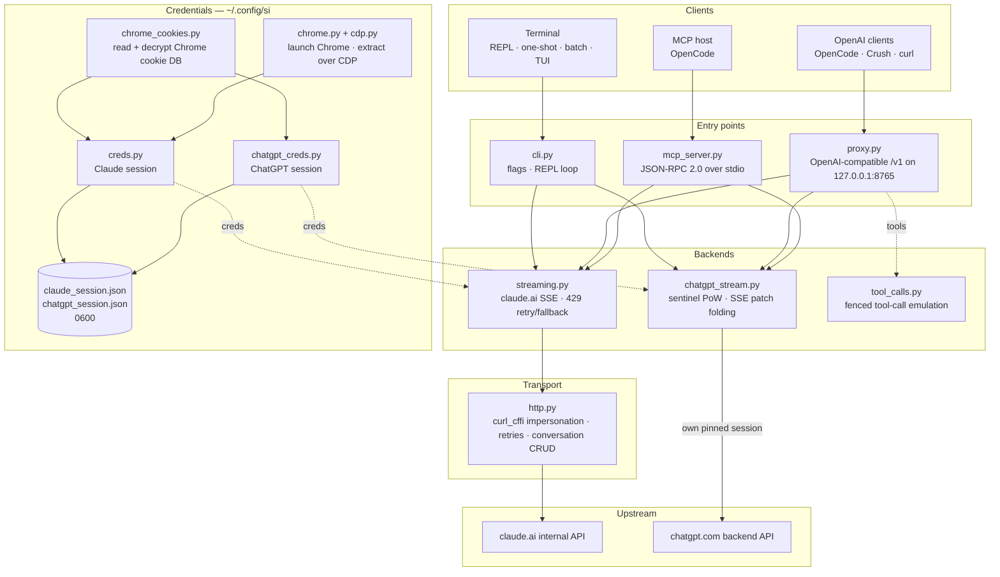

<div align="center">

[English](../../README.md) · [简体中文](README_zh.md) · [繁體中文](README_zh-TW.md) · [日本語](README_ja.md) · [한국어](README_ko.md) · [Türkçe](README_tr.md) · [Русский](README_ru.md) · [Tiếng Việt](README_vi.md) · [ไทย](README_th.md) · **Deutsch** · [Español](README_es.md) · [Français](README_fr.md) · [Українська](README_uk.md) · [Polski](README_pl.md) · [Português (Brasil)](README_pt-BR.md) · [العربية](README_ar.md) · [فارسی](README_fa.md) · [Bahasa Indonesia](README_id.md) · [Italiano](README_it.md)
· [Ελληνικά](README_el.md) · [മലയാളം](README_ml.md)

# Reclaude

</div>

Terminal-Client für Claude.ai und ChatGPT – spielt deine eigene Browser-Sitzung gegen deren interne Endpunkte ab und streamt Antworten Token für Token. Kein API-Schlüssel.

> Recherchewerkzeug. Es läuft unter deinem Claude.ai-Konto: dessen Limits, Tarifstufen und Abrechnung gelten weiterhin. Es umgeht keine Ratenlimits oder Paywalls.

> [!WARNING]
> **Verwende nicht dein Hauptkonto.** si steuert claude.ai und chatgpt.com über deine eigene Browser-Sitzung – ein Verhalten, das zur Einschränkung oder Sperrung des Kontos führen kann. Verwende ein Wegwerfkonto, dessen Verlust du verschmerzen kannst, niemals eines, das mit deiner E-Mail, Abrechnung oder Arbeit verbunden ist.

## Demo


Wenn der Proxy läuft, erscheint `si/haiku` im `/models`-Picker von OpenCode wie jeder andere Anbieter. Auswählen, fragen, zusehen, wie die Antwort hereingestreamt wird – alles über deine Claude.ai-Sitzung, ohne API-Schlüssel.

## Architektur

si besteht aus drei schlanken Oberflächen – einem Terminal-Client, einem OpenAI-kompatiblen Proxy und einem MCP-Server – über einem Paar Streaming-Backends.



Eine Anfrage durchläuft vier Schichten:

1. **Anmeldedaten** – `--from-chrome` liest die Cookie-Datenbank des Browsers und entschlüsselt sie mit dem Schlüsselbund des Betriebssystems (`chrome_cookies.py`); `--auto-fetch` startet echtes Chrome und holt Cookies samt Organisations-ID über CDP (`chrome.py`, `cdp.py`). Sitzungen landen in `~/.config/si/*.json` (`0600`). Der MCP-Server liest sie bei jedem Aufruf neu ein (kein Neustart nach erneutem Login); der Proxy lädt sie beim Start, also starte ihn nach einem erneuten Login neu.
2. **Einstiegspunkte** – `cli.py` parst Flags und führt die Modi REPL/One-Shot/Batch aus; `proxy.py` bedient `/v1/models` und `/v1/chat/completions`; `mcp_server.py` beantwortet `tools/call` für `claude_ask` / `chatgpt_ask`. Der Proxy routet anhand der Modell-ID (`chatgpt/…` → ChatGPT-Backend, alles andere → Claude); der MCP-Server stellt pro Backend ein Tool bereit.
3. **Backends** – `streaming.py` sendet an den Completion-Endpunkt von Claude.ai und faltet SSE-Deltas, mit begrenztem 429-Retry/Fallback; `chatgpt_stream.py` führt den Sentinel-Handshake aus (Proof-of-Work + Turnstile) und faltet ChatGPTs Snapshot/Patch-SSE zu Text zusammen. `tool_calls.py` verwandelt eingezäunte `tool_call`-Blöcke in echte OpenAI-`tool_calls`, weil der native Tool-Kanal von Claude.ai Clients blockiert, die nur auf abgeschlossene Antworten reagieren.
4. **Transport** – `http.py` hält eine `curl_cffi`-Sitzung an einen Chrome-TLS-Fingerabdruck gebunden, übernimmt Retries/Backoff und verantwortet das Anlegen/Löschen von Konversationen. Das ChatGPT-Backend hält seine eigene gebundene Sitzung, damit sich die beiden Fingerabdrücke nie vermischen.

Der Konversationszustand ist ein serverseitiger Chat pro Client-Sitzung: CLI/TUI löschen ihn beim Beenden, wenn Stealth aktiv ist, der Proxy ordnet ihn per `X-Conversation-Id` zu (und löscht Einmal-Chats), und der MCP-Server hält pro Anbieter einen für seine Laufzeit.

Helfer zur Installationszeit: `opencode.py` registriert den MCP-Server über `opencode mcp add`; `service.py` installiert den macOS-LaunchAgent, der den Proxy überwacht.

## Installation

```bash
git clone https://github.com/two35s/reclaude.git && cd reclaude
python3 -m venv .venv && source .venv/bin/activate
pip install -r requirements.txt
python -m si --opencode   # register the MCP tool with OpenCode (see below)
```

## Anmelden (einmalig)

```bash
python -m si --from-chrome   # steal session from your logged-in Chrome (recommended)
python -m si --auto-fetch    # or: launch Chrome, log in, auto-extract over CDP
python -m si --manual        # or: paste org_id + Cookie header by hand
```

Speichert in `~/.config/si/claude_session.json` (`600`).

Auf Linux setzen mit dem Desktop-Schlüsselbund verschlüsselte Chrome-Cookies (`v11`) ein installiertes `libsecret-tools` und einen entsperrten Schlüsselbund voraus; ohne beides verweigert `--from-chrome` das Profil, statt Müll zu speichern (nutze `--auto-fetch` als Fallback).

### ChatGPT-Anmeldedaten

```bash
python -m si --chatgpt --from-chrome   # steal chatgpt.com session from Chrome
python -m si --chatgpt --manual        # or paste the session-token cookie
python -m si --chatgpt --clear-session # delete stored chatgpt creds
```

Speichert in `~/.config/si/chatgpt_session.json` (`600`). Proxy und MCP-Server übernehmen sie automatisch; ein Modell mit Präfix `chatgpt/` erscheint dann neben den Claude-Modellen. Führe `--chatgpt --from-chrome` erneut aus, wenn Anfragen `401` zurückkommen.

## Chat

```bash
python -m si                 # REPL
python -m si --tui           # full-screen chat
python -m si --prompt "..."  # one shot
python -m si --model haiku   # haiku | sonnet (default) | opus | fable …
```

TUI-Befehle: `/new` `/model [name]` `/models` `/help` `/quit`.
REPL-Befehle: dieselben, plus `/stealth on|off` `/cleanup` `/clear-session`.

Eine serverseitige Konversation pro Sitzung sorgt für Mehrrunden-Gedächtnis; der Stealth-Modus löscht sie beim Beenden, damit sie nie in der Seitenleiste deines Browsers auftaucht (`--no-stealth`, um sie zu behalten).

## Proxy

```bash
python -m si --proxy                 # OpenAI-compatible API on :8765
python -m si --proxy --port 9000
python -m si --proxy &               # run in the background
```

Der Proxy muss laufen, damit Clients die Modelle sehen – wenn er beendet wird, schlägt jede Anfrage mit `ConnectionRefused` fehl. Unter macOS installiert `python -m si --install-service` einen launchd-Agent, der ihn beim Login startet und bei Beendigung neu startet (`--uninstall-service` entfernt ihn; Logs gehen nach `~/Library/Logs/si-proxy.log`).

Richte [Crush](https://github.com/charmbracelet/crush), [OpenCode](https://opencode.ai) oder einen beliebigen OpenAI-Client auf `http://localhost:8765/v1` aus.

Streaming (`text/event-stream`) und Nicht-Streaming-Anfragen werden beide unterstützt. Jede gestreamte Antwort wird zusätzlich nach `~/.config/si/last_response.txt` geschrieben – praktisch, wenn ein Client dir nichts anzeigt. Ein Stream, der ohne sein Abschlussereignis endet, wird als Upstream-Fehler gemeldet, statt als vollständige Antwort ausgegeben zu werden.

Bei einem `429` gibt der Proxy den Fehler zurück, statt dich still auf ein schwächeres Modell herabzustufen – Wiederholungen und Modellwahl liegen beim Client (OpenCode wiederholt selbst).

### ChatGPT-Modelle

Mit gespeicherten ChatGPT-Anmeldedaten (siehe oben) bedient `--proxy` über denselben `/v1`-Endpunkt auch `chatgpt/<slug>`-Modelle – `chatgpt/auto`, `chatgpt/gpt-6`, `chatgpt/gpt-6-mini`, … – neben den Claude-Modellen. Ein Proxy bedient beide Anbieter gleichzeitig; `/v1/models` listet alles auf.

```bash
curl http://localhost:8765/v1/chat/completions \
  -d '{"model": "chatgpt/auto", "messages": [{"role": "user", "content": "hi"}]}'
```

Mehrrunden-Gedächtnis funktioniert genauso: Sende einen `X-Conversation-Id`-Header, und die Runden teilen sich eine ChatGPT-Konversation (das OpenAI-Feld `user` wird nicht verwendet – es identifiziert einen Endnutzer, keine Konversation). Der Konversationszustand wird pro Backend geführt, sodass derselbe Schlüssel über `si/`- und `chatgpt/`-Modelle hinweg sie getrennt hält. Anfragen ohne den Header sind unabhängig, und ihre serverseitige Konversation wird danach gelöscht. Tool-Aufrufe, Streaming und das Verhalten, dass `429` als Fehler erscheint, gelten weiterhin. Ohne gespeicherte ChatGPT-Anmeldedaten liefert eine `chatgpt/`-Anfrage stattdessen ein klares `400`.

Anfragen führen eine Fallback-Konto-ID in den Sentinel-Headern mit, für Sitzungen, in denen der Auth-Endpunkt keine liefert. Setze `SI_CHATGPT_ACCOUNT_ID` auf deine eigene; sie ist für andere Konten ungeprüft – wenn ein frisches kostenloses Konto auf unerklärliche Sentinel-Ablehnungen stößt, fange dort an. Wenn der Sentinel kein Turnstile-Token ausstellt, liest si ein zuvor erfasstes aus `SI_CHATGPT_TURNSTILE` oder `~/.config/si/chatgpt_turnstile.txt`; das Token ist Sitzungsdaten und wird nicht eingecheckt.

**Tool-Aufrufe funktionieren.** OpenAI-`tools` werden in Text emuliert: Der Proxy hängt die Tool-Spezifikationen an den Prompt an, bittet das Modell, eingezäunte `tool_call`-Blöcke auszugeben, und wandelt sie in der Antwort in echte OpenAI-`tool_calls` um. Sende die Ergebnisse mit der nächsten Anfrage als `tool`-Nachrichten zurück, und das Modell fährt fort. (Der native Tool-Kanal von Claude.ai hält den Stream offen und wartet auf ein Ergebnis, was Clients blockiert, die nur auf abgeschlossene Antworten reagieren – deshalb nutzt der Proxy ihn nicht.) Beim `chatgpt/`-Backend steht der Protokollblock am Anfang des Prompts, da diese Oberfläche sonst „I can't reach that workspace“ antwortet, statt einen Zaun auszugeben; eine Antwort mit Tools, die dennoch mit einer solchen Ablehnung beginnt, wird einmal in einer frischen Konversation wiederholt, bevor sie angezeigt wird.

### Als normales OpenCode-Modell verwenden

Wenn der Proxy läuft, erscheinen `si/sonnet`, `si/haiku` und `si/opus` im `/models`-Picker von OpenCode wie jeder andere Anbieter. Wähle eines aus und chatte normal – Tools (read/edit/bash), Streaming und Mehrrunden funktionieren alle über dein Claude.ai-Konto.

`python -m si --opencode` gibt den fertig zum Einfügen geeigneten `providers`-Block für deine globale Konfiguration aus. Oder füge ihn von Hand ein:

```jsonc
{
  "providers": {
    "si": {
      "name": "si",
      "package": "@opencode/ai/providers/openai-compatible",
      "settings": { "baseURL": "http://localhost:8765/v1" },
      "models": {
        "sonnet": { "name": "Claude Sonnet", "modelID": "si/sonnet" },
        "haiku": { "name": "Claude Haiku", "modelID": "si/haiku" },
        "opus": { "name": "Claude Opus", "modelID": "si/opus" }
      }
    }
  }
}
```

## OpenCode-MCP-Server

Stelle si [OpenCode](https://opencode.ai) als natives Tool (`claude_ask`, `chatgpt_ask`) bereit, ohne es zu deinem Modellanbieter zu machen – OpenCode behält sein eigenes tool-fähiges Modell und kann Claude.ai oder ChatGPT über si aufrufen, wenn du es verlangst.

Installiere es mit einem Befehl, ausgeführt aus diesem Checkout:

```bash
python -m si --opencode
```

Das ruft OpenCodes eigenes `opencode mcp add` auf, sodass deine bestehende Konfiguration (inklusive Kommentaren) erhalten bleibt. Starte OpenCode neu und prüfe dann `opencode mcp list`.

Dein Modell kann dann `claude_ask(prompt, model="sonnet")` aufrufen; `model` akzeptiert Aliase (`sonnet`, `haiku`, `opus`) oder eine vollständige Modell-ID. `chatgpt_ask(prompt, model="auto")` macht dasselbe über ChatGPT (erfordert gespeicherte ChatGPT-Anmeldedaten; `model` nimmt einen chatgpt.com-Slug wie `auto`, `gpt-6`, `gpt-6-mini`).

<details>
<summary>Oder von Hand hinzufügen</summary>

```jsonc
{
  "mcp": {
    "servers": {
      "si": {
        "type": "local",
        "command": ["/absolute/path/to/si/.venv/bin/python", "-m", "si.mcp_server"],
        "environment": { "PYTHONPATH": "/absolute/path/to/si" }
      }
    }
  }
}
```

`PYTHONPATH` sorgt dafür, dass das Modul aus jedem Arbeitsverzeichnis importierbar ist, daher ist kein `cwd` nötig.

</details>

Prüfe den Handshake eigenständig:

```bash
printf '{"jsonrpc":"2.0","id":1,"method":"tools/list"}\n' | .venv/bin/python -m si.mcp_server
```

Hinweise:

- **Geteilte Konversationen.** Alle `claude_ask`-Aufrufe verwenden eine Claude.ai-Konversation wieder, und alle `chatgpt_ask`-Aufrufe eine ChatGPT-Konversation, für die Laufzeit des Servers, sodass Nachfragen den Kontext behalten. Keine von beiden wird per Stealth gelöscht, und beide erscheinen in der jeweiligen Seitenleiste, bis du sie entfernst.
- **Diagnose auf stderr.** si gibt Fortschritt/Fehler auf stderr aus, damit der MCP-Protokollstrom auf stdout nie beschädigt wird.
- **Einschränkungen.** Nur-Text-Durchreichung – keine Bildausgabe, und es kommen keine Tool-Aufrufe zurück. Anfragen laufen unter deinen eigenen Konten, daher gelten Tariflimits. Ein Aufruf kann bis zum HTTP-Timeout dauern (120 s), bei Ratenbegrenzung länger. `chatgpt_ask` meldet sauber einen Fehler, wenn ChatGPT-Anmeldedaten fehlen oder die Runde abgelehnt wird (Kontingent, Ratenlimit).
- **Fehlerbehebung.** `Session invalid or expired` → führe `python -m si --auto-fetch` (Claude) oder `--chatgpt --from-chrome` (ChatGPT) erneut aus; der nächste Aufruf übernimmt die neuen Anmeldedaten (kein Neustart nötig). Wenn das Tool fehlt, prüfe OpenCodes MCP-Logs und ob der venv-Pfad in `command` absolut und korrekt ist.

## Weitere Flags

`--batch FILE` ein Prompt pro Zeile → `~/.config/si/batch_results.json` · `--jailbreak FILE` Prompt aus Datei · `--org-id/--cookie` Anmeldedaten inline · `--clear-session` Anmeldedaten löschen · `--login` ein Chrome-Profil speichern, ohne zu extrahieren · `--opencode` das MCP-Tool bei OpenCode registrieren und die Provider-Konfiguration ausgeben.

## Wenn etwas kaputtgeht

| Symptom | Lösung |
|---|---|
| `Session invalid or expired` | `--from-chrome` oder `--auto-fetch` erneut ausführen |
| ChatGPT `401` / kein accessToken | `--chatgpt --from-chrome` erneut ausführen |
| ChatGPT `prepare`/`finalize` fehlgeschlagen | Der Sentinel-Handshake hat sich upstream geändert; aktualisiere si |
| `429` ratenbegrenzt | warten oder Modell wechseln (`/model haiku` in der CLI/TUI) |
| `ConnectionRefused` bei jedem Modell | Proxy läuft nicht – starte `python -m si --proxy` oder `--install-service` unter macOS |
| Keychain-Abfrage | **Immer erlauben** anklicken, erneut versuchen |

## Sicherheit

Dein `sessionKey` und das ChatGPT-Sitzungstoken sind Passwörter: Teile, lade oder committe die Anmeldedaten-Dateien niemals. Führe danach `--clear-session` (und `--chatgpt --clear-session`) aus; wenn sie offengelegt wurden, melde dich im Browser ab, um sie zu entwerten.

Der Proxy lauscht auf `127.0.0.1` ohne Authentifizierung, sofern `SI_PROXY_TOKEN` nicht gesetzt ist. Auf einem gemeinsam genutzten Mac kann ein anderer lokaler Benutzer oder Prozess, der Port 8765 erreicht, das Kontingent deines Kontos verbrauchen; setze das Token (und gib es dem Client) oder halte den Proxy außer Betrieb, wenn er nicht genutzt wird. Die macOS-LaunchAgent-Plist wird mit `600` geschrieben, weil sie das Token enthält, wenn eines gesetzt ist.

Das ChatGPT-Backend steuert die interne API von chatgpt.com mit deiner eigenen Browser-Sitzung. Das verstößt gegen OpenAIs Nutzungsbedingungen und kann zur Einschränkung oder Sperrung des Kontos führen – nutze ein Wegwerfkonto, auf eigenes Risiko.

## Entwicklung

```bash
pip install -r requirements-dev.txt
PYTHONPATH=. .venv/bin/python -m pytest -q   # tests
.venv/bin/python -m ruff check .             # lint
.venv/bin/python -m ruff format --check .    # formatting
```

## Lizenz

Nur für Forschungs- und Bildungszwecke. Keine Gewährleistung.
