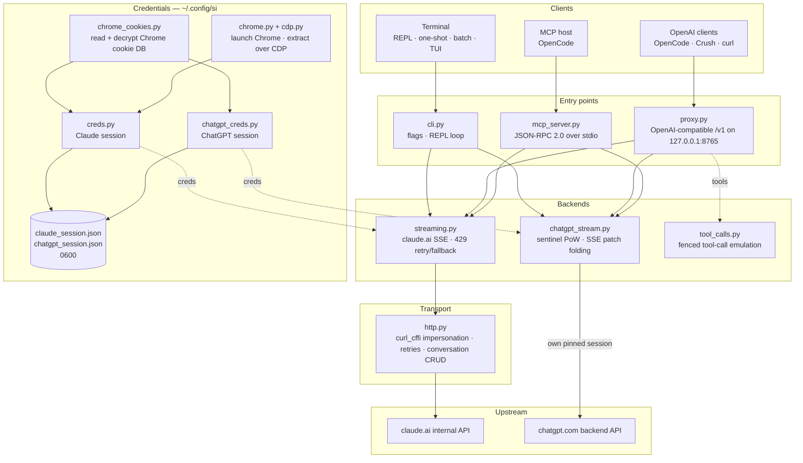

<div align="center">

[English](../../README.md) · [简体中文](README_zh.md) · [繁體中文](README_zh-TW.md) · [日本語](README_ja.md) · [한국어](README_ko.md) · [Türkçe](README_tr.md) · [Русский](README_ru.md) · [Tiếng Việt](README_vi.md) · [ไทย](README_th.md) · [Deutsch](README_de.md) · [Español](README_es.md) · [Français](README_fr.md) · [Українська](README_uk.md) · [Polski](README_pl.md) · [Português (Brasil)](README_pt-BR.md) · [العربية](README_ar.md) · [فارسی](README_fa.md) · [Bahasa Indonesia](README_id.md) · [Italiano](README_it.md)
· **Ελληνικά** · [മലയാളം](README_ml.md)

# Reclaude

</div>

Τερματικός πελάτης για το Claude.ai και το ChatGPT — αναπαράγει τη δική σας συνεδρία περιήγησης προς τα εσωτερικά τους endpoints και μεταδίδει τις απαντήσεις token-προς-token. Χωρίς API key.

> Ερευνητικό εργαλείο. Εκτελείται υπό τον λογαριασμό σας στο Claude.ai: τα όρια, οι βαθμίδες και η χρέωσή του εξακολουθούν να ισχύουν. Δεν παρακάμπτει όρια ρυθμού ή paywalls.

> [!WARNING]
> **Μη χρησιμοποιείτε τον κύριο λογαριασμό σας.** Το si οδηγεί το claude.ai και το chatgpt.com μέσω της δικής σας συνεδρίας περιήγησης — συμπεριφορά που μπορεί να οδηγήσει σε περιορισμό ή αποκλεισμό του λογαριασμού. Χρησιμοποιήστε έναν λογαριασμό μιας χρήσης που μπορείτε να χάσετε, ποτέ έναν που συνδέεται με το email, τη χρέωση ή την εργασία σας.

## Επίδειξη


Με τον proxy σε λειτουργία, το `si/haiku` εμφανίζεται στον επιλογέα `/models` του OpenCode όπως οποιοσδήποτε άλλος πάροχος. Επιλέξτε το, ρωτήστε, παρακολουθήστε την απάντηση να έρχεται σε ροή — όλα μέσω της συνεδρίας σας στο Claude.ai, χωρίς API key.

## Αρχιτεκτονική

Το si είναι τρεις λεπτές επιφάνειες — ένας πελάτης τερματικού, ένας proxy συμβατός με OpenAI και ένας MCP server — πάνω από ένα ζεύγος backends ροής.



Ένα αίτημα διασχίζει τέσσερα επίπεδα:

1. **Διαπιστευτήρια** — το `--from-chrome` διαβάζει τη βάση δεδομένων cookies του προγράμματος περιήγησης και την αποκρυπτογραφεί με το keyring του λειτουργικού συστήματος (`chrome_cookies.py`); το `--auto-fetch` εκκινεί πραγματικό Chrome και αντλεί cookies καθώς και το org id μέσω CDP (`chrome.py`, `cdp.py`). Οι συνεδρίες αποθηκεύονται στο `~/.config/si/*.json` (`0600`). Ο MCP server τις διαβάζει ξανά σε κάθε κλήση (χωρίς επανεκκίνηση μετά από νέα σύνδεση)· ο proxy τις φορτώνει κατά την εκκίνηση, οπότε επανεκκινήστε τον μετά από νέα σύνδεση.
2. **Σημεία εισόδου** — το `cli.py` αναλύει τα flags και εκτελεί τις λειτουργίες REPL/μίας εκτέλεσης/batch· το `proxy.py` εξυπηρετεί τα `/v1/models` και `/v1/chat/completions`· το `mcp_server.py` απαντά στο `tools/call` για τα `claude_ask` / `chatgpt_ask`. Ο proxy δρομολογεί με βάση το αναγνωριστικό μοντέλου (`chatgpt/…` → backend ChatGPT, όλα τα υπόλοιπα → Claude)· ο MCP server εκθέτει ένα εργαλείο ανά backend.
3. **Backends** — το `streaming.py` στέλνει αιτήματα στο endpoint ολοκλήρωσης του Claude.ai και συγχωνεύει τα δέλτα SSE, με πεπερασμένες επαναλήψεις/εναλλακτική διαδρομή για το 429· το `chatgpt_stream.py` εκτελεί τη χειραψία sentinel (proof-of-work + Turnstile) και συγχωνεύει τα SSE snapshot/patch του ChatGPT σε κείμενο. Το `tool_calls.py` μετατρέπει περιφραγμένα μπλοκ `tool_call` σε πραγματικά `tool_calls` του OpenAI, επειδή το εγγενές κανάλι εργαλείων του Claude.ai προκαλεί αδιέξοδο σε πελάτες που ενεργούν μόνο σε ολοκληρωμένες απαντήσεις.
4. **Μεταφορά** — το `http.py` διατηρεί μία συνεδρία `curl_cffi` καρφιτσωμένη σε αποτύπωμα TLS του Chrome, χειρίζεται επαναλήψεις/backoff και έχει στην ευθύνη του τη δημιουργία/διαγραφή συνομιλιών. Το backend του ChatGPT διατηρεί τη δική του καρφιτσωμένη συνεδρία, ώστε τα δύο αποτυπώματα να μην αναμειγνύονται ποτέ.

Η κατάσταση συνομιλίας είναι μία συνομιλία στην πλευρά του διακομιστή ανά συνεδρία πελάτη: το CLI/TUI τη διαγράφει κατά την έξοδο όταν το stealth είναι ενεργό, ο proxy τη χρησιμοποιεί ως κλειδί με το `X-Conversation-Id` (διαγράφοντας τις συνομιλίες μίας εκτέλεσης) και ο MCP server διατηρεί μία ανά πάροχο για όλη τη διάρκεια ζωής του.

Βοηθητικά κατά την εγκατάσταση: το `opencode.py` καταχωρεί τον MCP server μέσω `opencode mcp add`· το `service.py` εγκαθιστά το macOS LaunchAgent που επιβλέπει τον proxy.

## Εγκατάσταση

```bash
git clone https://github.com/two35s/reclaude.git && cd reclaude
python3 -m venv .venv && source .venv/bin/activate
pip install -r requirements.txt
python -m si --opencode   # register the MCP tool with OpenCode (see below)
```

## Σύνδεση (μία φορά)

```bash
python -m si --from-chrome   # steal session from your logged-in Chrome (recommended)
python -m si --auto-fetch    # or: launch Chrome, log in, auto-extract over CDP
python -m si --manual        # or: paste org_id + Cookie header by hand
```

Αποθηκεύεται στο `~/.config/si/claude_session.json` (`600`).

Στο Linux, τα cookies που κρυπτογράφησε ο Chrome με το keyring της επιφάνειας εργασίας (`v11`) απαιτούν εγκατεστημένο το `libsecret-tools` και ξεκλείδωτο keyring· χωρίς αυτά, το `--from-chrome` αρνείται το προφίλ αντί να αποθηκεύσει σαβούρα (χρησιμοποιήστε το `--auto-fetch` ως εναλλακτική).

### Διαπιστευτήρια ChatGPT

```bash
python -m si --chatgpt --from-chrome   # steal chatgpt.com session from Chrome
python -m si --chatgpt --manual        # or paste the session-token cookie
python -m si --chatgpt --clear-session # delete stored chatgpt creds
```

Αποθηκεύεται στο `~/.config/si/chatgpt_session.json` (`600`). Ο proxy και ο MCP server τα λαμβάνουν αυτόματα· ένα μοντέλο με πρόθεμα `chatgpt/` εμφανίζεται τότε δίπλα στα claude. Επανεκτελέστε το `--chatgpt --from-chrome` όταν τα αιτήματα επιστρέφουν `401`.

## Συνομιλία

```bash
python -m si                 # REPL
python -m si --tui           # full-screen chat
python -m si --prompt "..."  # one shot
python -m si --model haiku   # haiku | sonnet (default) | opus | fable …
```

Εντολές TUI: `/new` `/model [name]` `/models` `/help` `/quit`.
Εντολές REPL: οι ίδιες, συν `/stealth on|off` `/cleanup` `/clear-session`.

Μία συνομιλία στην πλευρά του διακομιστή ανά συνεδρία παρέχει μνήμη πολλαπλών γύρων· η λειτουργία stealth τη διαγράφει κατά την έξοδο, ώστε να μην εμφανίζεται ποτέ στην πλαϊνή γραμμή του προγράμματος περιήγησής σας (`--no-stealth` για να τη διατηρήσετε).

## Proxy

```bash
python -m si --proxy                 # OpenAI-compatible API on :8765
python -m si --proxy --port 9000
python -m si --proxy &               # run in the background
```

Ο proxy πρέπει να εκτελείται για να βλέπουν οι πελάτες τα μοντέλα — αν τερματιστεί, κάθε αίτημα αποτυγχάνει με `ConnectionRefused`. Στο macOS, το `python -m si --install-service` εγκαθιστά έναν launchd agent που τον ξεκινά κατά τη σύνδεση και τον επανεκκινεί αν τερματιστεί (`--uninstall-service` τον αφαιρεί· τα logs πηγαίνουν στο `~/Library/Logs/si-proxy.log`).

Στρέψτε το [Crush](https://github.com/charmbracelet/crush), το [OpenCode](https://opencode.ai) ή οποιονδήποτε πελάτη OpenAI στο `http://localhost:8765/v1`.

Υποστηρίζονται τόσο τα streaming αιτήματα (`text/event-stream`) όσο και τα μη streaming. Κάθε απάντηση σε ροή γράφεται επίσης στο `~/.config/si/last_response.txt` — βολικό όταν ένας πελάτης δεν σας δείχνει τίποτα. Μια ροή που τελειώνει χωρίς το τελικό της γεγονός αναφέρεται ως σφάλμα upstream αντί να παρουσιαστεί ως πλήρης απάντηση.

Σε `429` ο proxy επιστρέφει το σφάλμα αντί να σας υποβαθμίσει σιωπηλά σε ασθενέστερο μοντέλο — οι επαναλήψεις και η επιλογή μοντέλου ανήκουν στον πελάτη (το OpenCode επαναλαμβάνει μόνο του).

### Μοντέλα ChatGPT

Με αποθηκευμένα διαπιστευτήρια ChatGPT (βλ. παραπάνω), το `--proxy` εξυπηρετεί επίσης μοντέλα `chatgpt/<slug>` — `chatgpt/auto`, `chatgpt/gpt-6`, `chatgpt/gpt-6-mini`, … — μέσω του ίδιου endpoint `/v1`, δίπλα στα claude. Ένας proxy εξυπηρετεί και τους δύο παρόχους ταυτόχρονα· το `/v1/models` τα απαριθμεί όλα.

```bash
curl http://localhost:8765/v1/chat/completions \
  -d '{"model": "chatgpt/auto", "messages": [{"role": "user", "content": "hi"}]}'
```

Η μνήμη πολλαπλών γύρων λειτουργεί με τον ίδιο τρόπο: στείλτε ένα header `X-Conversation-Id` και οι γύροι μοιράζονται μία συνομιλία ChatGPT (το πεδίο `user` του OpenAI δεν χρησιμοποιείται — προσδιορίζει τελικό χρήστη, όχι συνομιλία). Η κατάσταση συνομιλίας έχει κλειδί ανά backend, οπότε η επαναχρησιμοποίηση ενός κλειδιού σε μοντέλα `si/` και `chatgpt/` τα διατηρεί ξεχωριστά. Τα αιτήματα χωρίς το header είναι ανεξάρτητα και η συνομιλία τους στην πλευρά του διακομιστή διαγράφεται μετά. Η κλήση εργαλείων, το streaming και η συμπεριφορά όπου το `429` εμφανίζεται ως σφάλμα ισχύουν όλα. Χωρίς αποθηκευμένα διαπιστευτήρια ChatGPT, ένα αίτημα `chatgpt/` επιστρέφει σαφές `400`.

Τα αιτήματα φέρουν ένα εφεδρικό account id στα headers sentinel για συνεδρίες όπου το endpoint αυθεντικοποίησης δεν παρέχει κάποιο. Ορίστε το `SI_CHATGPT_ACCOUNT_ID` στο δικό σας· δεν είναι επαληθευμένο για άλλους λογαριασμούς — αν ένας νέος δωρεάν λογαριασμός αντιμετωπίζει ανεξήγητες απορρίψεις sentinel, ξεκινήστε από εκεί. Όταν το sentinel δεν παράγει token Turnstile, το si διαβάζει ένα καταγεγραμμένο από το `SI_CHATGPT_TURNSTILE` ή το `~/.config/si/chatgpt_turnstile.txt`· το token είναι δεδομένα συνεδρίας και δεν γίνεται commit.

**Η κλήση εργαλείων λειτουργεί.** Τα `tools` του OpenAI εξομοιώνονται σε κείμενο: ο proxy προσαρτά τις προδιαγραφές των εργαλείων στο prompt, ζητά από το μοντέλο να εκπέμψει περιφραγμένα μπλοκ `tool_call` και τα μετατρέπει σε πραγματικά `tool_calls` του OpenAI στην απάντηση. Στείλτε τα αποτελέσματα πίσω ως μηνύματα `tool` στο επόμενο αίτημα και το μοντέλο συνεχίζει. (Το εγγενές κανάλι εργαλείων του Claude.ai κρατά τη ροή ανοιχτή περιμένοντας αποτέλεσμα, κάτι που προκαλεί αδιέξοδο σε πελάτες που ενεργούν μόνο σε ολοκληρωμένες απαντήσεις — γι' αυτό ο proxy δεν το χρησιμοποιεί.) Για το backend `chatgpt/` το μπλοκ πρωτοκόλλου προηγείται του prompt, καθώς αυτή η επιφάνεια αλλιώς απαντά «I can't reach that workspace» αντί να εκπέμψει περίφραξη· μια απάντηση που φέρει εργαλεία και εξακολουθεί να ξεκινά με μια τέτοια άρνηση επαναλαμβάνεται μία φορά σε νέα συνομιλία πριν εμφανιστεί.

### Χρήση ως κανονικό μοντέλο OpenCode

Με τον proxy σε λειτουργία, τα `si/sonnet`, `si/haiku` και `si/opus` εμφανίζονται στον επιλογέα `/models` του OpenCode όπως οποιοσδήποτε άλλος πάροχος. Επιλέξτε ένα και συνομιλήστε κανονικά — τα εργαλεία (read/edit/bash), το streaming και οι πολλαπλοί γύροι λειτουργούν όλα μέσω του λογαριασμού σας στο Claude.ai.

Το `python -m si --opencode` εκτυπώνει το έτοιμο προς επικόλληση μπλοκ `providers` για την καθολική σας ρύθμιση. Ή επικολλήστε το χειροκίνητα:

```jsonc
{
  "providers": {
    "si": {
      "name": "si",
      "package": "@opencode/ai/providers/openai-compatible",
      "settings": { "baseURL": "http://localhost:8765/v1" },
      "models": {
        "sonnet": { "name": "Claude Sonnet", "modelID": "si/sonnet" },
        "haiku": { "name": "Claude Haiku", "modelID": "si/haiku" },
        "opus": { "name": "Claude Opus", "modelID": "si/opus" }
      }
    }
  }
}
```

## MCP server του OpenCode

Εκθέστε το si στο [OpenCode](https://opencode.ai) ως εγγενές εργαλείο (`claude_ask`, `chatgpt_ask`) χωρίς να το κάνετε πάροχο μοντέλων σας — το OpenCode διατηρεί το δικό του μοντέλο με δυνατότητα εργαλείων και μπορεί να καλέσει το Claude.ai ή το ChatGPT μέσω του si όταν του ζητήσετε.

Εγκαταστήστε το με μία εντολή, εκτελώντας την από αυτό το checkout:

```bash
python -m si --opencode
```

Αυτό καλεί το ίδιο το `opencode mcp add` του OpenCode, ώστε η υπάρχουσα ρύθμισή σας (σχόλια συμπεριλαμβανομένων) να διατηρείται. Επανεκκινήστε το OpenCode και έπειτα ελέγξτε το `opencode mcp list`.

Το μοντέλο σας μπορεί τότε να καλέσει το `claude_ask(prompt, model="sonnet")`· το `model` δέχεται ψευδώνυμα (`sonnet`, `haiku`, `opus`) ή πλήρες αναγνωριστικό μοντέλου. Το `chatgpt_ask(prompt, model="auto")` κάνει το ίδιο μέσω ChatGPT (απαιτεί αποθηκευμένα διαπιστευτήρια ChatGPT· το `model` δέχεται slug του chatgpt.com όπως `auto`, `gpt-6`, `gpt-6-mini`).

<details>
<summary>Ή προσθέστε το χειροκίνητα</summary>

```jsonc
{
  "mcp": {
    "servers": {
      "si": {
        "type": "local",
        "command": ["/absolute/path/to/si/.venv/bin/python", "-m", "si.mcp_server"],
        "environment": { "PYTHONPATH": "/absolute/path/to/si" }
      }
    }
  }
}
```

Το `PYTHONPATH` είναι αυτό που καθιστά το module εισαγάγιμο από οποιονδήποτε κατάλογο εργασίας, οπότε δεν χρειάζεται `cwd`.

</details>

Ελέγξτε τη χειραψία μεμονωμένα:

```bash
printf '{"jsonrpc":"2.0","id":1,"method":"tools/list"}\n' | .venv/bin/python -m si.mcp_server
```

Σημειώσεις:

- **Κοινές συνομιλίες.** Όλες οι κλήσεις `claude_ask` επαναχρησιμοποιούν μία συνομιλία Claude.ai και όλες οι κλήσεις `chatgpt_ask` μία συνομιλία ChatGPT, για όλη τη διάρκεια ζωής του server, ώστε οι συνέχειες να διατηρούν το πλαίσιο. Καμία από τις δύο δεν διαγράφεται από το stealth και αμφότερες εμφανίζονται στην αντίστοιχη πλαϊνή γραμμή μέχρι να τις αφαιρέσετε.
- **Διαγνωστικά στο stderr.** Η έξοδος προόδου/σφαλμάτων του si πηγαίνει στο stderr, ώστε να μην αλλοιώνει ποτέ τη ροή πρωτοκόλλου MCP στο stdout.
- **Περιορισμοί.** Διέλευση μόνο κειμένου — χωρίς έξοδο εικόνας και χωρίς κλήσεις εργαλείων στην επιστροφή. Τα αιτήματα εκτελούνται υπό τους δικούς σας λογαριασμούς, οπότε ισχύουν τα όρια του προγράμματος. Μία κλήση μπορεί να διαρκέσει έως το χρονικό όριο HTTP (120 s), περισσότερο υπό περιορισμό ρυθμού. Το `chatgpt_ask` αποτυγχάνει καθαρά όταν λείπουν τα διαπιστευτήρια ChatGPT ή όταν ο γύρος απορρίπτεται (ποσόστωση, όριο ρυθμού).
- **Αντιμετώπιση προβλημάτων.** `Session invalid or expired` → επανεκτελέστε το `python -m si --auto-fetch` (Claude) ή το `--chatgpt --from-chrome` (ChatGPT)· η επόμενη κλήση λαμβάνει τα νέα διαπιστευτήρια (χωρίς επανεκκίνηση). Αν το εργαλείο λείπει, ελέγξτε τα logs MCP του OpenCode και ότι η διαδρομή venv στο `command` είναι απόλυτη και σωστή.

## Περισσότερα flags

`--batch FILE` ένα prompt ανά γραμμή → `~/.config/si/batch_results.json` · `--jailbreak FILE` prompt από αρχείο · `--org-id/--cookie` διαπιστευτήρια εντός της γραμμής · `--clear-session` σβήσιμο διαπιστευτηρίων · `--login` αποθήκευση προφίλ Chrome χωρίς εξαγωγή · `--opencode` καταχώριση του εργαλείου MCP στο OpenCode και εκτύπωση της ρύθμισης παρόχου.

## Αν χαλάσει

| Σύμπτωμα | Διόρθωση |
|---|---|
| `Session invalid or expired` | επανεκτελέστε `--from-chrome` ή `--auto-fetch` |
| ChatGPT `401` / χωρίς accessToken | επανεκτελέστε `--chatgpt --from-chrome` |
| Απέτυχε το `prepare`/`finalize` του ChatGPT | η χειραψία sentinel άλλαξε upstream· ενημερώστε το si |
| `429` όριο ρυθμού | περιμένετε ή αλλάξτε μοντέλο (`/model haiku` στο CLI/TUI) |
| `ConnectionRefused` σε κάθε μοντέλο | ο proxy δεν εκτελείται — ξεκινήστε `python -m si --proxy` ή `--install-service` στο macOS |
| Προτροπή Keychain | κάντε κλικ στο **Always Allow**, δοκιμάστε ξανά |

## Ασφάλεια

Το `sessionKey` και το session token του ChatGPT είναι κωδικοί πρόσβασης: μην κοινοποιείτε, ανεβάζετε ή κάνετε commit τα αρχεία διαπιστευτηρίων. Χρησιμοποιήστε το `--clear-session` (και το `--chatgpt --clear-session`) όταν τελειώσετε· αν εκτεθούν, αποσυνδεθείτε στο πρόγραμμα περιήγησης για να τα ακυρώσετε.

Ο proxy ακούει στο `127.0.0.1` χωρίς αυθεντικοποίηση, εκτός αν οριστεί το `SI_PROXY_TOKEN`. Σε κοινόχρηστο Mac, ένας άλλος τοπικός χρήστης ή διεργασία που μπορεί να φτάσει στη θύρα 8765 μπορεί να ξοδέψει την ποσόστωση του λογαριασμού σας· ορίστε το token (και δώστε το στον πελάτη) ή κρατήστε τον proxy κλειστό όταν δεν τον χρησιμοποιείτε. Το plist του macOS LaunchAgent γράφεται με `600`, επειδή φέρει το token όταν έχει οριστεί.

Το backend του ChatGPT οδηγεί το εσωτερικό API του chatgpt.com με τη δική σας συνεδρία περιήγησης. Αυτό αντιβαίνει στους όρους χρήσης του OpenAI και μπορεί να οδηγήσει σε περιορισμό ή αποκλεισμό του λογαριασμού — χρησιμοποιήστε λογαριασμό μιας χρήσης, με δική σας ευθύνη.

## Ανάπτυξη

```bash
pip install -r requirements-dev.txt
PYTHONPATH=. .venv/bin/python -m pytest -q   # tests
.venv/bin/python -m ruff check .             # lint
.venv/bin/python -m ruff format --check .    # formatting
```

## Άδεια

Μόνο για έρευνα και εκπαιδευτική χρήση. Χωρίς εγγύηση.
