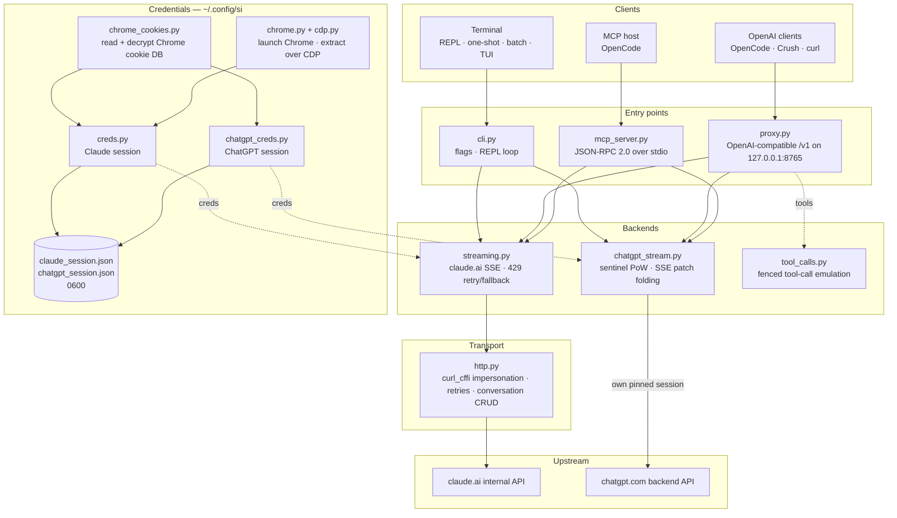

<div align="center">

[English](../../README.md) · [简体中文](README_zh.md) · [繁體中文](README_zh-TW.md) · [日本語](README_ja.md) · [한국어](README_ko.md) · [Türkçe](README_tr.md) · [Русский](README_ru.md) · [Tiếng Việt](README_vi.md) · [ไทย](README_th.md) · [Deutsch](README_de.md) · **Español** · [Français](README_fr.md) · [Українська](README_uk.md) · [Polski](README_pl.md) · [Português (Brasil)](README_pt-BR.md) · [العربية](README_ar.md) · [فارسی](README_fa.md) · [Bahasa Indonesia](README_id.md) · [Italiano](README_it.md)
· [Ελληνικά](README_el.md) · [മലയാളം](README_ml.md)

# Reclaude

</div>

Cliente de terminal para Claude.ai y ChatGPT — reproduce tu propia sesión del navegador contra sus endpoints internos y transmite las respuestas token a token. Sin clave de API.

> Herramienta de investigación. Se ejecuta bajo tu cuenta de Claude.ai: sus límites, niveles y facturación siguen aplicándose. No elude los límites de velocidad ni los muros de pago.

> [!WARNING]
> **No uses tu cuenta principal.** si controla claude.ai y chatgpt.com a través de tu propia sesión del navegador — un comportamiento que puede provocar que la cuenta sea limitada o bloqueada. Usa una cuenta desechable que puedas permitirte perder, nunca una vinculada a tu correo, facturación o trabajo.

## Demo


Con el proxy en ejecución, `si/haiku` aparece en el selector `/models` de OpenCode como cualquier otro proveedor. Selecciónalo, pregunta y observa cómo llega la respuesta en streaming — todo a través de tu sesión de Claude.ai, sin clave de API.

## Arquitectura

si consta de tres superficies delgadas — un cliente de terminal, un proxy compatible con OpenAI y un servidor MCP — sobre un único par de backends de streaming.



Una solicitud atraviesa cuatro capas:

1. **Credenciales** — `--from-chrome` lee la base de datos de cookies del navegador y la descifra con el llavero del sistema operativo (`chrome_cookies.py`); `--auto-fetch` inicia Chrome real y obtiene las cookies así como el id de organización mediante CDP (`chrome.py`, `cdp.py`). Las sesiones quedan en `~/.config/si/*.json` (`0600`). El servidor MCP las vuelve a leer en cada llamada (no hay que reiniciar tras volver a iniciar sesión); el proxy las carga al arrancar, así que reinícialo después de un nuevo inicio de sesión.
2. **Puntos de entrada** — `cli.py` analiza los flags y ejecuta los modos REPL/one-shot/batch; `proxy.py` sirve `/v1/models` y `/v1/chat/completions`; `mcp_server.py` responde a `tools/call` para `claude_ask` / `chatgpt_ask`. El proxy enruta según el id del modelo (`chatgpt/…` → backend de ChatGPT, todo lo demás → Claude); el servidor MCP expone una herramienta por backend.
3. **Backends** — `streaming.py` envía solicitudes al endpoint de completado de Claude.ai y combina los deltas SSE, con reintentos/fallback acotados para 429; `chatgpt_stream.py` ejecuta el handshake sentinel (prueba de trabajo + Turnstile) y combina el SSE de snapshot/patch de ChatGPT en texto. `tool_calls.py` convierte bloques `tool_call` delimitados por vallas en `tool_calls` reales de OpenAI, porque el canal nativo de herramientas de Claude.ai bloquea a los clientes que solo actúan sobre respuestas terminadas.
4. **Transporte** — `http.py` mantiene una sesión de `curl_cffi` fijada a una huella TLS de Chrome, gestiona reintentos/backoff y se encarga de crear/eliminar conversaciones. El backend de ChatGPT mantiene su propia sesión fijada para que las dos huellas nunca se mezclen.

El estado de las conversaciones es un chat del lado del servidor por sesión de cliente: la CLI/TUI lo elimina al salir cuando el modo stealth está activado, el proxy lo indexa por `X-Conversation-Id` (eliminando los chats de una sola petición) y el servidor MCP mantiene uno por proveedor durante toda su vida.

Auxiliares de instalación: `opencode.py` registra el servidor MCP mediante `opencode mcp add`; `service.py` instala el LaunchAgent de macOS que supervisa el proxy.

## Instalación

```bash
git clone https://github.com/two35s/reclaude.git && cd reclaude
python3 -m venv .venv && source .venv/bin/activate
pip install -r requirements.txt
python -m si --opencode   # register the MCP tool with OpenCode (see below)
```

## Inicio de sesión (una vez)

```bash
python -m si --from-chrome   # steal session from your logged-in Chrome (recommended)
python -m si --auto-fetch    # or: launch Chrome, log in, auto-extract over CDP
python -m si --manual        # or: paste org_id + Cookie header by hand
```

Se guarda en `~/.config/si/claude_session.json` (`600`).

En Linux, las cookies que Chrome cifró con el llavero del escritorio (`v11`) requieren que `libsecret-tools` esté instalado y que el llavero esté desbloqueado; sin ellos, `--from-chrome` rechaza el perfil en lugar de guardar datos basura (usa `--auto-fetch` como alternativa).

### Credenciales de ChatGPT

```bash
python -m si --chatgpt --from-chrome   # steal chatgpt.com session from Chrome
python -m si --chatgpt --manual        # or paste the session-token cookie
python -m si --chatgpt --clear-session # delete stored chatgpt creds
```

Se guarda en `~/.config/si/chatgpt_session.json` (`600`). El proxy y el servidor MCP las toman automáticamente; entonces aparece un modelo con prefijo `chatgpt/` junto a los de claude. Vuelve a ejecutar `--chatgpt --from-chrome` cuando las solicitudes devuelvan `401`.

## Chat

```bash
python -m si                 # REPL
python -m si --tui           # full-screen chat
python -m si --prompt "..."  # one shot
python -m si --model haiku   # haiku | sonnet (default) | opus | fable …
```

Comandos de la TUI: `/new` `/model [name]` `/models` `/help` `/quit`.
Comandos del REPL: los mismos, más `/stealth on|off` `/cleanup` `/clear-session`.

Una conversación del lado del servidor por sesión proporciona memoria multiturno; el modo stealth la elimina al salir para que nunca aparezca en la barra lateral de tu navegador (`--no-stealth` para conservarla).

## Proxy

```bash
python -m si --proxy                 # OpenAI-compatible API on :8765
python -m si --proxy --port 9000
python -m si --proxy &               # run in the background
```

El proxy debe estar en ejecución para que los clientes vean los modelos — si se detiene, toda solicitud falla con `ConnectionRefused`. En macOS, `python -m si --install-service` instala un agente launchd que lo inicia al iniciar sesión y lo reinicia si se detiene (`--uninstall-service` lo elimina; los registros van a `~/Library/Logs/si-proxy.log`).

Apunta [Crush](https://github.com/charmbracelet/crush), [OpenCode](https://opencode.ai) o cualquier cliente de OpenAI a `http://localhost:8765/v1`.

Se admiten tanto solicitudes en streaming (`text/event-stream`) como sin streaming. Cada respuesta en streaming también se escribe en `~/.config/si/last_response.txt` — útil cuando un cliente no te muestra nada. Un stream que termina sin su evento terminal se informa como error del upstream en lugar de presentarse como una respuesta completa.

Ante un `429`, el proxy devuelve el error en lugar de degradarte silenciosamente a un modelo más débil — los reintentos y la elección de modelo corresponden al cliente (OpenCode reintenta por su cuenta).

### Modelos de ChatGPT

Con las credenciales de ChatGPT guardadas (ver arriba), `--proxy` también sirve modelos `chatgpt/<slug>` — `chatgpt/auto`, `chatgpt/gpt-6`, `chatgpt/gpt-6-mini`, … — a través del mismo endpoint `/v1`, junto a los de claude. Un solo proxy sirve a ambos proveedores a la vez; `/v1/models` lista todo.

```bash
curl http://localhost:8765/v1/chat/completions \
  -d '{"model": "chatgpt/auto", "messages": [{"role": "user", "content": "hi"}]}'
```

La memoria multiturno funciona igual: envía una cabecera `X-Conversation-Id` y los turnos comparten una misma conversación de ChatGPT (el campo `user` de OpenAI no se usa — identifica a un usuario final, no a una conversación). El estado de la conversación se indexa por backend, así que reutilizar una misma clave entre modelos `si/` y `chatgpt/` los mantiene separados. Las solicitudes sin la cabecera son independientes, y su conversación del lado del servidor se elimina después. La llamada a herramientas, el streaming y el comportamiento de `429` como error se aplican igual. Sin credenciales de ChatGPT guardadas, una solicitud `chatgpt/` devuelve un `400` claro en su lugar.

Las solicitudes llevan un id de cuenta de reserva en las cabeceras sentinel para sesiones en las que el endpoint de autenticación no proporciona uno. Configura `SI_CHATGPT_ACCOUNT_ID` con el tuyo; no está verificado para otras cuentas — si una cuenta gratuita nueva sufre rechazos sentinel inexplicables, empieza por ahí. Cuando el sentinel no genera un token de Turnstile, si lee uno capturado de `SI_CHATGPT_TURNSTILE` o `~/.config/si/chatgpt_turnstile.txt`; el token son datos de sesión y no se incluye en el repositorio.

**La llamada a herramientas funciona.** Los `tools` de OpenAI se emulan en texto: el proxy añade las especificaciones de las herramientas al prompt, pide al modelo que emita bloques `tool_call` delimitados por vallas y los convierte en `tool_calls` reales de OpenAI en la respuesta. Envía los resultados de vuelta como mensajes `tool` en la siguiente solicitud y el modelo continúa. (El canal nativo de herramientas de Claude.ai mantiene el stream abierto esperando un resultado, lo que bloquea a los clientes que solo actúan sobre respuestas terminadas — por eso el proxy no lo usa.) Para el backend `chatgpt/`, el bloque de protocolo encabeza el prompt, ya que de lo contrario esa superficie responde "I can't reach that workspace" en lugar de emitir una valla; una respuesta con herramientas que aun así empiece con ese rechazo se reintenta una vez en una conversación nueva antes de mostrarse.

### Úsalo como un modelo normal de OpenCode

Con el proxy en ejecución, `si/sonnet`, `si/haiku` y `si/opus` aparecen en el selector `/models` de OpenCode como cualquier otro proveedor. Selecciona uno y chatea con normalidad — las herramientas (read/edit/bash), el streaming y el multiturno funcionan a través de tu cuenta de Claude.ai.

`python -m si --opencode` imprime el bloque `providers` listo para pegar en tu configuración global. O pégalo a mano:

```jsonc
{
  "providers": {
    "si": {
      "name": "si",
      "package": "@opencode/ai/providers/openai-compatible",
      "settings": { "baseURL": "http://localhost:8765/v1" },
      "models": {
        "sonnet": { "name": "Claude Sonnet", "modelID": "si/sonnet" },
        "haiku": { "name": "Claude Haiku", "modelID": "si/haiku" },
        "opus": { "name": "Claude Opus", "modelID": "si/opus" }
      }
    }
  }
}
```

## Servidor MCP de OpenCode

Expón si a [OpenCode](https://opencode.ai) como una herramienta nativa (`claude_ask`, `chatgpt_ask`) sin convertirlo en tu proveedor de modelos — OpenCode conserva su propio modelo con capacidad de herramientas y puede llamar a Claude.ai o ChatGPT a través de si cuando se lo pidas.

Instálalo con un solo comando, ejecutado desde este checkout:

```bash
python -m si --opencode
```

Eso llama al propio `opencode mcp add` de OpenCode, así que tu configuración existente (comentarios incluidos) se conserva. Reinicia OpenCode y luego comprueba `opencode mcp list`.

Tu modelo podrá entonces llamar a `claude_ask(prompt, model="sonnet")`; `model` acepta alias (`sonnet`, `haiku`, `opus`) o un id de modelo completo. `chatgpt_ask(prompt, model="auto")` hace lo mismo a través de ChatGPT (requiere credenciales de ChatGPT guardadas; `model` acepta un slug de chatgpt.com como `auto`, `gpt-6`, `gpt-6-mini`).

<details>
<summary>O añádelo a mano</summary>

```jsonc
{
  "mcp": {
    "servers": {
      "si": {
        "type": "local",
        "command": ["/absolute/path/to/si/.venv/bin/python", "-m", "si.mcp_server"],
        "environment": { "PYTHONPATH": "/absolute/path/to/si" }
      }
    }
  }
}
```

`PYTHONPATH` es lo que hace que el módulo sea importable desde cualquier directorio de trabajo, así que no se necesita `cwd`.

</details>

Comprueba el handshake de forma independiente:

```bash
printf '{"jsonrpc":"2.0","id":1,"method":"tools/list"}\n' | .venv/bin/python -m si.mcp_server
```

Notas:

- **Conversaciones compartidas.** Todas las llamadas a `claude_ask` reutilizan una conversación de Claude.ai, y todas las llamadas a `chatgpt_ask` una de ChatGPT, durante toda la vida del servidor, para que las preguntas de seguimiento mantengan el contexto. Ninguna se elimina en modo stealth y ambas aparecen en la barra lateral correspondiente hasta que las elimines.
- **Diagnósticos en stderr.** La salida de progreso/errores de si va a stderr, así que nunca corrompe el flujo del protocolo MCP en stdout.
- **Limitaciones.** Paso solo de texto — no hay salida de imágenes ni se devuelven llamadas a herramientas. Las solicitudes se ejecutan bajo tus propias cuentas, así que se aplican los límites de tu plan. Una llamada puede tardar hasta el timeout HTTP (120 s), y más si hay limitación de velocidad. `chatgpt_ask` falla limpiamente cuando faltan las credenciales de ChatGPT o se rechaza el turno (cuota, límite de velocidad).
- **Solución de problemas.** `Session invalid or expired` → vuelve a ejecutar `python -m si --auto-fetch` (Claude) o `--chatgpt --from-chrome` (ChatGPT); la siguiente llamada toma las nuevas credenciales (no hace falta reiniciar). Si falta la herramienta, revisa los registros MCP de OpenCode y que la ruta del venv en `command` sea absoluta y correcta.

## Más flags

`--batch FILE` un prompt por línea → `~/.config/si/batch_results.json` · `--jailbreak FILE` prompt desde archivo · `--org-id/--cookie` credenciales en línea · `--clear-session` borrar credenciales · `--login` guardar un perfil de Chrome sin extraer · `--opencode` registrar la herramienta MCP en OpenCode e imprimir la configuración del proveedor.

## Si falla

| Síntoma | Solución |
|---|---|
| `Session invalid or expired` | vuelve a ejecutar `--from-chrome` o `--auto-fetch` |
| ChatGPT `401` / no accessToken | vuelve a ejecutar `--chatgpt --from-chrome` |
| ChatGPT `prepare`/`finalize` failed | el handshake sentinel cambió en el upstream; actualiza si |
| `429` rate limited | espera, o cambia de modelo (`/model haiku` en la CLI/TUI) |
| `ConnectionRefused` on every model | el proxy no está en ejecución — inicia `python -m si --proxy`, o `--install-service` en macOS |
| Keychain prompt | haz clic en **Always Allow**, reintenta |

## Seguridad

Tu `sessionKey` y el token de sesión de ChatGPT son contraseñas: nunca compartas, subas ni hagas commit de los archivos de credenciales. Ejecuta `--clear-session` (y `--chatgpt --clear-session`) cuando termines; si se exponen, cierra sesión en el navegador para invalidarlos.

El proxy escucha en `127.0.0.1` sin autenticación a menos que se defina `SI_PROXY_TOKEN`. En un Mac compartido, otro usuario local o proceso que pueda alcanzar el puerto 8765 puede gastar la cuota de tu cuenta; define el token (y dáselo al cliente) o mantén el proxy apagado cuando no lo uses. El plist del LaunchAgent de macOS se escribe con permisos `600` porque contiene el token cuando se define uno.

El backend de ChatGPT utiliza la API interna de chatgpt.com con tu propia sesión del navegador. Eso va contra los términos de servicio de OpenAI y puede provocar que la cuenta sea limitada o bloqueada — usa una cuenta desechable, bajo tu propio riesgo.

## Desarrollo

```bash
pip install -r requirements-dev.txt
PYTHONPATH=. .venv/bin/python -m pytest -q   # tests
.venv/bin/python -m ruff check .             # lint
.venv/bin/python -m ruff format --check .    # formatting
```

## Licencia

Solo para uso de investigación y educativo. Sin garantía.
