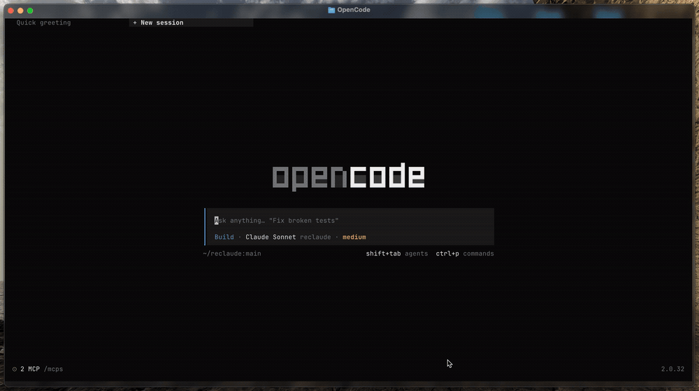
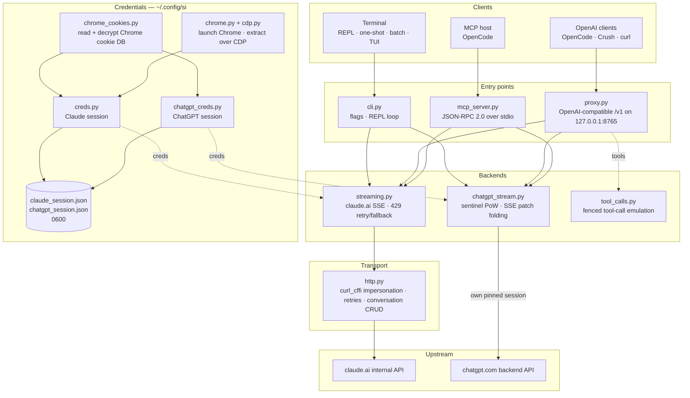

<div align="center">

[English](../../README.md) · [简体中文](README_zh.md) · [繁體中文](README_zh-TW.md) · [日本語](README_ja.md) · [한국어](README_ko.md) · [Türkçe](README_tr.md) · [Русский](README_ru.md) · [Tiếng Việt](README_vi.md) · [ไทย](README_th.md) · [Deutsch](README_de.md) · [Español](README_es.md) · [Français](README_fr.md) · [Українська](README_uk.md) · [Polski](README_pl.md) · [Português (Brasil)](README_pt-BR.md) · [العربية](README_ar.md) · **فارسی** · [Bahasa Indonesia](README_id.md) · [Italiano](README_it.md)
· [Ελληνικά](README_el.md) · [മലയാളം](README_ml.md)

# Reclaude

</div>

کلاینت ترمینالی برای Claude.ai و ChatGPT — نشست مرورگر خودتان را روی نقاط پایانی داخلی آن دو بازپخش می‌کند و پاسخ‌ها را توکن‌به‌توکن استریم می‌کند. بدون کلید API.

> ابزار پژوهشی. زیر حساب Claude.ai شما اجرا می‌شود: محدودیت‌ها، طرح‌ها و صورت‌حساب آن همچنان اعمال می‌شوند. سقف نرخ درخواست یا دیوارهای پرداخت را دور نمی‌زند.

> [!WARNING]
> **از حساب اصلی‌تان استفاده نکنید.** si از طریق نشست مرورگر خودتان claude.ai و chatgpt.com را هدایت می‌کند — رفتاری که می‌تواند به محدود یا مسدود شدن حساب منجر شود. از یک حساب یک‌بارمصرف استفاده کنید که توان از دست دادنش را دارید، هرگز حسابی که به ایمیل، صورت‌حساب یا کارتان گره خورده است.

## دمو



با در حال اجرا بودن پروکسی، `si/haiku` مثل هر ارائه‌دهنده دیگری در انتخاب‌گر `/models` در OpenCode ظاهر می‌شود. انتخابش کنید، بپرسید و ببینید پاسخ استریم می‌شود — همه از طریق نشست Claude.ai شما، بدون کلید API.

## معماری

si سه سطح نازک است — یک کلاینت ترمینال، یک پروکسی سازگار با OpenAI و یک سرور MCP — روی یک جفت بک‌اند استریم.



یک درخواست از چهار لایه می‌گذرد:

1. **اعتبارنامه‌ها** — `--from-chrome` پایگاه داده کوکی مرورگر را می‌خواند و آن را با keyring سیستم‌عامل رمزگشایی می‌کند (`chrome_cookies.py`)؛ `--auto-fetch` کروم واقعی را اجرا می‌کند و کوکی‌ها به‌همراه org id را از طریق CDP بیرون می‌کشد (`chrome.py`، `cdp.py`). نشست‌ها در `~/.config/si/*.json` (`0600`) ذخیره می‌شوند. سرور MCP آن‌ها را در هر فراخوانی دوباره می‌خواند (پس از ورود مجدد نیازی به راه‌اندازی دوباره نیست)؛ پروکسی آن‌ها را در زمان راه‌اندازی بارگذاری می‌کند، پس پس از ورود مجدد آن را دوباره راه‌اندازی کنید.
2. **نقاط ورود** — `cli.py` پرچم‌ها را تجزیه می‌کند و حالت‌های REPL/یک‌باره/دسته‌ای را اجرا می‌کند؛ `proxy.py` از `/v1/models` و `/v1/chat/completions` سرویس می‌دهد؛ `mcp_server.py` به `tools/call` برای `claude_ask` / `chatgpt_ask` پاسخ می‌دهد. پروکسی بر اساس شناسه مدل مسیریابی می‌کند (`chatgpt/…` → بک‌اند ChatGPT، بقیه → Claude)؛ سرور MCP یک ابزار به ازای هر بک‌اند ارائه می‌دهد.
3. **بک‌اندها** — `streaming.py` به نقطه پایانی completion در Claude.ai درخواست می‌فرستد و دلتاهای SSE را تجمیع می‌کند، با تلاش دوباره/فالبک محدود روی 429؛ `chatgpt_stream.py` دست‌دهی sentinel را اجرا می‌کند (proof-of-work + Turnstile) و SSE‌های snapshot/patch در ChatGPT را به متن تبدیل می‌کند. `tool_calls.py` بلوک‌های `tool_call` حصارکشی‌شده را به `tool_calls` واقعی OpenAI تبدیل می‌کند، چون کانال ابزار بومی Claude.ai کلاینت‌هایی را که فقط روی پاسخ‌های تمام‌شده عمل می‌کنند دچار بن‌بست می‌کند.
4. **لایه انتقال** — `http.py` یک نشست `curl_cffi` را روی اثر انگشت TLS کروم پین نگه می‌دارد، تلاش دوباره/عقب‌نشینی را مدیریت می‌کند و ساخت/حذف گفتگو را در اختیار دارد. بک‌اند ChatGPT نشست پین‌شده خودش را نگه می‌دارد تا آن دو اثر انگشت هرگز قاطی نشوند.

وضعیت گفتگو یک چت سمت‌سرور به ازای هر نشست کلاینت است: CLI/TUI هنگام خروج آن را حذف می‌کند وقتی حالت stealth روشن باشد، پروکسی آن را با `X-Conversation-Id` کلیددهی می‌کند (و چت‌های یک‌باره را حذف می‌کند)، و سرور MCP در طول عمرش یکی به ازای هر ارائه‌دهنده نگه می‌دارد.

کمکی‌های زمان نصب: `opencode.py` سرور MCP را از طریق `opencode mcp add` ثبت می‌کند؛ `service.py` عامل LaunchAgent در macOS را نصب می‌کند که بر پروکسی نظارت دارد.

## نصب

```bash
git clone https://github.com/two35s/reclaude.git && cd reclaude
python3 -m venv .venv && source .venv/bin/activate
pip install -r requirements.txt
python -m si --opencode   # register the MCP tool with OpenCode (see below)
```

## ورود (یک‌بار)

```bash
python -m si --from-chrome   # steal session from your logged-in Chrome (recommended)
python -m si --auto-fetch    # or: launch Chrome, log in, auto-extract over CDP
python -m si --manual        # or: paste org_id + Cookie header by hand
```

در `~/.config/si/claude_session.json` (`600`) ذخیره می‌شود.

در لینوکس، کوکی‌هایی که کروم با keyring دسکتاپ رمزگذاری کرده (`v11`) به نصب `libsecret-tools` و باز بودن keyring نیاز دارند؛ بدون آن‌ها `--from-chrome` پروفایل را رد می‌کند به‌جای اینکه داده خراب ذخیره کند (از `--auto-fetch` به‌عنوان جایگزین استفاده کنید).

### اعتبارنامه‌های ChatGPT

```bash
python -m si --chatgpt --from-chrome   # steal chatgpt.com session from Chrome
python -m si --chatgpt --manual        # or paste the session-token cookie
python -m si --chatgpt --clear-session # delete stored chatgpt creds
```

در `~/.config/si/chatgpt_session.json` (`600`) ذخیره می‌شود. پروکسی و سرور MCP این‌ها را به‌طور خودکار برمی‌دارند؛ سپس مدلی با پیشوند `chatgpt/` در کنار مدل‌های claude ظاهر می‌شود. وقتی درخواست‌ها با `401` برمی‌گردند، `--chatgpt --from-chrome` را دوباره اجرا کنید.

## چت

```bash
python -m si                 # REPL
python -m si --tui           # full-screen chat
python -m si --prompt "..."  # one shot
python -m si --model haiku   # haiku | sonnet (default) | opus | fable …
```

دستورهای TUI: `/new` `/model [name]` `/models` `/help` `/quit`.
دستورهای REPL: همان‌ها، به‌علاوه `/stealth on|off` `/cleanup` `/clear-session`.

یک گفتگوی سمت‌سرور به ازای هر نشست، حافظه چندنوبتی می‌دهد؛ حالت stealth هنگام خروج آن را حذف می‌کند تا هرگز در نوار کناری مرورگرتان ظاهر نشود (`--no-stealth` برای نگه داشتن آن).

## پروکسی

```bash
python -m si --proxy                 # OpenAI-compatible API on :8765
python -m si --proxy --port 9000
python -m si --proxy &               # run in the background
```

پروکسی باید در حال اجرا باشد تا کلاینت‌ها مدل‌ها را ببینند — اگر متوقف شود، هر درخواست با `ConnectionRefused` شکست می‌خورد. در macOS، `python -m si --install-service` یک عامل launchd نصب می‌کند که آن را هنگام ورود به سیستم اجرا می‌کند و در صورت خروج دوباره راه‌اندازی می‌کند (`--uninstall-service` آن را حذف می‌کند؛ لاگ‌ها به `~/Library/Logs/si-proxy.log` می‌روند).

[Crush](https://github.com/charmbracelet/crush)، [OpenCode](https://opencode.ai) یا هر کلاینت OpenAI را به `http://localhost:8765/v1` اشاره دهید.

درخواست‌های استریم (`text/event-stream`) و غیراستریم هر دو پشتیبانی می‌شوند. هر پاسخ استریم‌شده همچنین در `~/.config/si/last_response.txt` نوشته می‌شود — وقتی کلاینت چیزی نشانتان نمی‌دهد مفید است. استریمی که بدون رویداد پایانی‌اش تمام شود، به‌جای اینکه به‌عنوان پاسخ کامل جا زده شود، به‌عنوان خطای بالادست گزارش می‌شود.

روی `429` پروکسی خطا را برمی‌گرداند به‌جای اینکه بی‌صدا شما را به مدل ضعیف‌تری تنزل دهد — تلاش دوباره و انتخاب مدل وظیفه کلاینت است (OpenCode خودش تلاش دوباره می‌کند).

### مدل‌های ChatGPT

با ذخیره بودن اعتبارنامه‌های ChatGPT (به بالا نگاه کنید)، `--proxy` مدل‌های `chatgpt/<slug>` را هم ارائه می‌دهد — `chatgpt/auto`، `chatgpt/gpt-6`، `chatgpt/gpt-6-mini`، … — از طریق همان endpoint `/v1`، در کنار مدل‌های claude. یک پروکسی هر دو ارائه‌دهنده را هم‌زمان سرویس می‌دهد؛ `/v1/models` همه را فهرست می‌کند.

```bash
curl http://localhost:8765/v1/chat/completions \
  -d '{"model": "chatgpt/auto", "messages": [{"role": "user", "content": "hi"}]}'
```

حافظه چندنوبتی هم به همین شکل کار می‌کند: هدر `X-Conversation-Id` را بفرستید و نوبت‌ها در یک گفتگوی ChatGPT مشترک می‌شوند (فیلد `user` در OpenAI استفاده نمی‌شود — آن یک کاربر نهایی را شناسایی می‌کند، نه یک گفتگو). وضعیت گفتگو به ازای هر بک‌اند کلیددهی می‌شود، بنابراین استفاده دوباره از یک کلید در مدل‌های `si/` و `chatgpt/` آن‌ها را جدا نگه می‌دارد. درخواست‌های بدون هدر مستقل‌اند و گفتگوی سمت‌سرورشان بعداً حذف می‌شود. فراخوانی ابزار، استریم و رفتار «429 به‌صورت خطا» همه اعمال می‌شوند. بدون اعتبارنامه ذخیره‌شده ChatGPT، یک درخواست `chatgpt/` به‌جایش یک `400` شفاف برمی‌گرداند.

درخواست‌ها یک شناسه حساب فالبک در هدرهای sentinel حمل می‌کنند برای نشست‌هایی که نقطه پایانی احراز هویت یکی ارائه نمی‌دهد. `SI_CHATGPT_ACCOUNT_ID` را روی حساب خودتان تنظیم کنید؛ برای حساب‌های دیگر تأییدنشده است — اگر یک حساب رایگان تازه با ردهای sentinel بی‌دلیل مواجه شد، از همین‌جا شروع کنید. وقتی sentinel توکن Turnstile صادر نمی‌کند، si یک توکن ضبط‌شده را از `SI_CHATGPT_TURNSTILE` یا `~/.config/si/chatgpt_turnstile.txt` می‌خواند؛ توکن داده نشست است و کامیت نمی‌شود.

**فراخوانی ابزار کار می‌کند.** `tools` در OpenAI در متن شبیه‌سازی می‌شوند: پروکسی مشخصات ابزار را به پرامپت اضافه می‌کند، از مدل می‌خواهد بلوک‌های `tool_call` حصارکشی‌شده تولید کند و آن‌ها را در پاسخ به `tool_calls` واقعی OpenAI تبدیل می‌کند. نتایج را در درخواست بعدی به‌صورت پیام‌های `tool` برگردانید تا مدل ادامه دهد. (کانال ابزار بومی Claude.ai استریم را باز نگه می‌دارد تا منتظر نتیجه بماند، که کلاینت‌هایی را که فقط روی پاسخ‌های تمام‌شده عمل می‌کنند دچار بن‌بست می‌کند — پس پروکسی از آن استفاده نمی‌کند.) برای بک‌اند `chatgpt/`، بلوک پروتکل ابتدای پرامپت می‌آید، چون آن سطح در غیر این صورت به‌جای تولید حصار پاسخ می‌دهد «نمی‌توانم به آن workspace دسترسی پیدا کنم»؛ پاسخی که ابزار دارد ولی هنوز با چنین رد کردنی آغاز می‌شود، یک بار در یک گفتگوی تازه دوباره تلاش می‌شود پیش از اینکه نمایش داده شود.

### استفاده به‌عنوان یک مدل معمولی OpenCode

با در حال اجرا بودن پروکسی، `si/sonnet`، `si/haiku` و `si/opus` مثل هر ارائه‌دهنده دیگری در انتخاب‌گر `/models` در OpenCode ظاهر می‌شوند. یکی را انتخاب کنید و عادی گفتگو کنید — ابزارها (read/edit/bash)، استریم و چندنوبتی همه از طریق حساب Claude.ai شما کار می‌کنند.

`python -m si --opencode` بلوک `providers` آماده چسباندن را برای پیکربندی سراسری‌تان چاپ می‌کند. یا به‌صورت دستی بچسبانید:

```jsonc
{
  "providers": {
    "si": {
      "name": "si",
      "package": "@opencode/ai/providers/openai-compatible",
      "settings": { "baseURL": "http://localhost:8765/v1" },
      "models": {
        "sonnet": { "name": "Claude Sonnet", "modelID": "si/sonnet" },
        "haiku": { "name": "Claude Haiku", "modelID": "si/haiku" },
        "opus": { "name": "Claude Opus", "modelID": "si/opus" }
      }
    }
  }
}
```

## سرور MCP در OpenCode

si را به‌عنوان یک ابزار بومی (`claude_ask`، `chatgpt_ask`) در [OpenCode](https://opencode.ai) در دسترس بگذارید بدون اینکه آن را ارائه‌دهنده مدل خودتان کنید — OpenCode مدل توانمند-ابزار خودش را نگه می‌دارد و می‌تواند هر وقت بخواهید از طریق si به Claude.ai یا ChatGPT فراخوانی بزند.

با یک دستور نصبش کنید، از همین checkout اجرا کنید:

```bash
python -m si --opencode
```

این دستور `opencode mcp add` خود OpenCode را صدا می‌زند، پس پیکربندی موجودتان (شامل کامنت‌ها) حفظ می‌شود. OpenCode را دوباره راه‌اندازی کنید، سپس `opencode mcp list` را بررسی کنید.

مدل شما سپس می‌تواند `claude_ask(prompt, model="sonnet")` را صدا بزند؛ `model` نام‌های مستعار (`sonnet`، `haiku`، `opus`) یا یک شناسه کامل مدل را می‌پذیرد. `chatgpt_ask(prompt, model="auto")` همین کار را از طریق ChatGPT انجام می‌دهد (نیازمند ذخیره بودن اعتبارنامه‌های ChatGPT؛ `model` یک slug از chatgpt.com مثل `auto`، `gpt-6`، `gpt-6-mini` می‌گیرد).

<details>
<summary>یا به‌صورت دستی اضافه کنید</summary>

```jsonc
{
  "mcp": {
    "servers": {
      "si": {
        "type": "local",
        "command": ["/absolute/path/to/si/.venv/bin/python", "-m", "si.mcp_server"],
        "environment": { "PYTHONPATH": "/absolute/path/to/si" }
      }
    }
  }
}
```

`PYTHONPATH` همان چیزی است که ماژول را از هر پوشه کاری قابل ایمپورت می‌کند، پس نیازی به `cwd` نیست.

</details>

دست‌دهی را مستقل بررسی کنید:

```bash
printf '{"jsonrpc":"2.0","id":1,"method":"tools/list"}\n' | .venv/bin/python -m si.mcp_server
```

یادداشت‌ها:

- **گفتگوهای مشترک.** همه فراخوانی‌های `claude_ask` از یک گفتگوی Claude.ai و همه فراخوانی‌های `chatgpt_ask` از یک گفتگوی ChatGPT، در طول عمر سرور دوباره استفاده می‌کنند، تا پیگیری‌ها زمینه را حفظ کنند. هیچ‌کدام به‌صورت stealth حذف نمی‌شوند و هر دو تا وقتی خودتان حذفشان نکنید در نوار کناری مربوطه ظاهر می‌مانند.
- **تشخیص روی stderr.** خروجی پیشرفت/خطای si به stderr می‌رود، پس هرگز جریان پروتکل MCP روی stdout را خراب نمی‌کند.
- **محدودیت‌ها.** عبور فقط-متنی — خروجی تصویری نیست و فراخوانی ابزاری برنمی‌گردد. درخواست‌ها زیر حساب‌های خودتان اجرا می‌شوند، پس محدودیت‌های طرح اعمال می‌شوند. یک فراخوانی می‌تواند تا مهلت HTTP (۱۲۰ ثانیه) طول بکشد، زیر محدودیت نرخ بیشتر. `chatgpt_ask` وقتی اعتبارنامه‌های ChatGPT نبود یا نوبت رد شود (سهمیه، محدودیت نرخ) به‌درستی خطا می‌دهد.
- **عیب‌یابی.** `Session invalid or expired` → `python -m si --auto-fetch` را دوباره اجرا کنید (Claude) یا `--chatgpt --from-chrome` (ChatGPT)؛ فراخوانی بعدی اعتبارنامه‌های جدید را برمی‌دارد (بدون نیاز به راه‌اندازی دوباره). اگر ابزار پیدا نشد، لاگ‌های MCP در OpenCode را بررسی کنید و مطمئن شوید مسیر venv در `command` مطلق و درست است.

## پرچم‌های بیشتر

`--batch FILE` یک پرامپت در هر خط → `~/.config/si/batch_results.json` · `--jailbreak FILE` پرامپت از فایل · `--org-id/--cookie` اعتبارنامه‌های درون‌خطی · `--clear-session` پاک کردن اعتبارنامه‌ها · `--login` ذخیره پروفایل Chrome بدون استخراج · `--opencode` ثبت ابزار MCP در OpenCode و چاپ پیکربندی ارائه‌دهنده.

## اگر خراب شد

| نشانه | راه‌حل |
|---|---|
| `Session invalid or expired` | `--from-chrome` یا `--auto-fetch` را دوباره اجرا کنید |
| ChatGPT `401` / no accessToken | `--chatgpt --from-chrome` را دوباره اجرا کنید |
| ChatGPT `prepare`/`finalize` failed | دست‌دهی sentinel در بالادست تغییر کرده؛ si را به‌روزرسانی کنید |
| `429` rate limited | صبر کنید، یا مدل را عوض کنید (`/model haiku` در CLI/TUI) |
| `ConnectionRefused` on every model | پروکسی در حال اجرا نیست — `python -m si --proxy` را اجرا کنید، یا در macOS از `--install-service` |
| Keychain prompt | روی **Always Allow** کلیک کنید، دوباره تلاش کنید |

## امنیت

`sessionKey` و توکن نشست ChatGPT شما مثل رمز عبور هستند: فایل‌های اعتبارنامه را هرگز به اشتراک نگذارید، آپلود یا کامیت نکنید. وقتی کارتان تمام شد `--clear-session` (و `--chatgpt --clear-session`) را اجرا کنید؛ اگر افشا شدند، در مرورگر خارج شوید تا باطل شوند.

پروکسی روی `127.0.0.1` و بدون احراز هویت گوش می‌دهد مگر اینکه `SI_PROXY_TOKEN` تنظیم شده باشد. روی یک مک مشترک، کاربر یا فرایند محلی دیگری که به پورت 8765 دسترسی دارد می‌تواند سهمیه حساب شما را خرج کند؛ توکن را تنظیم کنید (و به کلاینت بدهید) یا وقتی استفاده نمی‌کنید پروکسی را خاموش نگه دارید. plist مربوط به LaunchAgent در macOS با `600` نوشته می‌شود چون وقتی توکن تنظیم شده باشد آن را حمل می‌کند.

بک‌اند ChatGPT با نشست مرورگر خودتان، API داخلی chatgpt.com را هدایت می‌کند. این کار خلاف شرایط خدمات OpenAI است و می‌تواند به محدود یا مسدود شدن حساب منجر شود — از یک حساب یک‌بارمصرف و با مسئولیت خودتان استفاده کنید.

## توسعه

```bash
pip install -r requirements-dev.txt
PYTHONPATH=. .venv/bin/python -m pytest -q   # tests
.venv/bin/python -m ruff check .             # lint
.venv/bin/python -m ruff format --check .    # formatting
```

## مجوز

فقط برای استفاده پژوهشی و آموزشی. بدون هیچ ضمانت.
