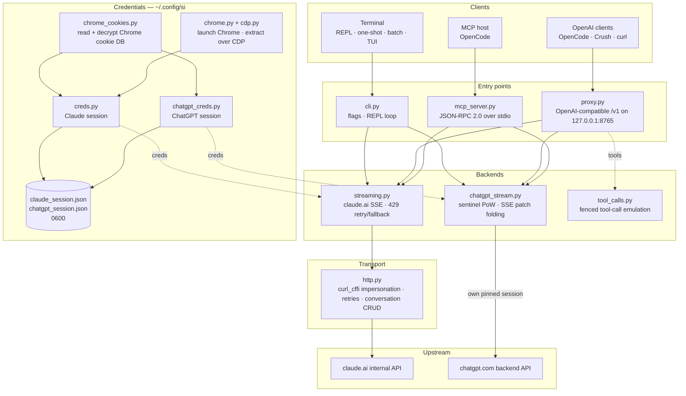

<div align="center">

[English](../../README.md) · [简体中文](README_zh.md) · [繁體中文](README_zh-TW.md) · [日本語](README_ja.md) · [한국어](README_ko.md) · [Türkçe](README_tr.md) · [Русский](README_ru.md) · [Tiếng Việt](README_vi.md) · [ไทย](README_th.md) · [Deutsch](README_de.md) · [Español](README_es.md) · **Français** · [Українська](README_uk.md) · [Polski](README_pl.md) · [Português (Brasil)](README_pt-BR.md) · [العربية](README_ar.md) · [فارسی](README_fa.md) · [Bahasa Indonesia](README_id.md) · [Italiano](README_it.md)
· [Ελληνικά](README_el.md) · [മലയാളം](README_ml.md)

# Reclaude

</div>

Client terminal pour Claude.ai et ChatGPT — rejoue votre propre session de navigateur sur leurs endpoints internes et diffuse les réponses token par token. Aucune clé API.

> Outil de recherche. Il fonctionne sous votre compte Claude.ai : ses limites, ses paliers et sa facturation s’appliquent toujours. Il ne contourne ni les limites de débit ni les paywalls.

> [!WARNING]
> **N’utilisez pas votre compte principal.** si pilote claude.ai et chatgpt.com via votre propre session de navigateur — un comportement qui peut entraîner une limitation ou un bannissement du compte. Utilisez un compte jetable que vous pouvez perdre, jamais un compte lié à votre e-mail, votre facturation ou votre travail.

## Démo


Avec le proxy en cours d’exécution, `si/haiku` apparaît dans le sélecteur `/models` d’OpenCode comme n’importe quel autre fournisseur. Sélectionnez-le, posez votre question, regardez la réponse arriver en streaming — le tout via votre session Claude.ai, sans clé API.

## Architecture

si est constitué de trois surfaces légères — un client terminal, un proxy compatible OpenAI et un serveur MCP — au-dessus d’une paire de backends de streaming.



Une requête traverse quatre couches :

1. **Identifiants** — `--from-chrome` lit la base de cookies du navigateur et la déchiffre avec le trousseau de clés de l’OS (`chrome_cookies.py`) ; `--auto-fetch` lance un vrai Chrome et récupère les cookies ainsi que l’org id via CDP (`chrome.py`, `cdp.py`). Les sessions sont stockées dans `~/.config/si/*.json` (`0600`). Le serveur MCP les relit à chaque appel (pas besoin de redémarrer après une reconnexion) ; le proxy les charge au démarrage, il faut donc le redémarrer après une reconnexion.
2. **Points d’entrée** — `cli.py` analyse les flags et exécute les modes REPL/one-shot/batch ; `proxy.py` sert `/v1/models` et `/v1/chat/completions` ; `mcp_server.py` répond aux appels `tools/call` pour `claude_ask` / `chatgpt_ask`. Le proxy route selon l’id de modèle (`chatgpt/…` → backend ChatGPT, tout le reste → Claude) ; le serveur MCP expose un outil par backend.
3. **Backends** — `streaming.py` envoie des requêtes à l’endpoint de complétion de Claude.ai et agrège les deltas SSE, avec un nombre borné de tentatives de repli en cas de 429 ; `chatgpt_stream.py` exécute la poignée de main sentinel (proof-of-work + Turnstile) et fusionne les SSE snapshot/patch de ChatGPT en texte. `tool_calls.py` transforme les blocs `tool_call` délimités par des fences en vrais `tool_calls` OpenAI, car le canal d’outils natif de Claude.ai bloque les clients qui n’agissent que sur des réponses terminées.
4. **Transport** — `http.py` maintient une session `curl_cffi` épinglée à une empreinte TLS de Chrome, gère les tentatives avec backoff et se charge de la création/suppression des conversations. Le backend ChatGPT conserve sa propre session épinglée afin que les deux empreintes ne se mélangent jamais.

L’état de conversation correspond à un chat côté serveur par session client : la CLI/TUI le supprime à la sortie lorsque le mode stealth est actif, le proxy l’indexe par `X-Conversation-Id` (en supprimant les chats one-shot), et le serveur MCP en conserve un par fournisseur pendant toute sa durée de vie.

Assistants d’installation : `opencode.py` enregistre le serveur MCP via `opencode mcp add` ; `service.py` installe le LaunchAgent macOS qui supervise le proxy.

## Installation

```bash
git clone https://github.com/two35s/reclaude.git && cd reclaude
python3 -m venv .venv && source .venv/bin/activate
pip install -r requirements.txt
python -m si --opencode   # register the MCP tool with OpenCode (see below)
```

## Connexion (une seule fois)

```bash
python -m si --from-chrome   # steal session from your logged-in Chrome (recommended)
python -m si --auto-fetch    # or: launch Chrome, log in, auto-extract over CDP
python -m si --manual        # or: paste org_id + Cookie header by hand
```

Enregistré dans `~/.config/si/claude_session.json` (`600`).

Sous Linux, les cookies Chrome chiffrés avec le trousseau du bureau (`v11`) nécessitent l’installation de `libsecret-tools` et un trousseau déverrouillé ; sans cela, `--from-chrome` refuse le profil plutôt que d’enregistrer des données corrompues (utilisez `--auto-fetch` en solution de repli).

### Identifiants ChatGPT

```bash
python -m si --chatgpt --from-chrome   # steal chatgpt.com session from Chrome
python -m si --chatgpt --manual        # or paste the session-token cookie
python -m si --chatgpt --clear-session # delete stored chatgpt creds
```

Enregistré dans `~/.config/si/chatgpt_session.json` (`600`). Le proxy et le serveur MCP les récupèrent automatiquement ; un modèle préfixé par `chatgpt/` apparaît alors à côté des modèles claude. Relancez `--chatgpt --from-chrome` lorsque les requêtes renvoient `401`.

## Discussion

```bash
python -m si                 # REPL
python -m si --tui           # full-screen chat
python -m si --prompt "..."  # one shot
python -m si --model haiku   # haiku | sonnet (default) | opus | fable …
```

Commandes de la TUI : `/new` `/model [name]` `/models` `/help` `/quit`.
Commandes du REPL : les mêmes, plus `/stealth on|off` `/cleanup` `/clear-session`.

Une conversation côté serveur par session assure la mémoire multi-tours ; le mode stealth la supprime à la sortie afin qu’elle n’apparaisse jamais dans la barre latérale de votre navigateur (`--no-stealth` pour la conserver).

## Proxy

```bash
python -m si --proxy                 # OpenAI-compatible API on :8765
python -m si --proxy --port 9000
python -m si --proxy &               # run in the background
```

Le proxy doit être en cours d’exécution pour que les clients voient les modèles — s’il s’arrête, chaque requête échoue avec `ConnectionRefused`. Sous macOS, `python -m si --install-service` installe un agent launchd qui le démarre à la connexion et le redémarre s’il s’arrête (`--uninstall-service` le supprime ; les logs vont dans `~/Library/Logs/si-proxy.log`).

Configurez [Crush](https://github.com/charmbracelet/crush), [OpenCode](https://opencode.ai) ou n’importe quel client OpenAI sur `http://localhost:8765/v1`.

Les requêtes en streaming (`text/event-stream`) et non-streaming sont toutes deux prises en charge. Chaque réponse en streaming est également écrite dans `~/.config/si/last_response.txt` — pratique lorsqu’un client ne vous affiche rien. Un flux qui se termine sans son événement terminal est signalé comme une erreur côté amont au lieu d’être présenté comme une réponse complète.

En cas de `429`, le proxy renvoie l’erreur au lieu de vous rétrograder silencieusement vers un modèle plus faible — les tentatives et le choix du modèle reviennent au client (OpenCode réessaie de son côté).

### Modèles ChatGPT

Avec des identifiants ChatGPT enregistrés (voir ci-dessus), `--proxy` sert aussi les modèles `chatgpt/<slug>` — `chatgpt/auto`, `chatgpt/gpt-6`, `chatgpt/gpt-6-mini`, … — via le même endpoint `/v1`, à côté des modèles claude. Un seul proxy sert les deux fournisseurs à la fois ; `/v1/models` liste le tout.

```bash
curl http://localhost:8765/v1/chat/completions \
  -d '{"model": "chatgpt/auto", "messages": [{"role": "user", "content": "hi"}]}'
```

La mémoire multi-tours fonctionne de la même manière : envoyez un en-tête `X-Conversation-Id` et les tours partagent une même conversation ChatGPT (le champ `user` d’OpenAI n’est pas utilisé — il identifie un utilisateur final, pas une conversation). L’état de conversation est indexé par backend, donc réutiliser une même clé entre les modèles `si/` et `chatgpt/` les maintient séparés. Les requêtes sans l’en-tête sont indépendantes, et leur conversation côté serveur est supprimée ensuite. L’appel d’outils, le streaming et le comportement « `429` renvoyé comme erreur » s’appliquent tous. Sans identifiants ChatGPT enregistrés, une requête `chatgpt/` renvoie à la place un `400` explicite.

Les requêtes transportent un account id de repli dans les en-têtes sentinel pour les sessions où l’endpoint d’authentification n’en fournit pas. Définissez `SI_CHATGPT_ACCOUNT_ID` avec le vôtre ; il n’est pas vérifié pour d’autres comptes — si un nouveau compte gratuit rencontre des rejets sentinel inexpliqués, commencez par là. Lorsque le sentinel ne génère pas de token Turnstile, si lit un token capturé dans `SI_CHATGPT_TURNSTILE` ou `~/.config/si/chatgpt_turnstile.txt` ; le token est une donnée de session et n’est pas commité.

**L’appel d’outils fonctionne.** Les `tools` d’OpenAI sont émulés en texte : le proxy ajoute les spécifications des outils au prompt, demande au modèle d’émettre des blocs `tool_call` délimités par des fences, puis les convertit en vrais `tool_calls` OpenAI dans la réponse. Renvoyez les résultats sous forme de messages `tool` à la requête suivante et le modèle continue. (Le canal d’outils natif de Claude.ai garde le flux ouvert en attendant un résultat, ce qui bloque les clients qui n’agissent que sur des réponses terminées — le proxy ne l’utilise donc pas.) Pour le backend `chatgpt/`, le bloc de protocole est placé en tête du prompt, car cette surface répond sinon « I can't reach that workspace » au lieu d’émettre une fence ; une réponse contenant des outils qui commence encore par un tel refus est retentée une fois dans une nouvelle conversation avant d’être affichée.

### Utiliser comme un modèle OpenCode normal

Avec le proxy en cours d’exécution, `si/sonnet`, `si/haiku` et `si/opus` apparaissent dans le sélecteur `/models` d’OpenCode comme n’importe quel autre fournisseur. Sélectionnez-en un et discutez normalement — les outils (read/edit/bash), le streaming et le multi-tours fonctionnent tous via votre compte Claude.ai.

`python -m si --opencode` affiche le bloc `providers` prêt à coller pour votre configuration globale. Ou collez-le à la main :

```jsonc
{
  "providers": {
    "si": {
      "name": "si",
      "package": "@opencode/ai/providers/openai-compatible",
      "settings": { "baseURL": "http://localhost:8765/v1" },
      "models": {
        "sonnet": { "name": "Claude Sonnet", "modelID": "si/sonnet" },
        "haiku": { "name": "Claude Haiku", "modelID": "si/haiku" },
        "opus": { "name": "Claude Opus", "modelID": "si/opus" }
      }
    }
  }
}
```

## Serveur MCP OpenCode

Exposez si à [OpenCode](https://opencode.ai) comme outil natif (`claude_ask`, `chatgpt_ask`) sans en faire votre fournisseur de modèles — OpenCode conserve son propre modèle capable d’outils et peut appeler Claude.ai ou ChatGPT via si lorsque vous le demandez.

Installez-le en une commande, depuis ce dépôt :

```bash
python -m si --opencode
```

Cela appelle la commande `opencode mcp add` d’OpenCode, donc votre configuration existante (commentaires compris) est préservée. Redémarrez OpenCode, puis vérifiez avec `opencode mcp list`.

Votre modèle peut alors appeler `claude_ask(prompt, model="sonnet")` ; `model` accepte des alias (`sonnet`, `haiku`, `opus`) ou un id de modèle complet. `chatgpt_ask(prompt, model="auto")` fait de même via ChatGPT (nécessite des identifiants ChatGPT enregistrés ; `model` prend un slug chatgpt.com comme `auto`, `gpt-6`, `gpt-6-mini`).

<details>
<summary>Ou ajoutez-le à la main</summary>

```jsonc
{
  "mcp": {
    "servers": {
      "si": {
        "type": "local",
        "command": ["/absolute/path/to/si/.venv/bin/python", "-m", "si.mcp_server"],
        "environment": { "PYTHONPATH": "/absolute/path/to/si" }
      }
    }
  }
}
```

C’est `PYTHONPATH` qui rend le module importable depuis n’importe quel répertoire de travail, donc aucun `cwd` n’est nécessaire.

</details>

Vérifiez la poignée de main de manière autonome :

```bash
printf '{"jsonrpc":"2.0","id":1,"method":"tools/list"}\n' | .venv/bin/python -m si.mcp_server
```

Remarques :

- **Conversations partagées.** Tous les appels `claude_ask` réutilisent une même conversation Claude.ai, et tous les appels `chatgpt_ask` une même conversation ChatGPT, pendant toute la durée de vie du serveur, afin que les relances conservent le contexte. Aucune des deux n’est supprimée en mode stealth et les deux apparaissent dans la barre latérale correspondante jusqu’à ce que vous les supprimiez.
- **Diagnostics sur stderr.** La sortie de progression/erreur de si va vers stderr, afin de ne jamais corrompre le flux du protocole MCP sur stdout.
- **Limitations.** Pass-through texte uniquement — aucune sortie d’image et aucun appel d’outil en retour. Les requêtes s’exécutent sous vos propres comptes, donc les limites de votre forfait s’appliquent. Un appel peut prendre jusqu’au timeout HTTP (120 s), plus longtemps en cas de limitation de débit. `chatgpt_ask` renvoie une erreur propre lorsque les identifiants ChatGPT manquent ou que le tour est refusé (quota, limite de débit).
- **Dépannage.** `Session invalid or expired` → relancez `python -m si --auto-fetch` (Claude) ou `--chatgpt --from-chrome` (ChatGPT) ; l’appel suivant récupère les nouveaux identifiants (aucun redémarrage nécessaire). Si l’outil est absent, consultez les logs MCP d’OpenCode et vérifiez que le chemin du venv dans `command` est absolu et correct.

## Autres flags

`--batch FILE` un prompt par ligne → `~/.config/si/batch_results.json` · `--jailbreak FILE` prompt depuis un fichier · `--org-id/--cookie` identifiants en ligne · `--clear-session` efface les identifiants · `--login` enregistre un profil Chrome sans extraction · `--opencode` enregistre l’outil MCP auprès d’OpenCode et affiche la configuration du fournisseur.

## En cas de problème

| Symptôme | Correctif |
|---|---|
| `Session invalid or expired` | relancez `--from-chrome` ou `--auto-fetch` |
| ChatGPT `401` / aucun accessToken | relancez `--chatgpt --from-chrome` |
| Échec de `prepare`/`finalize` ChatGPT | la poignée de main sentinel a changé côté amont ; mettez si à jour |
| `429` rate limited | attendez, ou changez de modèle (`/model haiku` dans la CLI/TUI) |
| `ConnectionRefused` sur tous les modèles | le proxy n’est pas démarré — lancez `python -m si --proxy`, ou `--install-service` sous macOS |
| Invite du trousseau | cliquez sur **Toujours autoriser**, réessayez |

## Sécurité

Votre `sessionKey` et le token de session ChatGPT sont des mots de passe : ne partagez, ne téléversez et ne commitez jamais les fichiers d’identifiants. Utilisez `--clear-session` (et `--chatgpt --clear-session`) lorsque vous avez terminé ; s’ils sont exposés, déconnectez-vous dans le navigateur pour les invalider.

Le proxy écoute sur `127.0.0.1` sans authentification, sauf si `SI_PROXY_TOKEN` est défini. Sur un Mac partagé, un autre utilisateur ou processus local pouvant atteindre le port 8765 peut consommer le quota de votre compte ; définissez le token (et fournissez-le au client) ou laissez le proxy désactivé lorsque vous ne l’utilisez pas. Le plist du LaunchAgent macOS est écrit en `600` car il contient le token lorsqu’il est défini.

Le backend ChatGPT pilote l’API interne de chatgpt.com avec votre propre session de navigateur. Cela enfreint les conditions d’utilisation d’OpenAI et peut entraîner une limitation ou un bannissement du compte — utilisez un compte jetable, à vos propres risques.

## Développement

```bash
pip install -r requirements-dev.txt
PYTHONPATH=. .venv/bin/python -m pytest -q   # tests
.venv/bin/python -m ruff check .             # lint
.venv/bin/python -m ruff format --check .    # formatting
```

## Licence

Usage de recherche et d’éducation uniquement. Aucune garantie.
