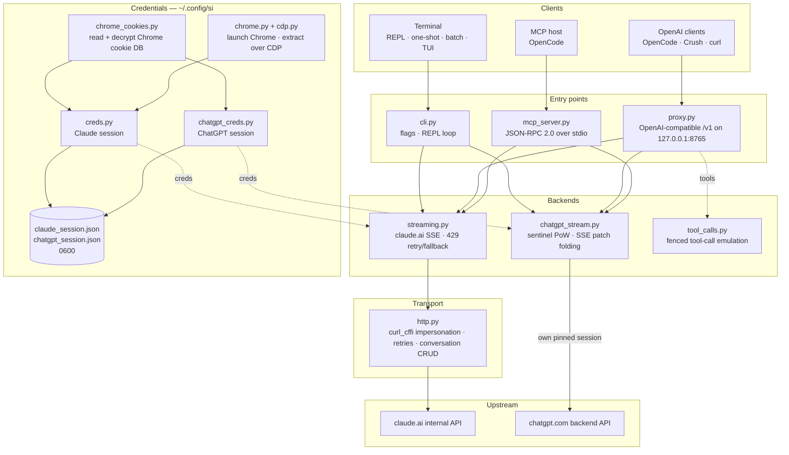

<div align="center">

[English](../../README.md) · [简体中文](README_zh.md) · [繁體中文](README_zh-TW.md) · [日本語](README_ja.md) · [한국어](README_ko.md) · [Türkçe](README_tr.md) · [Русский](README_ru.md) · [Tiếng Việt](README_vi.md) · [ไทย](README_th.md) · [Deutsch](README_de.md) · [Español](README_es.md) · [Français](README_fr.md) · [Українська](README_uk.md) · [Polski](README_pl.md) · [Português (Brasil)](README_pt-BR.md) · [العربية](README_ar.md) · [فارسی](README_fa.md) · **Bahasa Indonesia** · [Italiano](README_it.md)
· [Ελληνικά](README_el.md) · [മലയാളം](README_ml.md)

# Reclaude

</div>

Klien terminal untuk Claude.ai dan ChatGPT — memutar ulang sesi browser Anda sendiri ke endpoint internal mereka dan melakukan streaming balasan token demi token. Tanpa API key.

> Alat riset. Alat ini berjalan di bawah akun Claude.ai Anda: batas, tier, dan penagihannya tetap berlaku. Alat ini tidak melewati rate limit atau paywall.

> [!WARNING]
> **Jangan gunakan akun utama Anda.** si mengendalikan claude.ai dan chatgpt.com melalui sesi browser Anda sendiri — perilaku yang dapat membuat akun dibatasi atau diblokir. Gunakan akun sekali pakai yang siap Anda kehilangan, jangan pernah akun yang terhubung ke email, penagihan, atau pekerjaan Anda.

## Demo


Dengan proxy berjalan, `si/haiku` muncul di pemilih `/models` OpenCode seperti provider lain. Pilih, tanyakan, lalu saksikan balasan masuk secara streaming — semuanya melalui sesi Claude.ai Anda, tanpa API key.

## Arsitektur

si terdiri dari tiga permukaan tipis — klien terminal, proxy yang kompatibel dengan OpenAI, dan server MCP — di atas sepasang backend streaming.



Sebuah permintaan melewati empat lapisan:

1. **Kredensial** — `--from-chrome` membaca basis data cookie browser dan mendekripsinya dengan keyring OS (`chrome_cookies.py`); `--auto-fetch` meluncurkan Chrome asli dan mengambil cookie beserta org id melalui CDP (`chrome.py`, `cdp.py`). Sesi disimpan di `~/.config/si/*.json` (`0600`). Server MCP membacanya ulang pada setiap panggilan (tidak perlu restart setelah login ulang); proxy memuatnya saat startup, jadi restart proxy setelah login ulang.
2. **Titik masuk** — `cli.py` mem-parsing flag dan menjalankan mode REPL/one-shot/batch; `proxy.py` menyajikan `/v1/models` dan `/v1/chat/completions`; `mcp_server.py` menjawab `tools/call` untuk `claude_ask` / `chatgpt_ask`. Proxy merutekan berdasarkan id model (`chatgpt/…` → backend ChatGPT, sisanya → Claude); server MCP mengekspos satu tool per backend.
3. **Backend** — `streaming.py` mengirim POST ke endpoint completion Claude.ai dan menggabungkan delta SSE, dengan retry/fallback 429 yang dibatasi; `chatgpt_stream.py` menjalankan handshake sentinel (proof-of-work + Turnstile) dan menggabungkan SSE snapshot/patch ChatGPT menjadi teks. `tool_calls.py` mengubah blok `tool_call` berpagar menjadi `tool_calls` OpenAI sungguhan, karena kanal tool native Claude.ai membuat deadlock pada client yang hanya bertindak atas respons yang sudah selesai.
4. **Transport** — `http.py` mempertahankan satu sesi `curl_cffi` yang dipatok ke fingerprint TLS Chrome, menangani retry/backoff, dan bertanggung jawab atas pembuatan/penghapusan percakapan. Backend ChatGPT mempertahankan sesi terpatonya sendiri agar kedua fingerprint tidak pernah tercampur.

Status percakapan adalah satu chat sisi server per sesi klien: CLI/TUI menghapusnya saat keluar jika stealth aktif, proxy mengaitkannya dengan `X-Conversation-Id` (menghapus chat one-shot), dan server MCP menyimpan satu per provider selama masa hidupnya.

Helper saat instalasi: `opencode.py` mendaftarkan server MCP melalui `opencode mcp add`; `service.py` memasang LaunchAgent macOS yang mengawasi proxy.

## Instalasi

```bash
git clone https://github.com/two35s/reclaude.git && cd reclaude
python3 -m venv .venv && source .venv/bin/activate
pip install -r requirements.txt
python -m si --opencode   # register the MCP tool with OpenCode (see below)
```

## Login (sekali)

```bash
python -m si --from-chrome   # steal session from your logged-in Chrome (recommended)
python -m si --auto-fetch    # or: launch Chrome, log in, auto-extract over CDP
python -m si --manual        # or: paste org_id + Cookie header by hand
```

Disimpan ke `~/.config/si/claude_session.json` (`600`).

Di Linux, cookie yang dienkripsi Chrome dengan keyring desktop (`v11`) memerlukan `libsecret-tools` terpasang dan keyring tidak terkunci; tanpanya `--from-chrome` menolak profil tersebut alih-alih menyimpan data sampah (gunakan `--auto-fetch` sebagai fallback).

### Kredensial ChatGPT

```bash
python -m si --chatgpt --from-chrome   # steal chatgpt.com session from Chrome
python -m si --chatgpt --manual        # or paste the session-token cookie
python -m si --chatgpt --clear-session # delete stored chatgpt creds
```

Disimpan ke `~/.config/si/chatgpt_session.json` (`600`). Proxy dan server MCP mengambilnya secara otomatis; model berawalan `chatgpt/` kemudian muncul berdampingan dengan model claude. Jalankan ulang `--chatgpt --from-chrome` saat permintaan mengembalikan `401`.

## Chat

```bash
python -m si                 # REPL
python -m si --tui           # full-screen chat
python -m si --prompt "..."  # one shot
python -m si --model haiku   # haiku | sonnet (default) | opus | fable …
```

Perintah TUI: `/new` `/model [name]` `/models` `/help` `/quit`.
Perintah REPL: sama, ditambah `/stealth on|off` `/cleanup` `/clear-session`.

Satu percakapan sisi server per sesi memberikan memori multi-turn; mode stealth menghapusnya saat keluar sehingga tidak pernah muncul di sidebar browser Anda (`--no-stealth` untuk menyimpannya).

## Proxy

```bash
python -m si --proxy                 # OpenAI-compatible API on :8765
python -m si --proxy --port 9000
python -m si --proxy &               # run in the background
```

Proxy harus berjalan agar client dapat melihat model — jika proxy berhenti, setiap permintaan gagal dengan `ConnectionRefused`. Di macOS, `python -m si --install-service` memasang agen launchd yang menjalankannya saat login dan me-restart-nya jika berhenti (`--uninstall-service` menghapusnya; log masuk ke `~/Library/Logs/si-proxy.log`).

Arahkan [Crush](https://github.com/charmbracelet/crush), [OpenCode](https://opencode.ai), atau client OpenAI mana pun ke `http://localhost:8765/v1`.

Permintaan streaming (`text/event-stream`) dan non-streaming keduanya didukung. Setiap balasan yang di-streaming juga ditulis ke `~/.config/si/last_response.txt` — berguna saat client tidak menampilkan apa pun. Stream yang berakhir tanpa event terminalnya dilaporkan sebagai error upstream, bukan dilewatkan sebagai balasan lengkap.

Saat `429`, proxy mengembalikan error tersebut alih-alih diam-diam menurunkan Anda ke model yang lebih lemah — retry dan pemilihan model adalah urusan client (OpenCode melakukan retry sendiri).

### Model ChatGPT

Dengan kredensial ChatGPT tersimpan (lihat di atas), `--proxy` juga menyajikan model `chatgpt/<slug>` — `chatgpt/auto`, `chatgpt/gpt-6`, `chatgpt/gpt-6-mini`, … — melalui endpoint `/v1` yang sama, berdampingan dengan model claude. Satu proxy melayani kedua provider sekaligus; `/v1/models` mencantumkan semuanya.

```bash
curl http://localhost:8765/v1/chat/completions \
  -d '{"model": "chatgpt/auto", "messages": [{"role": "user", "content": "hi"}]}'
```

Memori multi-turn bekerja dengan cara yang sama: kirim header `X-Conversation-Id` dan giliran-giliran berbagi satu percakapan ChatGPT (field `user` milik OpenAI tidak digunakan — field itu mengidentifikasi pengguna akhir, bukan percakapan). Status percakapan dikaitkan per backend, jadi menggunakan satu key yang sama di model `si/` dan `chatgpt/` tetap memisahkannya. Permintaan tanpa header bersifat independen, dan percakapan sisi servernya dihapus setelahnya. Tool calling, streaming, dan perilaku `429`-yang-tampil-sebagai-error semuanya berlaku. Tanpa kredensial ChatGPT tersimpan, permintaan `chatgpt/` mengembalikan `400` yang jelas.

Permintaan membawa account id fallback di header sentinel untuk sesi yang endpoint auth-nya tidak menyediakannya. Setel `SI_CHATGPT_ACCOUNT_ID` ke milik Anda sendiri; nilai ini belum diverifikasi untuk akun lain — jika akun gratis baru mengalami penolakan sentinel yang tidak dijelaskan, mulailah dari sini. Saat sentinel tidak menerbitkan token Turnstile, si membaca token yang sudah ditangkap dari `SI_CHATGPT_TURNSTILE` atau `~/.config/si/chatgpt_turnstile.txt`; token itu adalah data sesi dan tidak di-commit.

**Tool calling berfungsi.** `tools` milik OpenAI diemulasikan dalam teks: proxy menambahkan spesifikasi tool ke prompt, meminta model mengeluarkan blok `tool_call` berpagar, dan mengubahnya menjadi `tool_calls` OpenAI sungguhan di respons. Kirim hasilnya kembali sebagai pesan `tool` pada permintaan berikutnya dan model melanjutkan. (Kanal tool native Claude.ai membiarkan stream terbuka menunggu hasil, yang membuat deadlock pada client yang hanya bertindak atas respons yang sudah selesai — jadi proxy tidak menggunakannya.) Untuk backend `chatgpt/`, blok protokol memimpin prompt, karena permukaan itu jika tidak akan menjawab "I can't reach that workspace" alih-alih mengeluarkan pagar; balasan yang membawa tool tetapi masih diawali penolakan semacam itu dicoba ulang sekali dalam percakapan baru sebelum ditampilkan.

### Gunakan sebagai model OpenCode biasa

Dengan proxy berjalan, `si/sonnet`, `si/haiku`, dan `si/opus` muncul di pemilih `/models` OpenCode seperti provider lain. Pilih salah satu dan mengobrollah seperti biasa — tool (read/edit/bash), streaming, dan multi-turn semuanya bekerja melalui akun Claude.ai Anda.

`python -m si --opencode` mencetak blok `providers` yang siap ditempel untuk konfigurasi global Anda. Atau tempel secara manual:

```jsonc
{
  "providers": {
    "si": {
      "name": "si",
      "package": "@opencode/ai/providers/openai-compatible",
      "settings": { "baseURL": "http://localhost:8765/v1" },
      "models": {
        "sonnet": { "name": "Claude Sonnet", "modelID": "si/sonnet" },
        "haiku": { "name": "Claude Haiku", "modelID": "si/haiku" },
        "opus": { "name": "Claude Opus", "modelID": "si/opus" }
      }
    }
  }
}
```

## Server MCP OpenCode

Ekspos si ke [OpenCode](https://opencode.ai) sebagai tool native (`claude_ask`, `chatgpt_ask`) tanpa menjadikannya provider model Anda — OpenCode tetap memakai modelnya sendiri yang mendukung tool dan dapat memanggil Claude.ai atau ChatGPT melalui si saat Anda memintanya.

Pasang dengan satu perintah, dijalankan dari checkout ini:

```bash
python -m si --opencode
```

Perintah itu memanggil `opencode mcp add` milik OpenCode sendiri, sehingga konfigurasi Anda yang ada (termasuk komentar) tetap terjaga. Restart OpenCode, lalu periksa `opencode mcp list`.

Model Anda kemudian dapat memanggil `claude_ask(prompt, model="sonnet")`; `model` menerima alias (`sonnet`, `haiku`, `opus`) atau id model lengkap. `chatgpt_ask(prompt, model="auto")` melakukan hal yang sama melalui ChatGPT (memerlukan kredensial ChatGPT tersimpan; `model` menerima slug chatgpt.com seperti `auto`, `gpt-6`, `gpt-6-mini`).

<details>
<summary>Atau tambahkan secara manual</summary>

```jsonc
{
  "mcp": {
    "servers": {
      "si": {
        "type": "local",
        "command": ["/absolute/path/to/si/.venv/bin/python", "-m", "si.mcp_server"],
        "environment": { "PYTHONPATH": "/absolute/path/to/si" }
      }
    }
  }
}
```

`PYTHONPATH`-lah yang membuat modul dapat diimpor dari direktori kerja mana pun, jadi `cwd` tidak diperlukan.

</details>

Periksa handshake secara mandiri:

```bash
printf '{"jsonrpc":"2.0","id":1,"method":"tools/list"}\n' | .venv/bin/python -m si.mcp_server
```

Catatan:

- **Percakapan bersama.** Semua panggilan `claude_ask` menggunakan ulang satu percakapan Claude.ai, dan semua panggilan `chatgpt_ask` satu percakapan ChatGPT, selama masa hidup server, sehingga tindak lanjut tetap membawa konteks. Keduanya tidak dihapus secara stealth dan keduanya muncul di sidebar masing-masing hingga Anda menghapusnya.
- **Diagnostik di stderr.** Output progres/error si dikirim ke stderr, sehingga tidak pernah merusak aliran protokol MCP di stdout.
- **Keterbatasan.** Passthrough hanya teks — tanpa output gambar, dan tidak ada tool call yang kembali. Permintaan berjalan di bawah akun Anda sendiri, jadi batas paket berlaku. Satu panggilan dapat memakan waktu hingga timeout HTTP (120 dtk), lebih lama saat terkena rate limit. `chatgpt_ask` menghasilkan error yang bersih saat kredensial ChatGPT tidak ada atau giliran ditolak (kuota, rate limit).
- **Pemecahan masalah.** `Session invalid or expired` → jalankan ulang `python -m si --auto-fetch` (Claude) atau `--chatgpt --from-chrome` (ChatGPT); panggilan berikutnya mengambil kredensial baru (tidak perlu restart). Jika tool tidak muncul, periksa log MCP OpenCode dan pastikan path venv di `command` bersifat absolut dan benar.

## Flag lainnya

`--batch FILE` satu prompt per baris → `~/.config/si/batch_results.json` · `--jailbreak FILE` prompt dari file · `--org-id/--cookie` kredensial inline · `--clear-session` hapus kredensial · `--login` simpan profil Chrome tanpa mengekstrak · `--opencode` daftarkan tool MCP ke OpenCode dan cetak konfigurasi provider.

## Jika bermasalah

| Gejala | Perbaikan |
|---|---|
| `Session invalid or expired` | jalankan ulang `--from-chrome` atau `--auto-fetch` |
| ChatGPT `401` / no accessToken | jalankan ulang `--chatgpt --from-chrome` |
| ChatGPT `prepare`/`finalize` failed | handshake sentinel berubah di upstream; perbarui si |
| `429` rate limited | tunggu, atau ganti model (`/model haiku` di CLI/TUI) |
| `ConnectionRefused` pada semua model | proxy tidak berjalan — jalankan `python -m si --proxy`, atau `--install-service` di macOS |
| Keychain prompt | klik **Always Allow**, coba lagi |

## Keamanan

`sessionKey` Anda dan token sesi ChatGPT adalah kata sandi: jangan pernah bagikan, unggah, atau commit file kredensial tersebut. Jalankan `--clear-session` (dan `--chatgpt --clear-session`) setelah selesai; jika terekspos, logout di browser untuk membatalkannya.

Proxy mendengarkan di `127.0.0.1` tanpa autentikasi kecuali `SI_PROXY_TOKEN` disetel. Di Mac yang dipakai bersama, pengguna atau proses lokal lain yang dapat menjangkau port 8765 dapat menghabiskan kuota akun Anda; setel token (dan berikan ke client) atau matikan proxy saat tidak digunakan. Plist LaunchAgent macOS ditulis `600` karena membawa token saat token disetel.

Backend ChatGPT mengendalikan API internal chatgpt.com dengan sesi browser Anda sendiri. Itu melanggar ketentuan layanan OpenAI dan dapat membuat akun dibatasi atau diblokir — gunakan akun sekali pakai, dengan risiko Anda sendiri.

## Pengembangan

```bash
pip install -r requirements-dev.txt
PYTHONPATH=. .venv/bin/python -m pytest -q   # tests
.venv/bin/python -m ruff check .             # lint
.venv/bin/python -m ruff format --check .    # formatting
```

## Lisensi

Hanya untuk penggunaan riset dan pendidikan. Tanpa jaminan.
