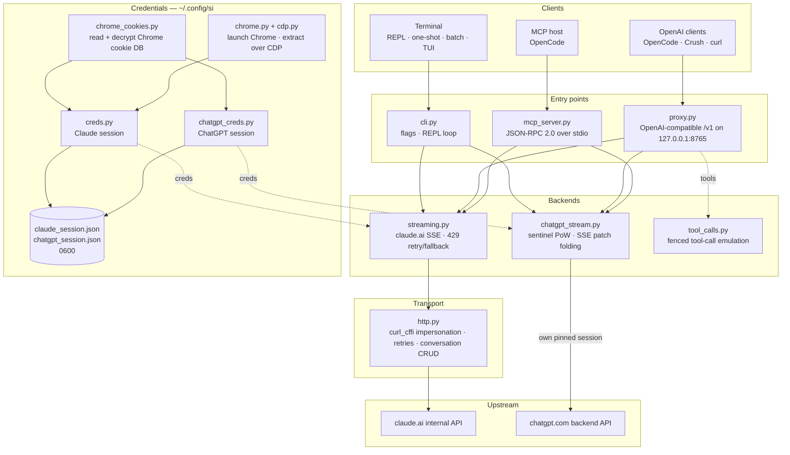

<div align="center">

[English](../../README.md) · [简体中文](README_zh.md) · [繁體中文](README_zh-TW.md) · [日本語](README_ja.md) · [한국어](README_ko.md) · [Türkçe](README_tr.md) · [Русский](README_ru.md) · [Tiếng Việt](README_vi.md) · [ไทย](README_th.md) · [Deutsch](README_de.md) · [Español](README_es.md) · [Français](README_fr.md) · [Українська](README_uk.md) · [Polski](README_pl.md) · [Português (Brasil)](README_pt-BR.md) · [العربية](README_ar.md) · [فارسی](README_fa.md) · [Bahasa Indonesia](README_id.md) · **Italiano**
· [Ελληνικά](README_el.md) · [മലയാളം](README_ml.md)

# Reclaude

</div>

Client da terminale per Claude.ai e ChatGPT — riproduce la tua sessione browser sui loro endpoint interni e trasmette le risposte in streaming token per token. Nessuna chiave API.

> Strumento di ricerca. Funziona sotto il tuo account Claude.ai: i suoi limiti, i piani e la fatturazione si applicano comunque. Non aggira i limiti di frequenza né i paywall.

> [!WARNING]
> **Non usare il tuo account principale.** si pilota claude.ai e chatgpt.com attraverso la tua sessione browser — un comportamento che può far limitare o bannare l'account. Usa un account usa e getta che puoi permetterti di perdere, mai uno legato alla tua email, alla fatturazione o al lavoro.

## Demo


Con il proxy in esecuzione, `si/haiku` compare nel selettore `/models` di OpenCode come qualsiasi altro provider. Selezionalo, fai una domanda, guarda la risposta arrivare in streaming — tutto tramite la tua sessione Claude.ai, senza chiave API.

## Architettura

si è tre superfici sottili — un client da terminale, un proxy compatibile OpenAI e un server MCP — sopra un'unica coppia di backend in streaming.



Una richiesta attraversa quattro livelli:

1. **Credenziali** — `--from-chrome` legge il database dei cookie del browser e lo decifra con il portachiavi del sistema operativo (`chrome_cookies.py`); `--auto-fetch` avvia Chrome reale e recupera i cookie più l'id dell'organizzazione tramite CDP (`chrome.py`, `cdp.py`). Le sessioni finiscono in `~/.config/si/*.json` (`0600`). Il server MCP le rilegge a ogni chiamata (nessun riavvio dopo un nuovo accesso); il proxy le carica all'avvio, quindi riavvialo dopo un nuovo accesso.
2. **Punti di ingresso** — `cli.py` analizza i flag ed esegue le modalità REPL/one-shot/batch; `proxy.py` serve `/v1/models` e `/v1/chat/completions`; `mcp_server.py` risponde a `tools/call` per `claude_ask` / `chatgpt_ask`. Il proxy instrada in base all'id del modello (`chatgpt/…` → backend ChatGPT, tutto il resto → Claude); il server MCP espone uno strumento per backend.
3. **Backend** — `streaming.py` invia richieste all'endpoint di completamento di Claude.ai e aggrega i delta SSE, con tentativi/fallback limitati sui 429; `chatgpt_stream.py` esegue l'handshake sentinel (proof-of-work + Turnstile) e converte gli SSE snapshot/patch di ChatGPT in testo. `tool_calls.py` trasforma i blocchi `tool_call` delimitati in veri `tool_calls` OpenAI, perché il canale nativo degli strumenti di Claude.ai blocca i client che agiscono solo sulle risposte completate.
4. **Trasporto** — `http.py` mantiene un'unica sessione `curl_cffi` ancorata a un'impronta TLS di Chrome, gestisce tentativi/backoff ed è responsabile della creazione/eliminazione delle conversazioni. Il backend ChatGPT mantiene una propria sessione ancorata, così le due impronte non si mescolano mai.

Lo stato della conversazione è una chat lato server per sessione client: la CLI/TUI la elimina all'uscita quando lo stealth è attivo, il proxy la indicizza tramite `X-Conversation-Id` (eliminando le chat one-shot) e il server MCP ne mantiene una per provider per tutta la sua durata.

Helper in fase di installazione: `opencode.py` registra il server MCP tramite `opencode mcp add`; `service.py` installa il LaunchAgent macOS che supervisiona il proxy.

## Installazione

```bash
git clone https://github.com/two35s/reclaude.git && cd reclaude
python3 -m venv .venv && source .venv/bin/activate
pip install -r requirements.txt
python -m si --opencode   # register the MCP tool with OpenCode (see below)
```

## Accesso (una volta sola)

```bash
python -m si --from-chrome   # steal session from your logged-in Chrome (recommended)
python -m si --auto-fetch    # or: launch Chrome, log in, auto-extract over CDP
python -m si --manual        # or: paste org_id + Cookie header by hand
```

Salva in `~/.config/si/claude_session.json` (`600`).

Su Linux, i cookie cifrati da Chrome con il portachiavi del desktop (`v11`) richiedono `libsecret-tools` installato e il portachiavi sbloccato; senza di essi `--from-chrome` rifiuta il profilo invece di salvare dati corrotti (usa `--auto-fetch` come fallback).

### Credenziali ChatGPT

```bash
python -m si --chatgpt --from-chrome   # steal chatgpt.com session from Chrome
python -m si --chatgpt --manual        # or paste the session-token cookie
python -m si --chatgpt --clear-session # delete stored chatgpt creds
```

Salva in `~/.config/si/chatgpt_session.json` (`600`). Il proxy e il server MCP le rilevano automaticamente; un modello con prefisso `chatgpt/` compare quindi accanto a quelli claude. Riesegui `--chatgpt --from-chrome` quando le richieste restituiscono `401`.

## Chat

```bash
python -m si                 # REPL
python -m si --tui           # full-screen chat
python -m si --prompt "..."  # one shot
python -m si --model haiku   # haiku | sonnet (default) | opus | fable …
```

Comandi TUI: `/new` `/model [name]` `/models` `/help` `/quit`.
Comandi REPL: gli stessi, più `/stealth on|off` `/cleanup` `/clear-session`.

Una conversazione lato server per sessione garantisce la memoria multi-turno; la modalità stealth la elimina all'uscita, così non appare mai nella barra laterale del browser (`--no-stealth` per conservarla).

## Proxy

```bash
python -m si --proxy                 # OpenAI-compatible API on :8765
python -m si --proxy --port 9000
python -m si --proxy &               # run in the background
```

Il proxy deve essere in esecuzione perché i client vedano i modelli — se termina, ogni richiesta fallisce con `ConnectionRefused`. Su macOS, `python -m si --install-service` installa un agente launchd che lo avvia all'accesso e lo riavvia se termina (`--uninstall-service` lo rimuove; i log vanno in `~/Library/Logs/si-proxy.log`).

Punta [Crush](https://github.com/charmbracelet/crush), [OpenCode](https://opencode.ai) o qualsiasi client OpenAI su `http://localhost:8765/v1`.

Sono supportate sia le richieste in streaming (`text/event-stream`) sia quelle non in streaming. Ogni risposta in streaming viene anche scritta in `~/.config/si/last_response.txt` — comodo quando un client non mostra nulla. Uno stream che termina senza il suo evento finale viene segnalato come errore upstream invece di essere spacciato per una risposta completa.

In caso di `429` il proxy restituisce l'errore invece di degradarti silenziosamente a un modello più debole — i tentativi e la scelta del modello spettano al client (OpenCode riprova da solo).

### Modelli ChatGPT

Con le credenziali ChatGPT salvate (vedi sopra), `--proxy` serve anche i modelli `chatgpt/<slug>` — `chatgpt/auto`, `chatgpt/gpt-6`, `chatgpt/gpt-6-mini`, … — attraverso lo stesso endpoint `/v1`, accanto a quelli claude. Un solo proxy serve entrambi i provider contemporaneamente; `/v1/models` elenca tutto.

```bash
curl http://localhost:8765/v1/chat/completions \
  -d '{"model": "chatgpt/auto", "messages": [{"role": "user", "content": "hi"}]}'
```

La memoria multi-turno funziona allo stesso modo: invia un header `X-Conversation-Id` e i turni condividono un'unica conversazione ChatGPT (il campo `user` di OpenAI non viene usato — identifica un utente finale, non una conversazione). Lo stato della conversazione è indicizzato per backend, quindi riutilizzare la stessa chiave tra modelli `si/` e `chatgpt/` li mantiene separati. Le richieste senza l'header sono indipendenti e la loro conversazione lato server viene eliminata in seguito. La chiamata degli strumenti, lo streaming e il comportamento che espone i `429` come errori valgono in entrambi i casi. Senza credenziali ChatGPT salvate, una richiesta `chatgpt/` restituisce invece un chiaro `400`.

Le richieste portano un id account di riserva negli header sentinel, per le sessioni in cui l'endpoint di autenticazione non ne fornisce uno. Imposta `SI_CHATGPT_ACCOUNT_ID` sul tuo; non è verificato per altri account — se un account gratuito appena creato incontra rifiuti sentinel inspiegabili, parti da lì. Quando il sentinel non genera un token Turnstile, si ne legge uno catturato da `SI_CHATGPT_TURNSTILE` o `~/.config/si/chatgpt_turnstile.txt`; il token è un dato di sessione e non viene committato.

**La chiamata degli strumenti funziona.** I `tools` di OpenAI sono emulati nel testo: il proxy aggiunge le specifiche degli strumenti al prompt, chiede al modello di emettere blocchi `tool_call` delimitati e li converte in veri `tool_calls` OpenAI nella risposta. Invia i risultati come messaggi `tool` nella richiesta successiva e il modello continua. (Il canale nativo degli strumenti di Claude.ai tiene lo stream aperto in attesa di un risultato, il che blocca i client che agiscono solo sulle risposte completate — per questo il proxy non lo usa.) Per il backend `chatgpt/` il blocco del protocollo apre il prompt, dato che quella superficie altrimenti risponde "non riesco a raggiungere quel workspace" invece di emettere un fence; una risposta con strumenti che si apre ancora con un simile rifiuto viene ritentata una volta in una conversazione nuova prima di essere mostrata.

### Usalo come un normale modello OpenCode

Con il proxy in esecuzione, `si/sonnet`, `si/haiku` e `si/opus` compaiono nel selettore `/models` di OpenCode come qualsiasi altro provider. Selezionane uno e chatta normalmente — strumenti (read/edit/bash), streaming e multi-turno funzionano tutti tramite il tuo account Claude.ai.

`python -m si --opencode` stampa il blocco `providers` pronto da incollare per la tua configurazione globale. Oppure incollalo a mano:

```jsonc
{
  "providers": {
    "si": {
      "name": "si",
      "package": "@opencode/ai/providers/openai-compatible",
      "settings": { "baseURL": "http://localhost:8765/v1" },
      "models": {
        "sonnet": { "name": "Claude Sonnet", "modelID": "si/sonnet" },
        "haiku": { "name": "Claude Haiku", "modelID": "si/haiku" },
        "opus": { "name": "Claude Opus", "modelID": "si/opus" }
      }
    }
  }
}
```

## Server MCP OpenCode

Espone si a [OpenCode](https://opencode.ai) come strumento nativo (`claude_ask`, `chatgpt_ask`) senza renderlo il tuo provider di modelli — OpenCode mantiene il proprio modello in grado di usare strumenti e può chiamare Claude.ai o ChatGPT tramite si quando glielo chiedi.

Installalo con un solo comando, eseguito da questo checkout:

```bash
python -m si --opencode
```

Questo chiama il comando `opencode mcp add` di OpenCode, quindi la tua configurazione esistente (commenti inclusi) viene preservata. Riavvia OpenCode, poi controlla `opencode mcp list`.

Il tuo modello può quindi chiamare `claude_ask(prompt, model="sonnet")`; `model` accetta alias (`sonnet`, `haiku`, `opus`) o un id di modello completo. `chatgpt_ask(prompt, model="auto")` fa lo stesso tramite ChatGPT (richiede credenziali ChatGPT salvate; `model` accetta uno slug di chatgpt.com come `auto`, `gpt-6`, `gpt-6-mini`).

<details>
<summary>Oppure aggiungilo a mano</summary>

```jsonc
{
  "mcp": {
    "servers": {
      "si": {
        "type": "local",
        "command": ["/absolute/path/to/si/.venv/bin/python", "-m", "si.mcp_server"],
        "environment": { "PYTHONPATH": "/absolute/path/to/si" }
      }
    }
  }
}
```

`PYTHONPATH` è ciò che rende il modulo importabile da qualsiasi directory di lavoro, quindi non serve alcun `cwd`.

</details>

Verifica l'handshake in modo autonomo:

```bash
printf '{"jsonrpc":"2.0","id":1,"method":"tools/list"}\n' | .venv/bin/python -m si.mcp_server
```

Note:

- **Conversazioni condivise.** Tutte le chiamate `claude_ask` riutilizzano un'unica conversazione Claude.ai, e tutte le chiamate `chatgpt_ask` un'unica conversazione ChatGPT, per tutta la durata del server, così i follow-up mantengono il contesto. Nessuna delle due viene eliminata in modalità stealth e entrambe compaiono nella rispettiva barra laterale finché non le rimuovi.
- **Diagnostica su stderr.** L'output di avanzamento/errori di si va su stderr, quindi non corrompe mai il flusso del protocollo MCP su stdout.
- **Limitazioni.** Passthrough solo testo — nessun output di immagini e nessuna chiamata di strumenti in risposta. Le richieste girano sotto i tuoi account, quindi si applicano i limiti del piano. Una chiamata può richiedere fino al timeout HTTP (120 s), di più in caso di limitazione di frequenza. `chatgpt_ask` restituisce un errore pulito quando mancano le credenziali ChatGPT o il turno viene rifiutato (quota, limite di frequenza).
- **Risoluzione dei problemi.** `Session invalid or expired` → riesegui `python -m si --auto-fetch` (Claude) o `--chatgpt --from-chrome` (ChatGPT); la chiamata successiva rileva le nuove credenziali (nessun riavvio necessario). Se lo strumento manca, controlla i log MCP di OpenCode e che il percorso del venv in `command` sia assoluto e corretto.

## Altri flag

`--batch FILE` un prompt per riga → `~/.config/si/batch_results.json` · `--jailbreak FILE` prompt da file · `--org-id/--cookie` credenziali inline · `--clear-session` cancella le credenziali · `--login` salva un profilo Chrome senza estrarre · `--opencode` registra lo strumento MCP con OpenCode e stampa la configurazione del provider.

## Se si rompe

| Sintomo | Soluzione |
|---|---|
| `Session invalid or expired` | riesegui `--from-chrome` o `--auto-fetch` |
| ChatGPT `401` / nessun accessToken | riesegui `--chatgpt --from-chrome` |
| ChatGPT `prepare`/`finalize` non riuscito | l'handshake sentinel è cambiato a monte; aggiorna si |
| `429` limite di frequenza | attendi, o cambia modello (`/model haiku` nella CLI/TUI) |
| `ConnectionRefused` su ogni modello | proxy non in esecuzione — avvia `python -m si --proxy`, oppure `--install-service` su macOS |
| Richiesta del portachiavi | clicca **Consenti sempre**, riprova |

## Sicurezza

Il tuo `sessionKey` e il token di sessione ChatGPT sono password: non condividere, caricare o committare mai i file delle credenziali. Usa `--clear-session` (e `--chatgpt --clear-session`) quando hai finito; se sono stati esposti, esci dal browser per invalidarli.

Il proxy ascolta su `127.0.0.1` senza autenticazione, a meno che `SI_PROXY_TOKEN` sia impostato. Su un Mac condiviso, un altro utente o processo locale che riesca a raggiungere la porta 8765 può consumare la quota del tuo account; imposta il token (e forniscilo al client) oppure tieni il proxy spento quando non lo usi. Il plist del LaunchAgent macOS viene scritto con permessi `600` perché contiene il token quando ne è impostato uno.

Il backend ChatGPT pilota l'API interna di chatgpt.com con la tua sessione browser. Ciò viola i termini di servizio di OpenAI e può far limitare o bannare l'account — usa un account usa e getta, a tuo rischio.

## Sviluppo

```bash
pip install -r requirements-dev.txt
PYTHONPATH=. .venv/bin/python -m pytest -q   # tests
.venv/bin/python -m ruff check .             # lint
.venv/bin/python -m ruff format --check .    # formatting
```

## Licenza

Solo per uso di ricerca e didattico. Nessuna garanzia.
