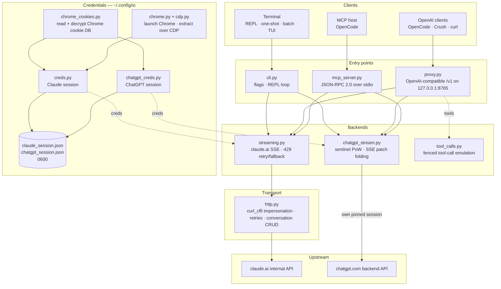

<div align="center">

[English](../../README.md) · [简体中文](README_zh.md) · [繁體中文](README_zh-TW.md) · **日本語** · [한국어](README_ko.md) · [Türkçe](README_tr.md) · [Русский](README_ru.md) · [Tiếng Việt](README_vi.md) · [ไทย](README_th.md) · [Deutsch](README_de.md) · [Español](README_es.md) · [Français](README_fr.md) · [Українська](README_uk.md) · [Polski](README_pl.md) · [Português (Brasil)](README_pt-BR.md) · [العربية](README_ar.md) · [فارسی](README_fa.md) · [Bahasa Indonesia](README_id.md) · [Italiano](README_it.md)
· [Ελληνικά](README_el.md) · [മലയാളം](README_ml.md)

# Reclaude

</div>

Claude.ai と ChatGPT のターミナルクライアント — 自分のブラウザセッションを彼らの内部エンドポイントに対して再生し、返信をトークン単位でストリーミングします。API キーは不要です。

> 研究用ツールです。あなたの Claude.ai アカウントで動作するため、その制限、プラン、課金は引き続き適用されます。レート制限やペイウォールを回避するものではありません。

> [!WARNING]
> **メインアカウントを使わないでください。** si は自分のブラウザセッションを通じて claude.ai と chatgpt.com を操作します — この行為によってアカウントが制限されたり禁止されたりする可能性があります。失っても構わない捨てアカウントを使い、メール、請求、仕事に関連するアカウントは決して使わないでください。

## デモ


プロキシが起動していると、`si/haiku` は他のプロバイダーと同じように OpenCode の `/models` ピッカーに表示されます。それを選んで質問すれば、返信がストリーミングで表示されます — すべてあなたの Claude.ai セッション経由で、API キーは不要です。

## アーキテクチャ

si は 3 つの薄い表面 — ターミナルクライアント、OpenAI 互換プロキシ、MCP サーバー — を、1 対のストリーミングバックエンドの上に載せたものです。



リクエストは 4 つの層を通ります:

1. **認証情報** — `--from-chrome` はブラウザの Cookie DB を読み、OS のキーリングで復号します (`chrome_cookies.py`)。`--auto-fetch` は実際の Chrome を起動し、CDP 経由で Cookie と org id を取得します (`chrome.py`、`cdp.py`)。セッションは `~/.config/si/*.json` (`0600`) に保存されます。MCP サーバーは呼び出しごとに再読み込みします (再ログイン後に再起動は不要)。プロキシは起動時に読み込むため、再ログイン後は再起動してください。
2. **エントリーポイント** — `cli.py` はフラグを解析し、REPL/ワンショット/バッチモードを実行します。`proxy.py` は `/v1/models` と `/v1/chat/completions` を提供します。`mcp_server.py` は `claude_ask` / `chatgpt_ask` に対する `tools/call` に応答します。プロキシはモデル ID でルーティングします (`chatgpt/…` → ChatGPT バックエンド、それ以外はすべて Claude)。MCP サーバーはバックエンドごとに 1 つのツールを公開します。
3. **バックエンド** — `streaming.py` は Claude.ai の補完エンドポイントに POST し、SSE デルタを畳み込みます。429 の再試行/フォールバックには上限があります。`chatgpt_stream.py` は sentinel ハンドシェイク (proof-of-work + Turnstile) を実行し、ChatGPT のスナップショット/パッチ SSE をテキストに畳み込みます。`tool_calls.py` はフェンス付き `tool_call` ブロックを実際の OpenAI `tool_calls` に変換します。Claude.ai のネイティブツールチャネルは、完了した応答にのみ反応するクライアントをデッドロックさせるためです。
4. **トランスポート** — `http.py` は Chrome の TLS フィンガープリントに固定された 1 つの `curl_cffi` セッションを保持し、再試行/バックオフを処理し、会話の作成/削除を担います。ChatGPT バックエンドは独自の固定セッションを保持するため、2 つのフィンガープリントが混ざることはありません。

会話状態はクライアントセッションごとにサーバー側のチャット 1 つです。CLI/TUI はステルスが有効な場合に終了時にそれを削除し、プロキシは `X-Conversation-Id` でキー付けし (ワンショットチャットは削除)、MCP サーバーは存続期間中プロバイダーごとに 1 つ保持します。

インストール時のヘルパー: `opencode.py` は `opencode mcp add` 経由で MCP サーバーを登録します。`service.py` はプロキシを監督する macOS LaunchAgent をインストールします。

## インストール

```bash
git clone https://github.com/two35s/reclaude.git && cd reclaude
python3 -m venv .venv && source .venv/bin/activate
pip install -r requirements.txt
python -m si --opencode   # register the MCP tool with OpenCode (see below)
```

## ログイン (初回のみ)

```bash
python -m si --from-chrome   # steal session from your logged-in Chrome (recommended)
python -m si --auto-fetch    # or: launch Chrome, log in, auto-extract over CDP
python -m si --manual        # or: paste org_id + Cookie header by hand
```

`~/.config/si/claude_session.json` (`600`) に保存されます。

Linux では、デスクトップキーリングで暗号化された Chrome の Cookie (`v11`) を扱うには、`libsecret-tools` がインストールされ、キーリングがロック解除されている必要があります。これらがない場合、`--from-chrome` はゴミを保存する代わりにプロファイルを拒否します (フォールバックとして `--auto-fetch` を使用してください)。

### ChatGPT の認証情報

```bash
python -m si --chatgpt --from-chrome   # steal chatgpt.com session from Chrome
python -m si --chatgpt --manual        # or paste the session-token cookie
python -m si --chatgpt --clear-session # delete stored chatgpt creds
```

`~/.config/si/chatgpt_session.json` (`600`) に保存されます。プロキシと MCP サーバーはこれらを自動的に読み取ります。すると `chatgpt/` プレフィックス付きのモデルが claude のモデルと並んで表示されます。リクエストが `401` を返すようになったら、`--chatgpt --from-chrome` を再実行してください。

## チャット

```bash
python -m si                 # REPL
python -m si --tui           # full-screen chat
python -m si --prompt "..."  # one shot
python -m si --model haiku   # haiku | sonnet (default) | opus | fable …
```

TUI コマンド: `/new` `/model [name]` `/models` `/help` `/quit`。
REPL コマンド: 同じものに加えて `/stealth on|off` `/cleanup` `/clear-session`。

セッションごとにサーバー側の会話を 1 つ持つことで、マルチターンの記憶が得られます。ステルスモードでは終了時にそれが削除されるため、ブラウザのサイドバーに表示されることはありません (保持するには `--no-stealth`)。

## プロキシ

```bash
python -m si --proxy                 # OpenAI-compatible API on :8765
python -m si --proxy --port 9000
python -m si --proxy &               # run in the background
```

クライアントがモデルを認識するにはプロキシが起動している必要があります — プロキシが終了すると、すべてのリクエストが `ConnectionRefused` で失敗します。macOS では、`python -m si --install-service` がログイン時にプロキシを起動し、終了したら再起動する launchd エージェントをインストールします (`--uninstall-service` で削除、ログは `~/Library/Logs/si-proxy.log` に出力されます)。

[Crush](https://github.com/charmbracelet/crush)、[OpenCode](https://opencode.ai)、または任意の OpenAI クライアントを `http://localhost:8765/v1` に向けてください。

ストリーミング (`text/event-stream`) と非ストリーミングのリクエストの両方がサポートされています。ストリーミングされた返信はすべて `~/.config/si/last_response.txt` にも書き込まれます — クライアントが何も表示しないときに便利です。終端イベントなしで終了したストリームは、完全な返信として扱われず、上流のエラーとして報告されます。

`429` の場合、プロキシは黙って弱いモデルにダウングレードする代わりにエラーを返します — 再試行とモデルの選択はクライアントの役割です (OpenCode は独自に再試行します)。

### ChatGPT モデル

ChatGPT の認証情報が保存されていれば (上記参照)、`--proxy` は claude のモデルに並んで `chatgpt/<slug>` モデルも提供します — `chatgpt/auto`、`chatgpt/gpt-6`、`chatgpt/gpt-6-mini`、… — 同じ `/v1` エンドポイント経由です。1 つのプロキシが両方のプロバイダーを同時に提供し、`/v1/models` がすべてを一覧表示します。

```bash
curl http://localhost:8765/v1/chat/completions \
  -d '{"model": "chatgpt/auto", "messages": [{"role": "user", "content": "hi"}]}'
```

マルチターンの記憶も同じように機能します: `X-Conversation-Id` ヘッダーを送ると、ターンが 1 つの ChatGPT 会話を共有します (OpenAI の `user` フィールドは使用されません — それはエンドユーザーを識別するものであり、会話を識別するものではありません)。会話状態はバックエンドごとにキー付けされるため、同じキーを `si/` と `chatgpt/` のモデルで再利用しても、それらは別々に保たれます。ヘッダーのないリクエストは独立しており、そのサーバー側の会話は後で削除されます。ツール呼び出し、ストリーミング、`429` がエラーとして表面化する動作はすべて適用されます。ChatGPT の認証情報が保存されていない場合、`chatgpt/` リクエストは代わりに明確な `400` を返します。

リクエストは、認証エンドポイントがアカウント ID を提供しないセッションのために、sentinel ヘッダーにフォールバックのアカウント ID を載せます。`SI_CHATGPT_ACCOUNT_ID` を自分のものに設定してください。これは他のアカウントでは検証されていません — 新しい無料アカウントで原因不明の sentinel 拒否に遭遇した場合は、そこから調べてください。sentinel が Turnstile トークンを発行しない場合、si は `SI_CHATGPT_TURNSTILE` または `~/.config/si/chatgpt_turnstile.txt` から取得したトークンを読み取ります。トークンはセッションデータであり、コミットされません。

**ツール呼び出しは機能します。** OpenAI の `tools` はテキスト内でエミュレートされます: プロキシはツール仕様をプロンプトに追加し、モデルにフェンス付き `tool_call` ブロックを出力するよう求め、それらをレスポンス内の実際の OpenAI `tool_calls` に変換します。結果を次のリクエストで `tool` メッセージとして返すと、モデルは続行します。(Claude.ai のネイティブツールチャネルは結果を待ってストリームを開いたままにするため、完了した応答にのみ反応するクライアントをデッドロックさせます — そのためプロキシはそれを使いません。) `chatgpt/` バックエンドではプロトコルブロックがプロンプトの先頭に置かれます。そうしないと、この表面はフェンスを出力する代わりに「そのワークスペースにはアクセスできません」と答えてしまうためです。ツールを含む返信がそれでもそのような拒否で始まる場合は、表示される前に新しい会話で 1 回再試行されます。

### 通常の OpenCode モデルとして使う

プロキシが起動していると、`si/sonnet`、`si/haiku`、`si/opus` が他のプロバイダーと同じように OpenCode の `/models` ピッカーに表示されます。1 つを選んで普通にチャットしてください — ツール (read/edit/bash)、ストリーミング、マルチターンはすべてあなたの Claude.ai アカウントを通じて機能します。

`python -m si --opencode` は、グローバル設定にそのまま貼り付けられる `providers` ブロックを出力します。または手動で貼り付けてもかまいません:

```jsonc
{
  "providers": {
    "si": {
      "name": "si",
      "package": "@opencode/ai/providers/openai-compatible",
      "settings": { "baseURL": "http://localhost:8765/v1" },
      "models": {
        "sonnet": { "name": "Claude Sonnet", "modelID": "si/sonnet" },
        "haiku": { "name": "Claude Haiku", "modelID": "si/haiku" },
        "opus": { "name": "Claude Opus", "modelID": "si/opus" }
      }
    }
  }
}
```

## OpenCode MCP サーバー

si をモデルプロバイダーにせずに、[OpenCode](https://opencode.ai) にネイティブツール (`claude_ask`、`chatgpt_ask`) として公開します — OpenCode は独自のツール対応モデルを保持し、あなたが頼んだときに si 経由で Claude.ai や ChatGPT を呼び出せます。

このチェックアウトから実行する 1 つのコマンドでインストールします:

```bash
python -m si --opencode
```

これは OpenCode 自身の `opencode mcp add` を呼び出すため、既存の設定 (コメントを含む) が保持されます。OpenCode を再起動し、`opencode mcp list` を確認してください。

その後、あなたのモデルは `claude_ask(prompt, model="sonnet")` を呼び出せます。`model` はエイリアス (`sonnet`、`haiku`、`opus`) または完全なモデル ID を受け付けます。`chatgpt_ask(prompt, model="auto")` は ChatGPT 経由で同じことを行います (ChatGPT の認証情報が保存されている必要があります。`model` は `auto`、`gpt-6`、`gpt-6-mini` のような chatgpt.com の slug を受け取ります)。

<details>
<summary>または手動で追加する</summary>

```jsonc
{
  "mcp": {
    "servers": {
      "si": {
        "type": "local",
        "command": ["/absolute/path/to/si/.venv/bin/python", "-m", "si.mcp_server"],
        "environment": { "PYTHONPATH": "/absolute/path/to/si" }
      }
    }
  }
}
```

`PYTHONPATH` があることで、どの作業ディレクトリからでもモジュールをインポートできるため、`cwd` は不要です。

</details>

ハンドシェイクを単体で確認する:

```bash
printf '{"jsonrpc":"2.0","id":1,"method":"tools/list"}\n' | .venv/bin/python -m si.mcp_server
```

メモ:

- **共有される会話。** すべての `claude_ask` 呼び出しは 1 つの Claude.ai 会話を、すべての `chatgpt_ask` 呼び出しは 1 つの ChatGPT 会話を、サーバーの存続期間中再利用するため、フォローアップでも文脈が保たれます。どちらもステルス削除されず、削除するまでそれぞれのサイドバーに表示されます。
- **stderr への診断。** si の進捗/エラー出力は stderr に送られるため、stdout 上の MCP プロトコルストリームを壊すことはありません。
- **制限事項。** テキストのみのパススルーです — 画像出力はなく、ツール呼び出しも返されません。リクエストはあなた自身のアカウントで実行されるため、プランの制限が適用されます。1 回の呼び出しは HTTP タイムアウト (120 秒) までかかり、レート制限下ではさらに長くなる場合があります。`chatgpt_ask` は、ChatGPT の認証情報がない場合やターンが拒否された場合 (クォータ、レート制限) にクリーンにエラーを返します。
- **トラブルシューティング。** `Session invalid or expired` → `python -m si --auto-fetch` (Claude) または `--chatgpt --from-chrome` (ChatGPT) を再実行してください。次の呼び出しで新しい認証情報が読み込まれます (再起動は不要)。ツールが見つからない場合は、OpenCode の MCP ログと、`command` 内の venv パスが絶対パスで正しいことを確認してください。

## その他のフラグ

`--batch FILE` 1 行に 1 プロンプト → `~/.config/si/batch_results.json` · `--jailbreak FILE` ファイルからプロンプトを読み込む · `--org-id/--cookie` 認証情報をインラインで指定 · `--clear-session` 認証情報を消去 · `--login` 抽出せずに Chrome プロファイルを保存 · `--opencode` MCP ツールを OpenCode に登録し、プロバイダー設定を出力。

## 壊れたときの対処

| 症状 | 対処 |
|---|---|
| `Session invalid or expired` | `--from-chrome` または `--auto-fetch` を再実行 |
| ChatGPT `401` / no accessToken | `--chatgpt --from-chrome` を再実行 |
| ChatGPT `prepare`/`finalize` failed | sentinel ハンドシェイクが上流で変更されました。si を更新してください |
| `429` rate limited | 待つか、モデルを切り替えてください (CLI/TUI で `/model haiku`) |
| `ConnectionRefused` on every model | プロキシが起動していません — `python -m si --proxy` を起動するか、macOS では `--install-service` |
| Keychain prompt | **Always Allow** をクリックして再試行 |

## セキュリティ

あなたの `sessionKey` と ChatGPT のセッショントークンはパスワードです: 認証情報ファイルを共有、アップロード、コミットしないでください。終了したら `--clear-session` (および `--chatgpt --clear-session`) を実行してください。漏洩した場合は、ブラウザでログアウトして無効化してください。

プロキシは、`SI_PROXY_TOKEN` が設定されていない限り、認証なしで `127.0.0.1` で待ち受けます。共有の Mac では、ポート 8765 に到達できる別のローカルユーザーやプロセスがあなたのアカウントのクォータを消費できます。トークンを設定する (そしてクライアントに渡す) か、使用していないときはプロキシを停止しておいてください。macOS の LaunchAgent plist は、トークンが設定されている場合にそれを含むため、`600` で書き込まれます。

ChatGPT バックエンドは、あなた自身のブラウザセッションで chatgpt.com の内部 API を操作します。これは OpenAI の利用規約に違反し、アカウントが制限または禁止される可能性があります — 捨てアカウントを使い、自己責任で行ってください。

## 開発

```bash
pip install -r requirements-dev.txt
PYTHONPATH=. .venv/bin/python -m pytest -q   # tests
.venv/bin/python -m ruff check .             # lint
.venv/bin/python -m ruff format --check .    # formatting
```

## ライセンス

研究および教育目的のみ。保証はありません。
