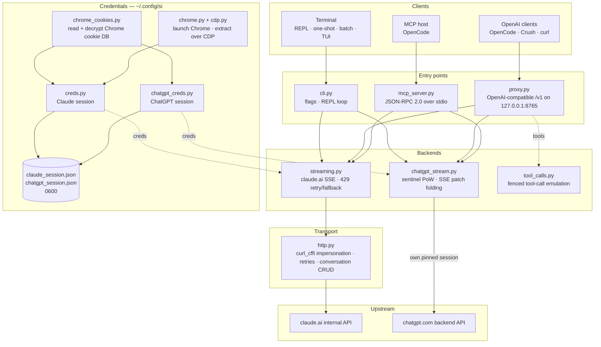

<div align="center">

[English](../../README.md) · [简体中文](README_zh.md) · [繁體中文](README_zh-TW.md) · [日本語](README_ja.md) · **한국어** · [Türkçe](README_tr.md) · [Русский](README_ru.md) · [Tiếng Việt](README_vi.md) · [ไทย](README_th.md) · [Deutsch](README_de.md) · [Español](README_es.md) · [Français](README_fr.md) · [Українська](README_uk.md) · [Polski](README_pl.md) · [Português (Brasil)](README_pt-BR.md) · [العربية](README_ar.md) · [فارسی](README_fa.md) · [Bahasa Indonesia](README_id.md) · [Italiano](README_it.md)
· [Ελληνικά](README_el.md) · [മലയാളം](README_ml.md)

# Reclaude

</div>

Claude.ai와 ChatGPT를 위한 터미널 클라이언트 — 자신의 브라우저 세션으로 그들의 내부 엔드포인트에 요청을 보내고 응답을 토큰 단위로 스트리밍합니다. API 키가 필요 없습니다.

> 연구용 도구입니다. 이 도구는 당신의 Claude.ai 계정으로 실행되므로, 해당 계정의 한도·요금제·과금이 그대로 적용됩니다. 속도 제한이나 유료 장벽을 우회하지 않습니다.

> [!WARNING]
> **주 계정을 사용하지 마세요.** si는 당신의 브라우저 세션을 통해 claude.ai와 chatgpt.com을 조작하며, 이런 행위는 계정이 제한되거나 정지될 수 있습니다. 잃어도 괜찮은 일회용 계정을 사용하고, 이메일·결제·업무와 연결된 계정은 절대 사용하지 마세요.

## 데모


프록시가 실행 중이면 `si/haiku`가 다른 제공자와 똑같이 OpenCode의 `/models` 선택 목록에 나타납니다. 선택하고 질문하면 응답이 실시간으로 스트리밍되는 것을 볼 수 있습니다 — 모두 당신의 Claude.ai 세션을 통해 이루어지며 API 키는 필요 없습니다.

## 아키텍처

si는 한 쌍의 스트리밍 백엔드를 공유하는 세 개의 얇은 계층 — 터미널 클라이언트, OpenAI 호환 프록시, MCP 서버 — 으로 구성됩니다.



요청은 네 개의 계층을 거칩니다:

1. **자격 증명** — `--from-chrome`은 브라우저의 쿠키 DB를 읽고 OS 키링으로 복호화합니다(`chrome_cookies.py`). `--auto-fetch`는 실제 Chrome을 실행하고 CDP를 통해 쿠키와 조직 ID를 가져옵니다(`chrome.py`, `cdp.py`). 세션은 `~/.config/si/*.json`(`0600`)에 저장됩니다. MCP 서버는 호출마다 세션을 다시 읽지만(재로그인 후 재시작할 필요 없음), 프록시는 시작할 때 로드하므로 재로그인 후에는 재시작해야 합니다.
2. **진입점** — `cli.py`는 플래그를 파싱하고 REPL/한 번 실행/배치 모드를 실행합니다. `proxy.py`는 `/v1/models`와 `/v1/chat/completions`를 제공합니다. `mcp_server.py`는 `claude_ask` / `chatgpt_ask`에 대한 `tools/call`에 응답합니다. 프록시는 모델 ID로 라우팅하며(`chatgpt/…` → ChatGPT 백엔드, 그 외 전부 → Claude), MCP 서버는 백엔드마다 하나의 도구를 노출합니다.
3. **백엔드** — `streaming.py`는 Claude.ai의 완성 엔드포인트로 요청을 보내고 SSE 델타를 합치며, 제한된 429 재시도/폴백을 수행합니다. `chatgpt_stream.py`는 센티널 핸드셰이크(작업 증명 + Turnstile)를 수행하고 ChatGPT의 스냅샷/패치 SSE를 텍스트로 합칩니다. `tool_calls.py`는 펜스로 감싼 `tool_call` 블록을 실제 OpenAI `tool_calls`로 변환합니다. Claude.ai의 기본 도구 채널은 완료된 응답에만 반응하는 클라이언트를 교착 상태에 빠뜨리기 때문입니다.
4. **전송** — `http.py`는 Chrome TLS 지문에 고정된 하나의 `curl_cffi` 세션을 유지하고, 재시도/백오프를 처리하며, 대화 생성/삭제를 담당합니다. ChatGPT 백엔드는 자체적으로 고정된 세션을 유지하므로 두 지문이 섞이지 않습니다.

대화 상태는 클라이언트 세션마다 서버 측 채팅 하나입니다. CLI/TUI는 스텔스 모드가 켜져 있으면 종료 시 이를 삭제하고, 프록시는 `X-Conversation-Id`로 이를 구분하며(일회성 채팅은 삭제), MCP 서버는 자신의 수명 동안 제공자마다 하나를 유지합니다.

설치 시 도우미: `opencode.py`는 `opencode mcp add`를 통해 MCP 서버를 등록하고, `service.py`는 프록시를 감독하는 macOS LaunchAgent를 설치합니다.

## 설치

```bash
git clone https://github.com/two35s/reclaude.git && cd reclaude
python3 -m venv .venv && source .venv/bin/activate
pip install -r requirements.txt
python -m si --opencode   # register the MCP tool with OpenCode (see below)
```

## 로그인 (최초 1회)

```bash
python -m si --from-chrome   # steal session from your logged-in Chrome (recommended)
python -m si --auto-fetch    # or: launch Chrome, log in, auto-extract over CDP
python -m si --manual        # or: paste org_id + Cookie header by hand
```

`~/.config/si/claude_session.json`(`600`)에 저장됩니다.

Linux에서 Chrome이 데스크톱 키링(`v11`)으로 암호화한 쿠키는 `libsecret-tools`가 설치되어 있고 키링이 잠금 해제되어 있어야 합니다. 그렇지 않으면 `--from-chrome`은 엉터리 값을 저장하는 대신 해당 프로필을 거부합니다(대안으로 `--auto-fetch` 사용).

### ChatGPT 자격 증명

```bash
python -m si --chatgpt --from-chrome   # steal chatgpt.com session from Chrome
python -m si --chatgpt --manual        # or paste the session-token cookie
python -m si --chatgpt --clear-session # delete stored chatgpt creds
```

`~/.config/si/chatgpt_session.json`(`600`)에 저장됩니다. 프록시와 MCP 서버는 이를 자동으로 인식하며, 그러면 `chatgpt/` 접두사가 붙은 모델이 claude 모델들과 함께 나타납니다. 요청이 `401`로 돌아오면 `--chatgpt --from-chrome`을 다시 실행하세요.

## 채팅

```bash
python -m si                 # REPL
python -m si --tui           # full-screen chat
python -m si --prompt "..."  # one shot
python -m si --model haiku   # haiku | sonnet (default) | opus | fable …
```

TUI 명령어: `/new` `/model [name]` `/models` `/help` `/quit`.
REPL 명령어: 동일하며, 추가로 `/stealth on|off` `/cleanup` `/clear-session`.

세션마다 서버 측 대화 하나가 다중 턴 기억을 제공합니다. 스텔스 모드는 종료 시 대화를 삭제하므로 브라우저 사이드바에 절대 나타나지 않습니다(유지하려면 `--no-stealth`).

## 프록시

```bash
python -m si --proxy                 # OpenAI-compatible API on :8765
python -m si --proxy --port 9000
python -m si --proxy &               # run in the background
```

클라이언트가 모델을 보려면 프록시가 실행 중이어야 합니다 — 프록시가 종료되면 모든 요청이 `ConnectionRefused`로 실패합니다. macOS에서는 `python -m si --install-service`가 로그인 시 프록시를 시작하고 종료되면 재시작하는 launchd 에이전트를 설치합니다(`--uninstall-service`로 제거하며, 로그는 `~/Library/Logs/si-proxy.log`에 기록됩니다).

[Crush](https://github.com/charmbracelet/crush), [OpenCode](https://opencode.ai), 또는 임의의 OpenAI 클라이언트를 `http://localhost:8765/v1`로 지정하세요.

스트리밍(`text/event-stream`)과 비스트리밍 요청을 모두 지원합니다. 스트리밍된 모든 응답은 `~/.config/si/last_response.txt`에도 기록되므로 클라이언트가 아무것도 보여주지 않을 때 유용합니다. 종료 이벤트 없이 끝나는 스트림은 완전한 응답으로 넘겨지지 않고 업스트림 오류로 보고됩니다.

`429`를 받으면 프록시는 조용히 더 약한 모델로 다운그레이드하는 대신 오류를 반환합니다 — 재시도와 모델 선택은 클라이언트의 몫입니다(OpenCode는 자체적으로 재시도합니다).

### ChatGPT 모델

ChatGPT 자격 증명이 저장되어 있으면(위 참고), `--proxy`는 `chatgpt/<slug>` 모델(`chatgpt/auto`, `chatgpt/gpt-6`, `chatgpt/gpt-6-mini`, …)도 claude 모델들과 함께 같은 `/v1` 엔드포인트로 제공합니다. 하나의 프록시가 두 제공자를 동시에 서비스하며, `/v1/models`가 모든 모델을 나열합니다.

```bash
curl http://localhost:8765/v1/chat/completions \
  -d '{"model": "chatgpt/auto", "messages": [{"role": "user", "content": "hi"}]}'
```

다중 턴 기억도 같은 방식으로 동작합니다. `X-Conversation-Id` 헤더를 보내면 여러 턴이 하나의 ChatGPT 대화를 공유합니다(OpenAI `user` 필드는 사용되지 않습니다 — 이는 최종 사용자를 식별하는 것이지 대화를 식별하는 것이 아닙니다). 대화 상태는 백엔드별로 구분되므로 `si/`와 `chatgpt/` 모델에서 같은 키를 재사용해도 서로 분리됩니다. 헤더가 없는 요청은 독립적이며, 끝난 뒤 서버 측 대화가 삭제됩니다. 도구 호출, 스트리밍, `429`가 오류로 노출되는 동작이 모두 적용됩니다. ChatGPT 자격 증명이 저장되어 있지 않으면 `chatgpt/` 요청은 대신 명확한 `400`을 반환합니다.

인증 엔드포인트가 계정 ID를 제공하지 않는 세션을 위해, 요청은 센티널 헤더에 대체 계정 ID를 담아 보냅니다. `SI_CHATGPT_ACCOUNT_ID`를 자신의 값으로 설정하세요. 이 값은 다른 계정에서는 검증되지 않습니다 — 새 무료 계정이 설명할 수 없는 센티널 거부를 겪는다면 여기서부터 확인하세요. 센티널이 Turnstile 토큰을 발급하지 않을 때 si는 `SI_CHATGPT_TURNSTILE` 또는 `~/.config/si/chatgpt_turnstile.txt`에서 캡처된 토큰을 읽습니다. 토큰은 세션 데이터이며 커밋되지 않습니다.

**도구 호출이 동작합니다.** OpenAI `tools`는 텍스트로 에뮬레이션됩니다. 프록시는 도구 명세를 프롬프트에 덧붙이고, 모델에게 펜스로 감싼 `tool_call` 블록을 내보내도록 요청한 뒤, 이를 응답에서 실제 OpenAI `tool_calls`로 변환합니다. 다음 요청에서 결과를 `tool` 메시지로 돌려보내면 모델이 이어서 진행합니다. (Claude.ai의 기본 도구 채널은 결과를 기다리며 스트림을 열어 두는데, 이는 완료된 응답에만 반응하는 클라이언트를 교착 상태에 빠뜨리므로 프록시는 이를 사용하지 않습니다.) `chatgpt/` 백엔드의 경우 프로토콜 블록이 프롬프트 맨 앞에 오는데, 그 표면은 그렇지 않으면 펜스를 내보내는 대신 "I can't reach that workspace"라고 답하기 때문입니다. 도구가 포함된 응답이 여전히 그런 거부로 시작하면 표시되기 전에 새 대화에서 한 번 재시도됩니다.

### 일반 OpenCode 모델처럼 사용하기

프록시가 실행 중이면 `si/sonnet`, `si/haiku`, `si/opus`가 다른 제공자와 똑같이 OpenCode의 `/models` 선택 목록에 나타납니다. 하나를 선택해 평소처럼 대화하세요 — 도구(read/edit/bash), 스트리밍, 다중 턴이 모두 당신의 Claude.ai 계정을 통해 동작합니다.

`python -m si --opencode`는 전역 설정에 바로 붙여넣을 수 있는 `providers` 블록을 출력합니다. 또는 직접 붙여넣으세요:

```jsonc
{
  "providers": {
    "si": {
      "name": "si",
      "package": "@opencode/ai/providers/openai-compatible",
      "settings": { "baseURL": "http://localhost:8765/v1" },
      "models": {
        "sonnet": { "name": "Claude Sonnet", "modelID": "si/sonnet" },
        "haiku": { "name": "Claude Haiku", "modelID": "si/haiku" },
        "opus": { "name": "Claude Opus", "modelID": "si/opus" }
      }
    }
  }
}
```

## OpenCode MCP 서버

[OpenCode](https://opencode.ai)에 si를 모델 제공자로 만들지 않고 네이티브 도구(`claude_ask`, `chatgpt_ask`)로 노출합니다 — OpenCode는 자체 도구 지원 모델을 유지하면서, 요청할 때 si를 통해 Claude.ai나 ChatGPT를 호출할 수 있습니다.

이 체크아웃에서 명령 하나로 설치하세요:

```bash
python -m si --opencode
```

이 명령은 OpenCode 자체의 `opencode mcp add`를 호출하므로 기존 설정(주석 포함)이 보존됩니다. OpenCode를 재시작한 뒤 `opencode mcp list`로 확인하세요.

그러면 모델이 `claude_ask(prompt, model="sonnet")`을 호출할 수 있습니다. `model`은 별칭(`sonnet`, `haiku`, `opus`) 또는 전체 모델 ID를 받습니다. `chatgpt_ask(prompt, model="auto")`는 ChatGPT를 통해 같은 일을 합니다(ChatGPT 자격 증명이 저장되어 있어야 하며, `model`은 `auto`, `gpt-6`, `gpt-6-mini` 같은 chatgpt.com 슬러그를 받습니다).

<details>
<summary>또는 직접 추가하기</summary>

```jsonc
{
  "mcp": {
    "servers": {
      "si": {
        "type": "local",
        "command": ["/absolute/path/to/si/.venv/bin/python", "-m", "si.mcp_server"],
        "environment": { "PYTHONPATH": "/absolute/path/to/si" }
      }
    }
  }
}
```

`PYTHONPATH` 덕분에 어느 작업 디렉터리에서든 모듈을 임포트할 수 있으므로 `cwd`가 필요하지 않습니다.

</details>

핸드셰이크를 단독으로 확인하세요:

```bash
printf '{"jsonrpc":"2.0","id":1,"method":"tools/list"}\n' | .venv/bin/python -m si.mcp_server
```

참고:

- **공유 대화.** 모든 `claude_ask` 호출은 서버 수명 동안 하나의 Claude.ai 대화를, 모든 `chatgpt_ask` 호출은 하나의 ChatGPT 대화를 재사용하므로 후속 질문이 맥락을 유지합니다. 둘 다 스텔스 삭제 대상이 아니며, 직접 제거할 때까지 각각의 사이드바에 나타납니다.
- **stderr 진단.** si의 진행/오류 출력은 stderr로 가므로 stdout의 MCP 프로토콜 스트림을 절대 손상시키지 않습니다.
- **제한 사항.** 텍스트 전용 패스스루 — 이미지 출력이 없고 도구 호출도 돌아오지 않습니다. 요청은 당신의 계정으로 실행되므로 요금제 한도가 적용됩니다. 한 호출은 최대 HTTP 타임아웃(120초)까지 걸릴 수 있으며, 속도 제한 상황에서는 더 길어질 수 있습니다. `chatgpt_ask`는 ChatGPT 자격 증명이 없거나 턴이 거부되면(할당량, 속도 제한) 깔끔하게 오류를 냅니다.
- **문제 해결.** `Session invalid or expired` → `python -m si --auto-fetch`(Claude) 또는 `--chatgpt --from-chrome`(ChatGPT)를 다시 실행하세요. 다음 호출이 새 자격 증명을 인식합니다(재시작 불필요). 도구가 보이지 않으면 OpenCode의 MCP 로그를 확인하고 `command`의 venv 경로가 절대 경로이며 올바른지 확인하세요.

## 추가 플래그

`--batch FILE` 한 줄에 프롬프트 하나 → `~/.config/si/batch_results.json` · `--jailbreak FILE` 파일에서 프롬프트 읽기 · `--org-id/--cookie` 인라인 자격 증명 · `--clear-session` 자격 증명 삭제 · `--login` 추출 없이 Chrome 프로필 저장 · `--opencode` OpenCode에 MCP 도구 등록 및 제공자 설정 출력.

## 문제가 생기면

| 증상 | 해결 |
|---|---|
| `Session invalid or expired` | `--from-chrome` 또는 `--auto-fetch` 다시 실행 |
| ChatGPT `401` / accessToken 없음 | `--chatgpt --from-chrome` 다시 실행 |
| ChatGPT `prepare`/`finalize` 실패 | 센티널 핸드셰이크가 업스트림에서 변경되었으므로 si를 업데이트하세요 |
| `429` 속도 제한 | 기다리거나 모델 전환 (CLI/TUI에서 `/model haiku`) |
| 모든 모델에서 `ConnectionRefused` | 프록시가 실행 중이 아님 — `python -m si --proxy`를 시작하거나 macOS에서 `--install-service` |
| 키체인 프롬프트 | **Always Allow** 클릭 후 재시도 |

## 보안

`sessionKey`와 ChatGPT 세션 토큰은 비밀번호와 같습니다. 자격 증명 파일을 절대 공유·업로드·커밋하지 마세요. 사용이 끝나면 `--clear-session`(및 `--chatgpt --clear-session`)을 실행하세요. 노출되었다면 브라우저에서 로그아웃하여 무효화하세요.

프록시는 `SI_PROXY_TOKEN`이 설정되지 않으면 인증 없이 `127.0.0.1`에서 수신 대기합니다. 공용 Mac에서는 포트 8765에 접근할 수 있는 다른 로컬 사용자나 프로세스가 당신 계정의 할당량을 소모할 수 있습니다. 토큰을 설정하고(클라이언트에도 전달) 사용하지 않을 때는 프록시를 꺼 두세요. macOS LaunchAgent plist는 토큰이 설정된 경우 이를 담기 때문에 `600`으로 기록됩니다.

ChatGPT 백엔드는 당신의 브라우저 세션으로 chatgpt.com의 내부 API를 조작합니다. 이는 OpenAI의 서비스 약관에 위배되며 계정이 제한되거나 정지될 수 있습니다 — 일회용 계정을 사용하세요, 책임은 본인에게 있습니다.

## 개발

```bash
pip install -r requirements-dev.txt
PYTHONPATH=. .venv/bin/python -m pytest -q   # tests
.venv/bin/python -m ruff check .             # lint
.venv/bin/python -m ruff format --check .    # formatting
```

## 라이선스

연구 및 교육 목적으로만 사용하십시오. 보증하지 않습니다.
