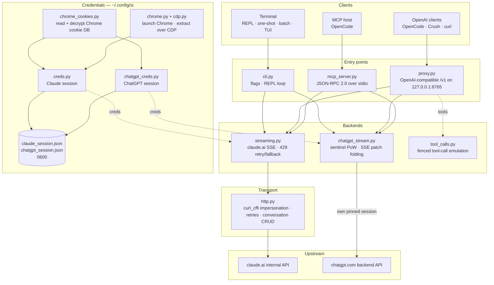

<div align="center">

[English](../../README.md) · [简体中文](README_zh.md) · [繁體中文](README_zh-TW.md) · [日本語](README_ja.md) · [한국어](README_ko.md) · [Türkçe](README_tr.md) · [Русский](README_ru.md) · [Tiếng Việt](README_vi.md) · [ไทย](README_th.md) · [Deutsch](README_de.md) · [Español](README_es.md) · [Français](README_fr.md) · [Українська](README_uk.md) · [Polski](README_pl.md) · [Português (Brasil)](README_pt-BR.md) · [العربية](README_ar.md) · [فارسی](README_fa.md) · [Bahasa Indonesia](README_id.md) · [Italiano](README_it.md)
· [Ελληνικά](README_el.md) · **മലയാളം**

# Reclaude

</div>

Claude.ai-ക്കും ChatGPT-ക്കുമുള്ള ടെർമിനൽ ക്ലയന്റ് — നിങ്ങളുടെ സ്വന്തം ബ്രൗസർ സെഷൻ അവരുടെ ആന്തരിക എൻഡ്പോയിന്റുകൾക്ക് നേരെ റീപ്ലേ ചെയ്ത് മറുപടികൾ ടോക്കൺ-ബൈ-ടോക്കൺ സ്ട്രീം ചെയ്യുന്നു. API കീ ആവശ്യമില്ല.

> ഗവേഷണ ഉപകരണം. ഇത് നിങ്ങളുടെ Claude.ai അക്കൗണ്ടിന് കീഴിൽ പ്രവർത്തിക്കുന്നു: അതിന്റെ പരിധികൾ, ടയറുകൾ, ബില്ലിംഗ് എന്നിവ ഇപ്പോഴും ബാധകമാണ്. ഇത് റേറ്റ് ലിമിറ്റുകളോ പേവാളുകളോ ബൈപ്പാസ് ചെയ്യുന്നില്ല.

> [!WARNING]
> **നിങ്ങളുടെ പ്രധാന അക്കൗണ്ട് ഉപയോഗിക്കരുത്.** si നിങ്ങളുടെ സ്വന്തം ബ്രൗസർ സെഷനിലൂടെ claude.ai-യും chatgpt.com-ഉം നിയന്ത്രിക്കുന്നു — ഈ പെരുമാറ്റം അക്കൗണ്ട് പരിമിതപ്പെടുത്താനോ വിലക്കാനോ ഇടയാക്കാം. നഷ്ടപ്പെട്ടാലും സാരമില്ലാത്ത ഒരു താൽക്കാലിക അക്കൗണ്ട് ഉപയോഗിക്കുക; നിങ്ങളുടെ ഇമെയിൽ, ബില്ലിംഗ്, ജോലി എന്നിവയുമായി ബന്ധിപ്പിച്ച ഒരു അക്കൗണ്ടും ഒരിക്കലും ഉപയോഗിക്കരുത്.

## ഡെമോ


പ്രോക്സി പ്രവർത്തിക്കുമ്പോൾ, മറ്റേതൊരു പ്രൊവൈഡറിനെയും പോലെ `si/haiku` OpenCode-ന്റെ `/models` പിക്കറിൽ പ്രത്യക്ഷപ്പെടും. അത് തിരഞ്ഞെടുത്ത് ചോദിക്കുക, മറുപടി സ്ട്രീം ചെയ്ത് വരുന്നത് കാണുക — എല്ലാം നിങ്ങളുടെ Claude.ai സെഷനിലൂടെ, API കീയില്ലാതെ.

## ആർക്കിടെക്ചർ

si മൂന്ന് നേർത്ത പ്രതലങ്ങളാണ് — ഒരു ടെർമിനൽ ക്ലയന്റ്, OpenAI-സമ്മതമായ ഒരു പ്രോക്സി, ഒരു MCP സെർവർ — ഒരു ജോടി സ്ട്രീമിംഗ് ബാക്ക്എൻഡുകൾക്ക് മുകളിൽ.



ഒരു അഭ്യർത്ഥന നാല് പാളികളിലൂടെ കടന്നുപോകുന്നു:

1. **ക്രെഡൻഷ്യലുകൾ** — `--from-chrome` ബ്രൗസറിന്റെ കുക്കി DB വായിച്ച് OS കീറിംഗ് ഉപയോഗിച്ച് ഡീക്രിപ്റ്റ് ചെയ്യുന്നു (`chrome_cookies.py`); `--auto-fetch` യഥാർത്ഥ Chrome സമാരംഭിച്ച് CDP വഴി കുക്കികളും ഓർഗ് ഐഡിയും എടുക്കുന്നു (`chrome.py`, `cdp.py`). സെഷനുകൾ `~/.config/si/*.json`-ൽ (`0600`) എത്തുന്നു. MCP സെർവർ ഓരോ കോളിലും അവ വീണ്ടും വായിക്കുന്നു (വീണ്ടും ലോഗിൻ ചെയ്ത ശേഷം റീസ്റ്റാർട്ട് ആവശ്യമില്ല); പ്രോക്സി അവ സ്റ്റാർട്ടപ്പിൽ ലോഡ് ചെയ്യുന്നു, അതിനാൽ വീണ്ടും ലോഗിൻ ചെയ്ത ശേഷം അത് റീസ്റ്റാർട്ട് ചെയ്യുക.
2. **പ്രവേശന പോയിന്റുകൾ** — `cli.py` ഫ്ലാഗുകൾ പാഴ്സ് ചെയ്ത് REPL/വൺ-ഷോട്ട്/ബാച്ച് മോഡുകൾ പ്രവർത്തിപ്പിക്കുന്നു; `proxy.py` `/v1/models`, `/v1/chat/completions` എന്നിവ നൽകുന്നു; `mcp_server.py` `claude_ask` / `chatgpt_ask` എന്നിവയ്ക്കുള്ള `tools/call`-ന് ഉത്തരം നൽകുന്നു. പ്രോക്സി മോഡൽ ഐഡി അനുസരിച്ചാണ് റൂട്ട് ചെയ്യുന്നത് (`chatgpt/…` → ChatGPT ബാക്ക്എൻഡ്, ബാക്കിയെല്ലാം → Claude); MCP സെർവർ ഓരോ ബാക്ക്എൻഡിനും ഒരു ടൂൾ വീതം വെളിപ്പെടുത്തുന്നു.
3. **ബാക്ക്എൻഡുകൾ** — `streaming.py` Claude.ai-യുടെ കമ്പ്ലീഷൻ എൻഡ്പോയിന്റിലേക്ക് പോസ്റ്റ് ചെയ്ത് SSE ഡെൽറ്റകൾ സംയോജിപ്പിക്കുന്നു, പരിമിതമായ 429 റിട്രൈ/ഫാൾബാക്കോടെ; `chatgpt_stream.py` സെന്റിനൽ ഹാൻഡ്ഷേക്ക് (proof-of-work + Turnstile) പ്രവർത്തിപ്പിച്ച് ChatGPT-യുടെ സ്നാപ്ഷോട്ട്/പാച്ച് SSE ടെക്സ്റ്റായി സംയോജിപ്പിക്കുന്നു. `tool_calls.py` ഫെൻസുചെയ്ത `tool_call` ബ്ലോക്കുകളെ യഥാർത്ഥ OpenAI `tool_calls` ആക്കി മാറ്റുന്നു, കാരണം Claude.ai-യുടെ നേറ്റീവ് ടൂൾ ചാനൽ പൂർത്തിയായ മറുപടികളിൽ മാത്രം പ്രവർത്തിക്കുന്ന ക്ലയന്റുകളെ ഡെഡ്ലോക്ക് ചെയ്യുന്നു.
4. **ട്രാൻസ്പോർട്ട്** — `http.py` ഒരു Chrome TLS ഫിംഗർപ്രിന്റിലേക്ക് പിൻ ചെയ്ത ഒരു `curl_cffi` സെഷൻ സൂക്ഷിക്കുന്നു, റിട്രൈ/ബാക്കോഫ് കൈകാര്യം ചെയ്യുന്നു, സംഭാഷണങ്ങളുടെ നിർമ്മാണവും ഇല്ലാതാക്കലും അതിന്റെ ചുമതലയാണ്. ChatGPT ബാക്ക്എൻഡ് അതിന്റേതായ പിൻ ചെയ്ത സെഷൻ സൂക്ഷിക്കുന്നു, അതിനാൽ രണ്ട് ഫിംഗർപ്രിന്റുകളും ഒരിക്കലും കലരില്ല.

സംഭാഷണ അവസ്ഥ ഓരോ ക്ലയന്റ് സെഷനും ഒരു സെർവർ-സൈഡ് ചാറ്റ് ആണ്: സ്റ്റെൽത്ത് ഓണായിരിക്കുമ്പോൾ CLI/TUI പുറത്തുകടക്കുമ്പോൾ അത് ഇല്ലാതാക്കുന്നു, പ്രോക്സി അതിനെ `X-Conversation-Id` ഉപയോഗിച്ച് കീ ചെയ്യുന്നു (വൺ-ഷോട്ട് ചാറ്റുകൾ ഇല്ലാതാക്കുന്നു), MCP സെർവർ അതിന്റെ ആയുസ്സിൽ ഓരോ പ്രൊവൈഡർക്കും ഒന്ന് സൂക്ഷിക്കുന്നു.

ഇൻസ്റ്റാൾ സമയത്തെ സഹായികൾ: `opencode.py` `opencode mcp add` വഴി MCP സെർവർ രജിസ്റ്റർ ചെയ്യുന്നു; `service.py` പ്രോക്സിയെ മേൽനോട്ടം ചെയ്യുന്ന macOS LaunchAgent ഇൻസ്റ്റാൾ ചെയ്യുന്നു.

## ഇൻസ്റ്റാൾ

```bash
git clone https://github.com/two35s/reclaude.git && cd reclaude
python3 -m venv .venv && source .venv/bin/activate
pip install -r requirements.txt
python -m si --opencode   # register the MCP tool with OpenCode (see below)
```

## ലോഗിൻ (ഒരിക്കൽ)

```bash
python -m si --from-chrome   # steal session from your logged-in Chrome (recommended)
python -m si --auto-fetch    # or: launch Chrome, log in, auto-extract over CDP
python -m si --manual        # or: paste org_id + Cookie header by hand
```

`~/.config/si/claude_session.json`-ൽ (`600`) സേവ് ചെയ്യുന്നു.

Linux-ൽ, ഡെസ്ക്ടോപ്പ് കീറിംഗ് ഉപയോഗിച്ച് Chrome എൻക്രിപ്റ്റ് ചെയ്ത കുക്കികൾക്ക് (`v11`) `libsecret-tools` ഇൻസ്റ്റാൾ ചെയ്തിരിക്കണം, കീറിംഗ് അൺലോക്ക് ചെയ്തിരിക്കണം; അവയില്ലാതെ `--from-chrome` ചപ്പുചവറുകൾ സേവ് ചെയ്യുന്നതിനുപകരം പ്രൊഫൈൽ നിരസിക്കുന്നു (പകരമായി `--auto-fetch` ഉപയോഗിക്കുക).

### ChatGPT ക്രെഡൻഷ്യലുകൾ

```bash
python -m si --chatgpt --from-chrome   # steal chatgpt.com session from Chrome
python -m si --chatgpt --manual        # or paste the session-token cookie
python -m si --chatgpt --clear-session # delete stored chatgpt creds
```

`~/.config/si/chatgpt_session.json`-ൽ (`600`) സേവ് ചെയ്യുന്നു. പ്രോക്സിയും MCP സെർവറും ഇവ സ്വയമേവ എടുക്കുന്നു; തുടർന്ന് `chatgpt/` പ്രിഫിക്സുള്ള ഒരു മോഡൽ claude മോഡലുകൾക്കൊപ്പം പ്രത്യക്ഷപ്പെടും. അഭ്യർത്ഥനകൾ `401` നൽകി തിരികെ വരുമ്പോൾ `--chatgpt --from-chrome` വീണ്ടും പ്രവർത്തിപ്പിക്കുക.

## ചാറ്റ്

```bash
python -m si                 # REPL
python -m si --tui           # full-screen chat
python -m si --prompt "..."  # one shot
python -m si --model haiku   # haiku | sonnet (default) | opus | fable …
```

TUI കമാൻഡുകൾ: `/new` `/model [name]` `/models` `/help` `/quit`.
REPL കമാൻഡുകൾ: അതേ കമാൻഡുകൾ, കൂടാതെ `/stealth on|off` `/cleanup` `/clear-session`.

ഓരോ സെഷനും ഒരു സെർവർ-സൈഡ് സംഭാഷണം ഉള്ളതിനാൽ മൾട്ടി-ടേൺ മെമ്മറി ലഭിക്കുന്നു; സ്റ്റെൽത്ത് മോഡ് പുറത്തുകടക്കുമ്പോൾ അത് ഇല്ലാതാക്കുന്നു, അതിനാൽ അത് നിങ്ങളുടെ ബ്രൗസർ സൈഡ്ബാറിൽ ഒരിക്കലും കാണില്ല (`--no-stealth` നൽകിയാൽ അത് നിലനിർത്തും).

## പ്രോക്സി

```bash
python -m si --proxy                 # OpenAI-compatible API on :8765
python -m si --proxy --port 9000
python -m si --proxy &               # run in the background
```

മോഡലുകൾ കാണാൻ ക്ലയന്റുകൾക്ക് പ്രോക്സി പ്രവർത്തിക്കേണ്ടതാണ് — അത് നിർത്തിയാൽ എല്ലാ അഭ്യർത്ഥനകളും `ConnectionRefused` എന്ന പിശകോടെ പരാജയപ്പെടും. macOS-ൽ, `python -m si --install-service` ലോഗിൻ ചെയ്യുമ്പോൾ അത് ആരംഭിക്കുകയും നിർത്തിയാൽ വീണ്ടും ആരംഭിക്കുകയും ചെയ്യുന്ന ഒരു launchd ഏജന്റ് ഇൻസ്റ്റാൾ ചെയ്യുന്നു (`--uninstall-service` അത് നീക്കം ചെയ്യുന്നു; ലോഗുകൾ `~/Library/Logs/si-proxy.log`-ൽ പോകുന്നു).

[Crush](https://github.com/charmbracelet/crush), [OpenCode](https://opencode.ai), അല്ലെങ്കിൽ ഏതെങ്കിലും OpenAI ക്ലയന്റ് `http://localhost:8765/v1`-ലേക്ക് ചൂണ്ടിക്കാണിക്കുക.

സ്ട്രീമിംഗ് (`text/event-stream`), നോൺ-സ്ട്രീമിംഗ് അഭ്യർത്ഥനകൾ എന്നിവ രണ്ടും പിന്തുണയ്ക്കുന്നു. സ്ട്രീം ചെയ്ത ഓരോ മറുപടിയും `~/.config/si/last_response.txt`-ലേക്കും എഴുതുന്നു — ക്ലയന്റ് ഒന്നും കാണിക്കാത്തപ്പോൾ ഇത് ഉപകരിക്കും. ടെർമിനൽ ഇവന്റ് ഇല്ലാതെ അവസാനിക്കുന്ന സ്ട്രീം പൂർണ്ണ മറുപടിയായി കണക്കാക്കുന്നതിനുപകരം അപ്സ്ട്രീം പിശകായി റിപ്പോർട്ട് ചെയ്യുന്നു.

`429` വരുമ്പോൾ പ്രോക്സി നിങ്ങളെ നിശബ്ദം ദുർബലമായ ഒരു മോഡലിലേക്ക് തരംതാഴ്ത്തുന്നതിനുപകരം പിശക് തിരികെ നൽകുന്നു — റിട്രൈകളും മോഡൽ തിരഞ്ഞെടുപ്പും ക്ലയന്റിന്റേതാണ് (OpenCode സ്വയം റിട്രൈ ചെയ്യുന്നു).

### ChatGPT മോഡലുകൾ

ChatGPT ക്രെഡൻഷ്യലുകൾ സേവ് ചെയ്തിരുന്നാൽ (മുകളിൽ കാണുക), `--proxy` അതേ `/v1` എൻഡ്പോയിന്റിലൂടെ `chatgpt/<slug>` മോഡലുകളും നൽകുന്നു — `chatgpt/auto`, `chatgpt/gpt-6`, `chatgpt/gpt-6-mini`, … — claude മോഡലുകൾക്കൊപ്പം. ഒരു പ്രോക്സി ഒരേസമയം രണ്ട് പ്രൊവൈഡർമാരെയും നൽകുന്നു; `/v1/models` എല്ലാം ലിസ്റ്റ് ചെയ്യുന്നു.

```bash
curl http://localhost:8765/v1/chat/completions \
  -d '{"model": "chatgpt/auto", "messages": [{"role": "user", "content": "hi"}]}'
```

മൾട്ടി-ടേൺ മെമ്മറി അതേ രീതിയിൽ പ്രവർത്തിക്കുന്നു: ഒരു `X-Conversation-Id` ഹെഡർ അയച്ചാൽ ടേണുകൾ ഒരേ ChatGPT സംഭാഷണം പങ്കിടുന്നു (OpenAI-യുടെ `user` ഫീൽഡ് ഉപയോഗിക്കുന്നില്ല — അത് ഒരു അന്തിമ ഉപയോക്താവിനെയാണ് തിരിച്ചറിയുന്നത്, സംഭാഷണത്തെയല്ല). സംഭാഷണ അവസ്ഥ ഓരോ ബാക്ക്എൻഡിനും വെവ്വേറെ കീ ചെയ്യുന്നു, അതിനാൽ `si/`-ലും `chatgpt/`-ലും ഒരേ കീ വീണ്ടും ഉപയോഗിച്ചാലും അവ വേർതിരിഞ്ഞിരിക്കുന്നു. ഹെഡർ ഇല്ലാത്ത അഭ്യർത്ഥനകൾ സ്വതന്ത്രമാണ്, അവയുടെ സെർവർ-സൈഡ് സംഭാഷണം പിന്നീട് ഇല്ലാതാക്കുന്നു. ടൂൾ കോളിംഗ്, സ്ട്രീമിംഗ്, `429` പിശകായി പ്രത്യക്ഷപ്പെടുന്ന സ്വഭാവം എന്നിവയെല്ലാം ഇവിടെയും ബാധകമാണ്. ChatGPT ക്രെഡൻഷ്യലുകൾ സേവ് ചെയ്തിട്ടില്ലെങ്കിൽ, `chatgpt/` അഭ്യർത്ഥന പകരം വ്യക്തമായ ഒരു `400` തിരികെ നൽകും.

auth എൻഡ്പോയിന്റ് ഒന്നും നൽകാത്ത സെഷനുകൾക്കായി അഭ്യർത്ഥനകൾ സെന്റിനൽ ഹെഡറുകളിൽ ഒരു ഫാൾബാക്ക് അക്കൗണ്ട് ഐഡി കൊണ്ടുപോകുന്നു. `SI_CHATGPT_ACCOUNT_ID` നിങ്ങളുടേതായി സെറ്റ് ചെയ്യുക; മറ്റ് അക്കൗണ്ടുകൾക്ക് ഇത് പരിശോധിക്കപ്പെട്ടിട്ടില്ല — പുതിയ ഒരു സൗജന്യ അക്കൗണ്ടിന് വിശദീകരിക്കാനാകാത്ത സെന്റിനൽ നിരസിക്കലുകൾ ഉണ്ടാകുന്നുവെങ്കിൽ, അവിടെ നിന്ന് തുടങ്ങുക. സെന്റിനൽ ഒരു Turnstile ടോക്കൺ നിർമ്മിക്കാത്തപ്പോൾ, si `SI_CHATGPT_TURNSTILE`-ൽ നിന്നോ `~/.config/si/chatgpt_turnstile.txt`-ൽ നിന്നോ ക്യാപ്ചർ ചെയ്ത ഒന്ന് വായിക്കുന്നു; ടോക്കൺ സെഷൻ ഡാറ്റയാണ്, കമ്മിറ്റ് ചെയ്യുന്നില്ല.

**ടൂൾ കോളിംഗ് പ്രവർത്തിക്കുന്നു.** OpenAI `tools` ടെക്സ്റ്റിൽ അനുകരിക്കുന്നു: പ്രോക്സി ടൂൾ സ്പെക്കുകൾ പ്രോംപ്റ്റിൽ ചേർക്കുന്നു, ഫെൻസുചെയ്ത `tool_call` ബ്ലോക്കുകൾ പുറപ്പെടുവിക്കാൻ മോഡലിനോട് ആവശ്യപ്പെടുന്നു, അവ മറുപടിയിൽ യഥാർത്ഥ OpenAI `tool_calls` ആക്കി മാറ്റുന്നു. അടുത്ത അഭ്യർത്ഥനയിൽ ഫലങ്ങൾ `tool` സന്ദേശങ്ങളായി തിരികെ അയയ്ക്കുക, മോഡൽ തുടരും. (Claude.ai-യുടെ നേറ്റീവ് ടൂൾ ചാനൽ ഒരു ഫലത്തിനായി കാത്ത് സ്ട്രീം തുറന്നിടുന്നു, ഇത് പൂർത്തിയായ മറുപടികളിൽ മാത്രം പ്രവർത്തിക്കുന്ന ക്ലയന്റുകളെ ഡെഡ്ലോക്ക് ചെയ്യുന്നു — അതിനാൽ പ്രോക്സി അത് ഉപയോഗിക്കുന്നില്ല.) `chatgpt/` ബാക്ക്എൻഡിൽ പ്രോട്ടോക്കോൾ ബ്ലോക്ക് പ്രോംപ്റ്റിന്റെ തുടക്കത്തിലാണ്, കാരണം ആ പ്രതലം അല്ലെങ്കിൽ ഒരു ഫെൻസ് പുറപ്പെടുവിക്കുന്നതിനുപകരം "I can't reach that workspace" എന്ന് ഉത്തരം നൽകും; അത്തരം ഒരു നിരസിക്കലോടെ ഇപ്പോഴും തുടങ്ങുന്ന ടൂളുകൾ അടങ്ങിയ മറുപടി കാണിക്കുന്നതിന് മുമ്പ് പുതിയ ഒരു സംഭാഷണത്തിൽ ഒരിക്കൽ റിട്രൈ ചെയ്യുന്നു.

### സാധാരണ OpenCode മോഡലായി ഉപയോഗിക്കുക

പ്രോക്സി പ്രവർത്തിക്കുമ്പോൾ, `si/sonnet`, `si/haiku`, `si/opus` എന്നിവ മറ്റേതൊരു പ്രൊവൈഡറിനെയും പോലെ OpenCode-ന്റെ `/models` പിക്കറിൽ പ്രത്യക്ഷപ്പെടും. ഒന്ന് തിരഞ്ഞെടുത്ത് സാധാരണപോലെ ചാറ്റ് ചെയ്യുക — ടൂളുകൾ (read/edit/bash), സ്ട്രീമിംഗ്, മൾട്ടി-ടേൺ എന്നിവയെല്ലാം നിങ്ങളുടെ Claude.ai അക്കൗണ്ടിലൂടെ പ്രവർത്തിക്കും.

`python -m si --opencode` നിങ്ങളുടെ ഗ്ലോബൽ കോൺഫിഗിനായി ഉടൻ പേസ്റ്റ് ചെയ്യാവുന്ന `providers` ബ്ലോക്ക് പ്രിന്റ് ചെയ്യുന്നു. അല്ലെങ്കിൽ കൈകൊണ്ട് പേസ്റ്റ് ചെയ്യുക:

```jsonc
{
  "providers": {
    "si": {
      "name": "si",
      "package": "@opencode/ai/providers/openai-compatible",
      "settings": { "baseURL": "http://localhost:8765/v1" },
      "models": {
        "sonnet": { "name": "Claude Sonnet", "modelID": "si/sonnet" },
        "haiku": { "name": "Claude Haiku", "modelID": "si/haiku" },
        "opus": { "name": "Claude Opus", "modelID": "si/opus" }
      }
    }
  }
}
```

## OpenCode MCP സെർവർ

si-യെ നിങ്ങളുടെ മോഡൽ പ്രൊവൈഡറാക്കാതെ തന്നെ [OpenCode](https://opencode.ai)-ന് ഒരു നേറ്റീവ് ടൂളായി (`claude_ask`, `chatgpt_ask`) വെളിപ്പെടുത്തുക — OpenCode അതിന്റേതായ ടൂൾ കഴിവുള്ള മോഡൽ സൂക്ഷിക്കുന്നു, നിങ്ങൾ ആവശ്യപ്പെടുമ്പോൾ si വഴി Claude.ai-യെയോ ChatGPT-യെയോ വിളിക്കാൻ കഴിയും.

ഈ ചെക്ക്ഔട്ടിൽ നിന്ന് ഒരു കമാൻഡ് ഉപയോഗിച്ച് ഇത് ഇൻസ്റ്റാൾ ചെയ്യുക:

```bash
python -m si --opencode
```

അത് OpenCode-ന്റെ സ്വന്തം `opencode mcp add` വിളിക്കുന്നു, അതിനാൽ നിങ്ങളുടെ നിലവിലുള്ള കോൺഫിഗ് (കമന്റുകൾ ഉൾപ്പെടെ) സംരക്ഷിക്കപ്പെടുന്നു. OpenCode റീസ്റ്റാർട്ട് ചെയ്ത് `opencode mcp list` പരിശോധിക്കുക.

തുടർന്ന് നിങ്ങളുടെ മോഡലിന് `claude_ask(prompt, model="sonnet")` വിളിക്കാം; `model` അലിയാസുകൾ (`sonnet`, `haiku`, `opus`) അല്ലെങ്കിൽ ഒരു പൂർണ്ണ മോഡൽ ഐഡി സ്വീകരിക്കുന്നു. `chatgpt_ask(prompt, model="auto")` ChatGPT വഴി അതേ കാര്യം ചെയ്യുന്നു (ChatGPT ക്രെഡൻഷ്യലുകൾ സേവ് ചെയ്തിരിക്കണം; `model` എന്നത് `auto`, `gpt-6`, `gpt-6-mini` പോലുള്ള ഒരു chatgpt.com സ്ലഗ് സ്വീകരിക്കുന്നു).

<details>
<summary>അല്ലെങ്കിൽ കൈകൊണ്ട് ചേർക്കുക</summary>

```jsonc
{
  "mcp": {
    "servers": {
      "si": {
        "type": "local",
        "command": ["/absolute/path/to/si/.venv/bin/python", "-m", "si.mcp_server"],
        "environment": { "PYTHONPATH": "/absolute/path/to/si" }
      }
    }
  }
}
```

ഏതൊരു വർക്കിംഗ് ഡയറക്ടറിയിൽ നിന്നും മൊഡ്യൂൾ ഇംപോർട്ട് ചെയ്യാനാക്കുന്നത് `PYTHONPATH` ആണ്, അതിനാൽ `cwd` ആവശ്യമില്ല.

</details>

ഹാൻഡ്ഷേക്ക് സ്വതന്ത്രമായി പരിശോധിക്കുക:

```bash
printf '{"jsonrpc":"2.0","id":1,"method":"tools/list"}\n' | .venv/bin/python -m si.mcp_server
```

കുറിപ്പുകൾ:

- **പങ്കിട്ട സംഭാഷണങ്ങൾ.** സെർവറിന്റെ ആയുസ്സിൽ എല്ലാ `claude_ask` കോളുകളും ഒരു Claude.ai സംഭാഷണം വീണ്ടും ഉപയോഗിക്കുന്നു, എല്ലാ `chatgpt_ask` കോളുകളും ഒരു ChatGPT സംഭാഷണം; അതിനാൽ ഫോളോ-അപ്പുകൾക്ക് സന്ദർഭം നിലനിൽക്കുന്നു. രണ്ടും സ്റ്റെൽത്ത്-ഡിലീറ്റ് ചെയ്യുന്നില്ല, നിങ്ങൾ അവ നീക്കം ചെയ്യുന്നതുവരെ രണ്ടും ബന്ധപ്പെട്ട സൈഡ്ബാറിൽ കാണാം.
- **stderr-ൽ ഡയഗ്നോസ്റ്റിക്സ്.** si-യുടെ പ്രോഗ്രസ്/എറർ ഔട്ട്പുട്ട് stderr-ലേക്ക് പോകുന്നു, അതിനാൽ അത് stdout-ലെ MCP പ്രോട്ടോക്കോൾ സ്ട്രീമിനെ ഒരിക്കലും കേടുവരുത്തില്ല.
- **പരിമിതികൾ.** ടെക്സ്റ്റ്-മാത്രം കൈമാറ്റം — ഇമേജ് ഔട്ട്പുട്ടില്ല, ടൂൾ കോളുകളും തിരികെ വരുന്നില്ല. അഭ്യർത്ഥനകൾ നിങ്ങളുടെ സ്വന്തം അക്കൗണ്ടുകൾക്ക് കീഴിൽ പ്രവർത്തിക്കുന്നു, അതിനാൽ പ്ലാൻ പരിധികൾ ബാധകമാണ്. ഒരു കോളിന് HTTP ടൈംഔട്ട് (120 s) വരെ എടുക്കാം, റേറ്റ് ലിമിറ്റിംഗിൽ അതിലും കൂടുതൽ. ChatGPT ക്രെഡൻഷ്യലുകൾ ഇല്ലാതിരിക്കുകയോ ടേൺ നിരസിക്കപ്പെടുകയോ (ക്വോട്ട, റേറ്റ് ലിമിറ്റ്) ചെയ്താൽ `chatgpt_ask` വ്യക്തമായി പിശക് നൽകുന്നു.
- **പ്രശ്നപരിഹാരം.** `Session invalid or expired` → `python -m si --auto-fetch` (Claude) അല്ലെങ്കിൽ `--chatgpt --from-chrome` (ChatGPT) വീണ്ടും പ്രവർത്തിപ്പിക്കുക; അടുത്ത കോൾ പുതിയ ക്രെഡൻഷ്യലുകൾ എടുക്കും (റീസ്റ്റാർട്ട് ആവശ്യമില്ല). ടൂൾ കാണുന്നില്ലെങ്കിൽ, OpenCode-ന്റെ MCP ലോഗുകളും `command`-ലെ venv പാത്ത് കൃത്യവും ശരിയുമാണോ എന്നും പരിശോധിക്കുക.

## കൂടുതൽ ഫ്ലാഗുകൾ

`--batch FILE` ഓരോ വരിയിലും ഒരു പ്രോംപ്റ്റ് → `~/.config/si/batch_results.json` · `--jailbreak FILE` ഫയലിൽ നിന്ന് പ്രോംപ്റ്റ് · `--org-id/--cookie` ഇൻലൈൻ ക്രെഡൻഷ്യലുകൾ · `--clear-session` ക്രെഡൻഷ്യലുകൾ മായ്ക്കുക · `--login` എക്സ്ട്രാക്റ്റ് ചെയ്യാതെ ഒരു Chrome പ്രൊഫൈൽ സേവ് ചെയ്യുക · `--opencode` OpenCode-നൊപ്പം MCP ടൂൾ രജിസ്റ്റർ ചെയ്ത് പ്രൊവൈഡർ കോൺഫിഗ് പ്രിന്റ് ചെയ്യുക.

## തകരുകയാണെങ്കിൽ

| ലക്ഷണം | പരിഹാരം |
|---|---|
| `Session invalid or expired` | `--from-chrome` അല്ലെങ്കിൽ `--auto-fetch` വീണ്ടും പ്രവർത്തിപ്പിക്കുക |
| ChatGPT `401` / no accessToken | `--chatgpt --from-chrome` വീണ്ടും പ്രവർത്തിപ്പിക്കുക |
| ChatGPT `prepare`/`finalize` failed | അപ്സ്ട്രീമിൽ സെന്റിനൽ ഹാൻഡ്ഷേക്ക് മാറി; si അപ്ഡേറ്റ് ചെയ്യുക |
| `429` rate limited | കാത്തിരിക്കുക, അല്ലെങ്കിൽ മോഡൽ മാറ്റുക (CLI/TUI-യിൽ `/model haiku`) |
| `ConnectionRefused` on every model | പ്രോക്സി പ്രവർത്തിക്കുന്നില്ല — `python -m si --proxy` ആരംഭിക്കുക, അല്ലെങ്കിൽ macOS-ൽ `--install-service` |
| Keychain prompt | **Always Allow** ക്ലിക്ക് ചെയ്ത് വീണ്ടും ശ്രമിക്കുക |

## സുരക്ഷ

നിങ്ങളുടെ `sessionKey`-ഉം ChatGPT സെഷൻ ടോക്കണും പാസ്വേഡുകളാണ്: ക്രെഡൻഷ്യൽ ഫയലുകൾ ഒരിക്കലും പങ്കിടരുത്, അപ്ലോഡ് ചെയ്യരുത്, കമ്മിറ്റ് ചെയ്യരുത്. കഴിഞ്ഞാൽ `--clear-session` (ഒപ്പം `--chatgpt --clear-session`) ഉപയോഗിക്കുക; വെളിപ്പെട്ടാൽ അവ അസാധുവാക്കാൻ ബ്രൗസറിൽ ലോഗ് ഔട്ട് ചെയ്യുക.

`SI_PROXY_TOKEN` സെറ്റ് ചെയ്തിട്ടില്ലെങ്കിൽ പ്രോക്സി ഒരു ഓതന്റിക്കേഷനും കൂടാതെ `127.0.0.1`-ൽ ശ്രവിക്കുന്നു. പങ്കിട്ട ഒരു Mac-ൽ, പോർട്ട് 8765-ൽ എത്താൻ കഴിയുന്ന മറ്റൊരു ലോക്കൽ ഉപയോക്താവിനോ പ്രോസസിനോ നിങ്ങളുടെ അക്കൗണ്ടിന്റെ ക്വോട്ട ചെലവഴിക്കാം; ടോക്കൺ സെറ്റ് ചെയ്യുക (അത് ക്ലയന്റിന് നൽകുക) അല്ലെങ്കിൽ ഉപയോഗിക്കാത്തപ്പോൾ പ്രോക്സി ഓഫ് ആക്കുക. ടോക്കൺ സെറ്റ് ചെയ്തിരിക്കുമ്പോൾ അത് വഹിക്കുന്നതിനാൽ macOS LaunchAgent plist `600` ആയി എഴുതുന്നു.

ChatGPT ബാക്ക്എൻഡ് നിങ്ങളുടെ സ്വന്തം ബ്രൗസർ സെഷൻ ഉപയോഗിച്ച് chatgpt.com-ന്റെ ആന്തരിക API നിയന്ത്രിക്കുന്നു. ഇത് OpenAI-യുടെ സേവന നിബന്ധനകൾക്ക് വിരുദ്ധമാണ്, അക്കൗണ്ട് പരിമിതപ്പെടുത്താനോ വിലക്കാനോ ഇടയാക്കാം — നിങ്ങളുടെ സ്വന്തം ഉത്തരവാദിത്തത്തിൽ, ഒരു താൽക്കാലിക അക്കൗണ്ട് ഉപയോഗിക്കുക.

## ഡെവ്

```bash
pip install -r requirements-dev.txt
PYTHONPATH=. .venv/bin/python -m pytest -q   # tests
.venv/bin/python -m ruff check .             # lint
.venv/bin/python -m ruff format --check .    # formatting
```

## ലൈസൻസ്

ഗവേഷണ, വിദ്യാഭ്യാസ ആവശ്യങ്ങൾക്ക് മാത്രം. യാതൊരു വാറന്റിയും നൽകുന്നില്ല.
