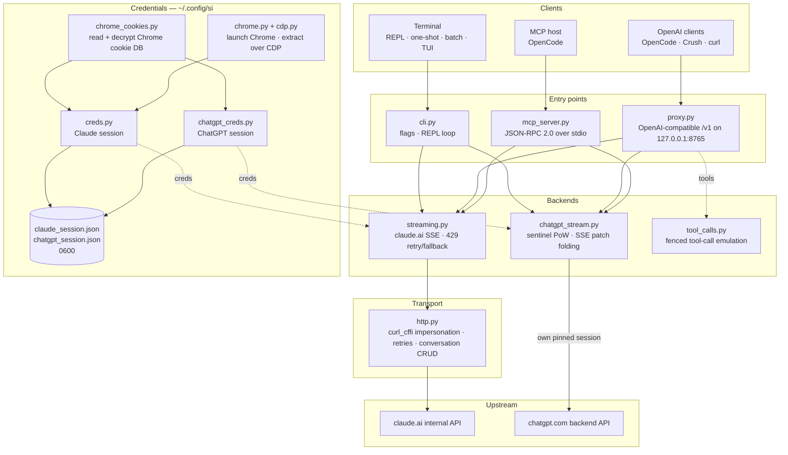

<div align="center">

[English](../../README.md) · [简体中文](README_zh.md) · [繁體中文](README_zh-TW.md) · [日本語](README_ja.md) · [한국어](README_ko.md) · [Türkçe](README_tr.md) · [Русский](README_ru.md) · [Tiếng Việt](README_vi.md) · [ไทย](README_th.md) · [Deutsch](README_de.md) · [Español](README_es.md) · [Français](README_fr.md) · [Українська](README_uk.md) · **Polski** · [Português (Brasil)](README_pt-BR.md) · [العربية](README_ar.md) · [فارسی](README_fa.md) · [Bahasa Indonesia](README_id.md) · [Italiano](README_it.md)
· [Ελληνικά](README_el.md) · [മലയാളം](README_ml.md)

# Reclaude

</div>

Klient terminalowy dla Claude.ai i ChatGPT — odtwarza Twoją własną sesję przeglądarki na ich wewnętrznych endpointach i strumieniuje odpowiedzi token po tokenie. Bez klucza API.

> Narzędzie badawcze. Działa na Twoim koncie Claude.ai: jego limity, plany i rozliczenia nadal obowiązują. Nie omija limitów szybkości ani paywalli.

> [!WARNING]
> **Nie używaj swojego głównego konta.** si steruje claude.ai i chatgpt.com przez Twoją własną sesję przeglądarki — zachowanie, które może doprowadzić do ograniczenia lub zbanowania konta. Używaj konta jednorazowego, którego utratę możesz zaakceptować, nigdy takiego, które jest powiązane z Twoim e-mailem, rozliczeniami lub pracą.

## Demo


Gdy proxy działa, `si/haiku` pojawia się w selektorze `/models` OpenCode jak każdy inny dostawca. Wybierz go, zapytaj, obserwuj strumieniowanie odpowiedzi — wszystko przez Twoją sesję Claude.ai, bez klucza API.

## Architektura

si to trzy cienkie powierzchnie — klient terminalowy, proxy zgodne z OpenAI i serwer MCP — nad jedną parą strumieniowych backendów.



Żądanie przechodzi przez cztery warstwy:

1. **Poświadczenia** — `--from-chrome` czyta bazę ciasteczek przeglądarki i odszyfrowuje ją kluczem keyringa systemu (`chrome_cookies.py`); `--auto-fetch` uruchamia prawdziwego Chrome'a i pobiera ciasteczka oraz id organizacji przez CDP (`chrome.py`, `cdp.py`). Sesje trafiają do `~/.config/si/*.json` (`0600`). Serwer MCP odczytuje je przy każdym wywołaniu (bez restartu po ponownym zalogowaniu); proxy ładuje je przy starcie, więc uruchom je ponownie po ponownym zalogowaniu.
2. **Punkty wejścia** — `cli.py` parsuje flagi i obsługuje tryby REPL/jednorazowy/wsadowy; `proxy.py` serwuje `/v1/models` i `/v1/chat/completions`; `mcp_server.py` odpowiada na `tools/call` dla `claude_ask` / `chatgpt_ask`. Proxy kieruje żądania na podstawie id modelu (`chatgpt/…` → backend ChatGPT, wszystko inne → Claude); serwer MCP udostępnia jedno narzędzie na backend.
3. **Backendy** — `streaming.py` wysyła żądania do endpointu uzupełnień Claude.ai i składa delty SSE, z ograniczonym ponawianiem/fallbackiem przy 429; `chatgpt_stream.py` wykonuje handshake sentinela (proof-of-work + Turnstile) i składa snapshot/patch SSE ChatGPT w tekst. `tool_calls.py` zamienia bloki `tool_call` w ogrodzeniu na prawdziwe `tool_calls` OpenAI, ponieważ natywny kanał narzędzi Claude.ai blokuje klientów, którzy działają tylko na zakończonych odpowiedziach.
4. **Transport** — `http.py` utrzymuje jedną sesję `curl_cffi` przypiętą do odcisku TLS Chrome'a, obsługuje ponowienia/backoff i zarządza tworzeniem/usuwaniem konwersacji. Backend ChatGPT utrzymuje własną przypiętą sesję, aby dwa odciski nigdy się nie mieszały.

Stan konwersacji to jeden czat po stronie serwera na sesję klienta: CLI/TUI usuwają go przy wyjściu, gdy stealth jest włączony, proxy kluczuje go przez `X-Conversation-Id` (usuwając czaty jednorazowe), a serwer MCP utrzymuje po jednym na dostawcę przez cały czas swojego działania.

Pomocniki instalacyjne: `opencode.py` rejestruje serwer MCP przez `opencode mcp add`; `service.py` instaluje LaunchAgent macOS, który nadzoruje proxy.

## Instalacja

```bash
git clone https://github.com/two35s/reclaude.git && cd reclaude
python3 -m venv .venv && source .venv/bin/activate
pip install -r requirements.txt
python -m si --opencode   # register the MCP tool with OpenCode (see below)
```

## Logowanie (jednorazowo)

```bash
python -m si --from-chrome   # steal session from your logged-in Chrome (recommended)
python -m si --auto-fetch    # or: launch Chrome, log in, auto-extract over CDP
python -m si --manual        # or: paste org_id + Cookie header by hand
```

Zapisuje do `~/.config/si/claude_session.json` (`600`).

W systemie Linux ciasteczka zaszyfrowane przez Chrome kluczem keyringa pulpitu (`v11`) wymagają zainstalowania `libsecret-tools` i odblokowanego keyringa; bez nich `--from-chrome` odrzuca profil zamiast zapisywać śmieci (użyj `--auto-fetch` jako fallbacku).

### Poświadczenia ChatGPT

```bash
python -m si --chatgpt --from-chrome   # steal chatgpt.com session from Chrome
python -m si --chatgpt --manual        # or paste the session-token cookie
python -m si --chatgpt --clear-session # delete stored chatgpt creds
```

Zapisuje do `~/.config/si/chatgpt_session.json` (`600`). Proxy i serwer MCP pobierają je automatycznie; model z prefiksem `chatgpt/` pojawia się wtedy obok modeli claude. Uruchom ponownie `--chatgpt --from-chrome`, gdy żądania zwracają `401`.

## Czat

```bash
python -m si                 # REPL
python -m si --tui           # full-screen chat
python -m si --prompt "..."  # one shot
python -m si --model haiku   # haiku | sonnet (default) | opus | fable …
```

Polecenia TUI: `/new` `/model [name]` `/models` `/help` `/quit`.
Polecenia REPL: te same, plus `/stealth on|off` `/cleanup` `/clear-session`.

Jedna konwersacja po stronie serwera na sesję zapewnia pamięć wielu tur; tryb stealth usuwa ją przy wyjściu, więc nigdy nie pojawia się na pasku bocznym przeglądarki (`--no-stealth`, aby ją zachować).

## Proxy

```bash
python -m si --proxy                 # OpenAI-compatible API on :8765
python -m si --proxy --port 9000
python -m si --proxy &               # run in the background
```

Proxy musi działać, aby klienci widzieli modele — jeśli zakończy działanie, każde żądanie kończy się błędem `ConnectionRefused`. W systemie macOS `python -m si --install-service` instaluje agenta launchd, który uruchamia je przy logowaniu i restartuje po zakończeniu (`--uninstall-service` usuwa go; logi trafiają do `~/Library/Logs/si-proxy.log`).

Skieruj [Crush](https://github.com/charmbracelet/crush), [OpenCode](https://opencode.ai) lub dowolnego klienta OpenAI na `http://localhost:8765/v1`.

Obsługiwane są zarówno żądania strumieniowe (`text/event-stream`), jak i niestrumieniowe. Każda odpowiedź strumieniowana jest też zapisywana do `~/.config/si/last_response.txt` — przydatne, gdy klient nic nie pokazuje. Strumień, który kończy się bez zdarzenia końcowego, jest zgłaszany jako błąd nadrzędny, zamiast być podany jako kompletna odpowiedź.

Przy `429` proxy zwraca błąd, zamiast po cichu degradować Cię do słabszego modelu — ponowienia i wybór modelu należą do klienta (OpenCode ponawia samodzielnie).

### Modele ChatGPT

Gdy poświadczenia ChatGPT są zapisane (patrz wyżej), `--proxy` udostępnia również modele `chatgpt/<slug>` — `chatgpt/auto`, `chatgpt/gpt-6`, `chatgpt/gpt-6-mini`, … — przez ten sam endpoint `/v1`, obok modeli claude. Jedno proxy obsługuje obu dostawców naraz; `/v1/models` wyświetla wszystko.

```bash
curl http://localhost:8765/v1/chat/completions \
  -d '{"model": "chatgpt/auto", "messages": [{"role": "user", "content": "hi"}]}'
```

Pamięć wielu tur działa tak samo: wyślij nagłówek `X-Conversation-Id`, a tury będą współdzielić jedną konwersację ChatGPT (pole `user` OpenAI nie jest używane — identyfikuje ono użytkownika końcowego, a nie konwersację). Stan konwersacji jest kluczowany per backend, więc ponowne użycie jednego klucza dla modeli `si/` i `chatgpt/` utrzymuje je osobno. Żądania bez nagłówka są niezależne, a ich konwersacja po stronie serwera jest później usuwana. Wywoływanie narzędzi, strumieniowanie i zachowanie `429` jako błędu — wszystko to obowiązuje. Bez zapisanych poświadczeń ChatGPT żądanie `chatgpt/` zwraca zamiast tego czytelny `400`.

Żądania zawierają zapasowe id konta w nagłówkach sentinela dla sesji, w których endpoint uwierzytelniania go nie dostarcza. Ustaw `SI_CHATGPT_ACCOUNT_ID` na własne; nie jest ono weryfikowane dla innych kont — jeśli świeże darmowe konto napotyka niewyjaśnione odrzucenia sentinela, zacznij od tego. Gdy sentinel nie tworzy tokena Turnstile, si odczytuje przechwycony z `SI_CHATGPT_TURNSTILE` lub `~/.config/si/chatgpt_turnstile.txt`; token jest danymi sesji i nie jest commitowany.

**Wywoływanie narzędzi działa.** `tools` OpenAI są emulowane tekstowo: proxy dołącza specyfikacje narzędzi do promptu, prosi model o wyemitowanie bloków `tool_call` w ogrodzeniu i konwertuje je na prawdziwe `tool_calls` OpenAI w odpowiedzi. Wyślij wyniki z powrotem jako wiadomości `tool` w następnym żądaniu, a model będzie kontynuował. (Natywny kanał narzędzi Claude.ai utrzymuje strumień otwarty, czekając na wynik, co blokuje klientów działających tylko na zakończonych odpowiedziach — dlatego proxy go nie używa.) W backendzie `chatgpt/` blok protokołu otwiera prompt, ponieważ ta powierzchnia w przeciwnym razie odpowiada „nie mogę się połączyć z tym workspace'em” zamiast emitować ogrodzenie; odpowiedź zawierająca narzędzia, która nadal zaczyna się od takiej odmowy, jest ponawiana raz w świeżej konwersacji, zanim zostanie pokazana.

### Używanie jako zwykłego modelu OpenCode

Gdy proxy działa, `si/sonnet`, `si/haiku` i `si/opus` pojawiają się w selektorze `/models` OpenCode jak każdy inny dostawca. Wybierz jeden i rozmawiaj normalnie — narzędzia (read/edit/bash), strumieniowanie i wiele tur działają przez Twoje konto Claude.ai.

`python -m si --opencode` wypisuje gotowy do wklejenia blok `providers` dla Twojej konfiguracji globalnej. Możesz też wkleić go ręcznie:

```jsonc
{
  "providers": {
    "si": {
      "name": "si",
      "package": "@opencode/ai/providers/openai-compatible",
      "settings": { "baseURL": "http://localhost:8765/v1" },
      "models": {
        "sonnet": { "name": "Claude Sonnet", "modelID": "si/sonnet" },
        "haiku": { "name": "Claude Haiku", "modelID": "si/haiku" },
        "opus": { "name": "Claude Opus", "modelID": "si/opus" }
      }
    }
  }
}
```

## Serwer MCP OpenCode

Udostępnij si w [OpenCode](https://opencode.ai) jako natywne narzędzie (`claude_ask`, `chatgpt_ask`), nie czyniąc go swoim dostawcą modeli — OpenCode zachowuje własny model zdolny do narzędzi i może wywołać Claude.ai lub ChatGPT przez si, gdy o to poprosisz.

Zainstaluj jednym poleceniem, uruchomionym z tego checkoutu:

```bash
python -m si --opencode
```

To wywołuje własny `opencode mcp add` OpenCode, więc istniejąca konfiguracja (łącznie z komentarzami) zostaje zachowana. Uruchom ponownie OpenCode, a następnie sprawdź `opencode mcp list`.

Twój model może wtedy wywołać `claude_ask(prompt, model="sonnet")`; `model` przyjmuje aliasy (`sonnet`, `haiku`, `opus`) lub pełne id modelu. `chatgpt_ask(prompt, model="auto")` robi to samo przez ChatGPT (wymaga zapisanych poświadczeń ChatGPT; `model` przyjmuje slug chatgpt.com, np. `auto`, `gpt-6`, `gpt-6-mini`).

<details>
<summary>Lub dodaj ręcznie</summary>

```jsonc
{
  "mcp": {
    "servers": {
      "si": {
        "type": "local",
        "command": ["/absolute/path/to/si/.venv/bin/python", "-m", "si.mcp_server"],
        "environment": { "PYTHONPATH": "/absolute/path/to/si" }
      }
    }
  }
}
```

`PYTHONPATH` sprawia, że moduł jest importowalny z dowolnego katalogu roboczego, więc `cwd` nie jest potrzebne.

</details>

Sprawdź handshake osobno:

```bash
printf '{"jsonrpc":"2.0","id":1,"method":"tools/list"}\n' | .venv/bin/python -m si.mcp_server
```

Uwagi:

- **Współdzielone konwersacje.** Wszystkie wywołania `claude_ask` używają jednej konwersacji Claude.ai, a wszystkie wywołania `chatgpt_ask` — jednej konwersacji ChatGPT, przez cały czas działania serwera, więc kolejne pytania zachowują kontekst. Żadna z nich nie jest usuwana w trybie stealth i obie pojawiają się na odpowiednim pasku bocznym, dopóki ich nie usuniesz.
- **Diagnostyka na stderr.** Wyjście postępu/błędów si trafia na stderr, więc nigdy nie uszkadza strumienia protokołu MCP na stdout.
- **Ograniczenia.** Przekazywanie tylko tekstu — brak wyjścia obrazów i żadne wywołania narzędzi nie wracają. Żądania działają na Twoich kontach, więc obowiązują limity planu. Jedno wywołanie może zająć do limitu czasu HTTP (120 s), dłużej przy limitowaniu szybkości. `chatgpt_ask` zgłasza czysty błąd, gdy brakuje poświadczeń ChatGPT lub tura zostaje odrzucona (limit, limit szybkości).
- **Rozwiązywanie problemów.** `Session invalid or expired` → uruchom ponownie `python -m si --auto-fetch` (Claude) lub `--chatgpt --from-chrome` (ChatGPT); następne wywołanie podchwyci nowe poświadczenia (restart nie jest potrzebny). Jeśli narzędzia brakuje, sprawdź logi MCP OpenCode i czy ścieżka venv w `command` jest bezwzględna i poprawna.

## Więcej flag

`--batch FILE` jeden prompt na linię → `~/.config/si/batch_results.json` · `--jailbreak FILE` prompt z pliku · `--org-id/--cookie` poświadczenia w linii · `--clear-session` usuń poświadczenia · `--login` zapisz profil Chrome bez wyodrębniania · `--opencode` zarejestruj narzędzie MCP w OpenCode i wypisz konfigurację dostawcy.

## Jeśli coś nie działa

| Objaw | Rozwiązanie |
|---|---|
| `Session invalid or expired` | uruchom ponownie `--from-chrome` lub `--auto-fetch` |
| ChatGPT `401` / brak accessToken | uruchom ponownie `--chatgpt --from-chrome` |
| ChatGPT `prepare`/`finalize` failed | handshake sentinela zmienił się po stronie serwera; zaktualizuj si |
| `429` rate limited | poczekaj lub zmień model (`/model haiku` w CLI/TUI) |
| `ConnectionRefused` przy każdym modelu | proxy nie działa — uruchom `python -m si --proxy` lub `--install-service` w systemie macOS |
| Monit o keychain | kliknij **Zawsze zezwalaj**, spróbuj ponownie |

## Bezpieczeństwo

Twój `sessionKey` i token sesji ChatGPT to hasła: nigdy nie udostępniaj, nie wysyłaj ani nie commituj plików poświadczeń. Użyj `--clear-session` (oraz `--chatgpt --clear-session`) po zakończeniu; jeśli zostały ujawnione, wyloguj się w przeglądarce, aby je unieważnić.

Proxy nasłuchuje na `127.0.0.1` bez uwierzytelniania, chyba że ustawiono `SI_PROXY_TOKEN`. Na współdzielonym Macu inny lokalny użytkownik lub proces, który może połączyć się z portem 8765, może zużywać limit Twojego konta; ustaw token (i przekaż go klientowi) albo wyłącz proxy, gdy nie jest używane. Plist LaunchAgenta macOS jest zapisywany z uprawnieniami `600`, ponieważ zawiera token, gdy jest ustawiony.

Backend ChatGPT steruje wewnętrznym API chatgpt.com przy użyciu Twojej własnej sesji przeglądarki. Jest to sprzeczne z warunkami korzystania OpenAI i może doprowadzić do ograniczenia lub zbanowania konta — używaj konta jednorazowego, na własne ryzyko.

## Programowanie

```bash
pip install -r requirements-dev.txt
PYTHONPATH=. .venv/bin/python -m pytest -q   # tests
.venv/bin/python -m ruff check .             # lint
.venv/bin/python -m ruff format --check .    # formatting
```

## Licencja

Wyłącznie do użytku badawczego i edukacyjnego. Bez gwarancji.
