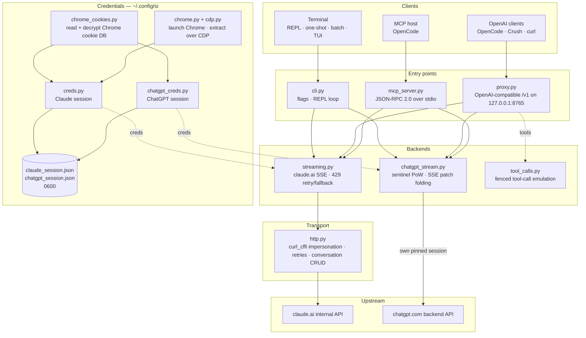

<div align="center">

[English](../../README.md) · [简体中文](README_zh.md) · [繁體中文](README_zh-TW.md) · [日本語](README_ja.md) · [한국어](README_ko.md) · [Türkçe](README_tr.md) · [Русский](README_ru.md) · [Tiếng Việt](README_vi.md) · [ไทย](README_th.md) · [Deutsch](README_de.md) · [Español](README_es.md) · [Français](README_fr.md) · [Українська](README_uk.md) · [Polski](README_pl.md) · **Português (Brasil)** · [العربية](README_ar.md) · [فارسی](README_fa.md) · [Bahasa Indonesia](README_id.md) · [Italiano](README_it.md)
· [Ελληνικά](README_el.md) · [മലയാളം](README_ml.md)

# Reclaude

</div>

Cliente de terminal para Claude.ai e ChatGPT — reproduz sua própria sessão do navegador contra os endpoints internos deles e transmite respostas token a token. Sem chave de API.

> Ferramenta de pesquisa. Ela roda sob a sua conta do Claude.ai: seus limites, níveis de plano e cobrança continuam valendo. Ela não contorna limites de taxa nem paywalls.

> [!WARNING]
> **Não use sua conta principal.** O si controla o claude.ai e o chatgpt.com por meio da sua própria sessão do navegador — um comportamento que pode fazer a conta ser limitada ou banida. Use uma conta descartável que você possa perder, nunca uma vinculada ao seu e-mail, cobrança ou trabalho.

## Demonstração


Com o proxy em execução, `si/haiku` aparece no seletor `/models` do OpenCode como qualquer outro provedor. Escolha-o, pergunte, veja a resposta chegar em streaming — tudo pela sua sessão do Claude.ai, sem chave de API.

## Arquitetura

O si é composto por três superfícies finas — um cliente de terminal, um proxy compatível com OpenAI e um servidor MCP — sobre um par de backends de streaming.



Uma requisição atravessa quatro camadas:

1. **Credenciais** — `--from-chrome` lê o banco de cookies do navegador e o descriptografa com o keyring do sistema operacional (`chrome_cookies.py`); `--auto-fetch` inicia o Chrome real e obtém cookies e o id da organização via CDP (`chrome.py`, `cdp.py`). As sessões ficam em `~/.config/si/*.json` (`0600`). O servidor MCP as relê a cada chamada (sem reiniciar após novo login); o proxy as carrega na inicialização, então reinicie-o após um novo login.
2. **Pontos de entrada** — `cli.py` interpreta as flags e executa os modos REPL/one-shot/batch; `proxy.py` serve `/v1/models` e `/v1/chat/completions`; `mcp_server.py` responde a `tools/call` para `claude_ask` / `chatgpt_ask`. O proxy roteia pelo id do modelo (`chatgpt/…` → backend do ChatGPT, todo o resto → Claude); o servidor MCP expõe uma ferramenta por backend.
3. **Backends** — `streaming.py` envia requisições ao endpoint de conclusão do Claude.ai e consolida os deltas SSE, com retry/fallback limitado em 429; `chatgpt_stream.py` executa o handshake sentinel (proof-of-work + Turnstile) e consolida o SSE de snapshot/patch do ChatGPT em texto. `tool_calls.py` transforma blocos `tool_call` cercados em `tool_calls` reais da OpenAI, porque o canal nativo de ferramentas do Claude.ai deixa em deadlock clientes que só agem em respostas concluídas.
4. **Transporte** — `http.py` mantém uma sessão `curl_cffi` fixada em uma impressão digital TLS do Chrome, trata retries/backoff e é responsável pela criação/exclusão de conversas. O backend do ChatGPT mantém sua própria sessão fixada para que as duas impressões digitais nunca se misturem.

O estado da conversa é um chat do lado do servidor por sessão de cliente: a CLI/TUI o exclui ao sair quando o modo stealth está ativado, o proxy o indexa por `X-Conversation-Id` (excluindo chats one-shot), e o servidor MCP mantém um por provedor durante seu tempo de vida.

Auxiliares de instalação: `opencode.py` registra o servidor MCP via `opencode mcp add`; `service.py` instala o LaunchAgent do macOS que supervisiona o proxy.

## Instalação

```bash
git clone https://github.com/two35s/reclaude.git && cd reclaude
python3 -m venv .venv && source .venv/bin/activate
pip install -r requirements.txt
python -m si --opencode   # register the MCP tool with OpenCode (see below)
```

## Login (uma vez)

```bash
python -m si --from-chrome   # steal session from your logged-in Chrome (recommended)
python -m si --auto-fetch    # or: launch Chrome, log in, auto-extract over CDP
python -m si --manual        # or: paste org_id + Cookie header by hand
```

Salva em `~/.config/si/claude_session.json` (`600`).

No Linux, cookies que o Chrome criptografou com o keyring da área de trabalho (`v11`) exigem `libsecret-tools` instalado e o keyring desbloqueado; sem eles, `--from-chrome` recusa o perfil em vez de salvar lixo (use `--auto-fetch` como alternativa).

### Credenciais do ChatGPT

```bash
python -m si --chatgpt --from-chrome   # steal chatgpt.com session from Chrome
python -m si --chatgpt --manual        # or paste the session-token cookie
python -m si --chatgpt --clear-session # delete stored chatgpt creds
```

Salva em `~/.config/si/chatgpt_session.json` (`600`). O proxy e o servidor MCP as capturam automaticamente; um modelo com prefixo `chatgpt/` então aparece ao lado dos modelos claude. Execute novamente `--chatgpt --from-chrome` quando as requisições retornarem `401`.

## Chat

```bash
python -m si                 # REPL
python -m si --tui           # full-screen chat
python -m si --prompt "..."  # one shot
python -m si --model haiku   # haiku | sonnet (default) | opus | fable …
```

Comandos da TUI: `/new` `/model [name]` `/models` `/help` `/quit`.
Comandos do REPL: os mesmos, mais `/stealth on|off` `/cleanup` `/clear-session`.

Uma conversa do lado do servidor por sessão proporciona memória multiturno; o modo stealth a exclui ao sair para que ela nunca apareça na barra lateral do seu navegador (`--no-stealth` para mantê-la).

## Proxy

```bash
python -m si --proxy                 # OpenAI-compatible API on :8765
python -m si --proxy --port 9000
python -m si --proxy &               # run in the background
```

O proxy precisa estar em execução para que os clientes vejam os modelos — se ele encerrar, toda requisição falha com `ConnectionRefused`. No macOS, `python -m si --install-service` instala um agente launchd que o inicia no login e o reinicia se ele encerrar (`--uninstall-service` o remove; os logs vão para `~/Library/Logs/si-proxy.log`).

Aponte o [Crush](https://github.com/charmbracelet/crush), o [OpenCode](https://opencode.ai), ou qualquer cliente OpenAI para `http://localhost:8765/v1`.

Requisições com streaming (`text/event-stream`) e sem streaming são ambas suportadas. Toda resposta em streaming também é gravada em `~/.config/si/last_response.txt` — útil quando um cliente não mostra nada. Um stream que termina sem seu evento terminal é reportado como erro do upstream em vez de ser apresentado como uma resposta completa.

Em um `429`, o proxy retorna o erro em vez de rebaixar você silenciosamente para um modelo mais fraco — retries e escolha de modelo pertencem ao cliente (o OpenCode tenta novamente por conta própria).

### Modelos do ChatGPT

Com credenciais do ChatGPT armazenadas (veja acima), `--proxy` também serve modelos `chatgpt/<slug>` — `chatgpt/auto`, `chatgpt/gpt-6`, `chatgpt/gpt-6-mini`, … — pelo mesmo endpoint `/v1`, ao lado dos claude. Um único proxy serve os dois provedores ao mesmo tempo; `/v1/models` lista tudo.

```bash
curl http://localhost:8765/v1/chat/completions \
  -d '{"model": "chatgpt/auto", "messages": [{"role": "user", "content": "hi"}]}'
```

A memória multiturno funciona da mesma forma: envie um cabeçalho `X-Conversation-Id` e os turnos compartilham uma conversa do ChatGPT (o campo `user` da OpenAI não é usado — ele identifica um usuário final, não uma conversa). O estado da conversa é indexado por backend, então reutilizar uma mesma chave entre modelos `si/` e `chatgpt/` os mantém separados. Requisições sem o cabeçalho são independentes, e sua conversa do lado do servidor é excluída depois. Chamada de ferramentas, streaming e o comportamento de `429` vir como erro se aplicam. Sem credenciais do ChatGPT armazenadas, uma requisição `chatgpt/` retorna um `400` claro em vez disso.

As requisições carregam um id de conta de fallback nos cabeçalhos sentinel para sessões em que o endpoint de autenticação não fornece um. Defina `SI_CHATGPT_ACCOUNT_ID` com o seu próprio; ele não é verificado para outras contas — se uma conta gratuita nova sofrer rejeições sentinel inexplicadas, comece por aí. Quando o sentinel não gera um token Turnstile, o si lê um capturado de `SI_CHATGPT_TURNSTILE` ou `~/.config/si/chatgpt_turnstile.txt`; o token é dado de sessão e não é commitado.

**A chamada de ferramentas funciona.** As `tools` da OpenAI são emuladas em texto: o proxy anexa as especificações das ferramentas ao prompt, pede ao modelo que emita blocos `tool_call` cercados e os converte em `tool_calls` reais da OpenAI na resposta. Envie os resultados de volta como mensagens `tool` na próxima requisição e o modelo continua. (O canal nativo de ferramentas do Claude.ai mantém o stream aberto aguardando um resultado, o que deixa em deadlock clientes que só agem em respostas concluídas — por isso o proxy não o usa.) Para o backend `chatgpt/`, o bloco de protocolo lidera o prompt, já que essa superfície, de outra forma, responde "não consigo acessar esse workspace" em vez de emitir uma cerca; uma resposta que carrega ferramentas mas ainda começa com essa recusa é repetida uma vez em uma conversa nova antes de ser exibida.

### Usar como um modelo normal do OpenCode

Com o proxy em execução, `si/sonnet`, `si/haiku` e `si/opus` aparecem no seletor `/models` do OpenCode como qualquer outro provedor. Selecione um e converse normalmente — ferramentas (read/edit/bash), streaming e multiturno funcionam pela sua conta do Claude.ai.

`python -m si --opencode` imprime o bloco `providers` pronto para colar na sua configuração global. Ou cole à mão:

```jsonc
{
  "providers": {
    "si": {
      "name": "si",
      "package": "@opencode/ai/providers/openai-compatible",
      "settings": { "baseURL": "http://localhost:8765/v1" },
      "models": {
        "sonnet": { "name": "Claude Sonnet", "modelID": "si/sonnet" },
        "haiku": { "name": "Claude Haiku", "modelID": "si/haiku" },
        "opus": { "name": "Claude Opus", "modelID": "si/opus" }
      }
    }
  }
}
```

## Servidor MCP do OpenCode

Exponha o si ao [OpenCode](https://opencode.ai) como uma ferramenta nativa (`claude_ask`, `chatgpt_ask`) sem torná-lo seu provedor de modelos — o OpenCode mantém seu próprio modelo com suporte a ferramentas e pode chamar Claude.ai ou ChatGPT pelo si quando você pedir.

Instale com um único comando, executado a partir deste checkout:

```bash
python -m si --opencode
```

Isso chama o `opencode mcp add` do próprio OpenCode, então sua configuração existente (comentários incluídos) é preservada. Reinicie o OpenCode e então verifique `opencode mcp list`.

Seu modelo pode então chamar `claude_ask(prompt, model="sonnet")`; `model` aceita aliases (`sonnet`, `haiku`, `opus`) ou um id de modelo completo. `chatgpt_ask(prompt, model="auto")` faz o mesmo pelo ChatGPT (requer credenciais do ChatGPT armazenadas; `model` aceita um slug do chatgpt.com como `auto`, `gpt-6`, `gpt-6-mini`).

<details>
<summary>Ou adicione à mão</summary>

```jsonc
{
  "mcp": {
    "servers": {
      "si": {
        "type": "local",
        "command": ["/absolute/path/to/si/.venv/bin/python", "-m", "si.mcp_server"],
        "environment": { "PYTHONPATH": "/absolute/path/to/si" }
      }
    }
  }
}
```

`PYTHONPATH` é o que torna o módulo importável de qualquer diretório de trabalho, então nenhum `cwd` é necessário.

</details>

Verifique o handshake isoladamente:

```bash
printf '{"jsonrpc":"2.0","id":1,"method":"tools/list"}\n' | .venv/bin/python -m si.mcp_server
```

Notas:

- **Conversas compartilhadas.** Todas as chamadas `claude_ask` reutilizam uma conversa do Claude.ai, e todas as chamadas `chatgpt_ask` uma conversa do ChatGPT, durante o tempo de vida do servidor, então acompanhamentos mantêm o contexto. Nenhuma delas é excluída em modo stealth e ambas aparecem na respectiva barra lateral até você removê-las.
- **Diagnósticos no stderr.** A saída de progresso/erro do si vai para stderr, então ela nunca corrompe o stream do protocolo MCP em stdout.
- **Limitações.** Passthrough somente texto — sem saída de imagens e sem chamadas de ferramentas de volta. As requisições rodam sob suas próprias contas, então os limites do plano se aplicam. Uma chamada pode levar até o timeout HTTP (120 s), mais sob limitação de taxa. `chatgpt_ask` falha de forma limpa quando as credenciais do ChatGPT estão ausentes ou o turno é recusado (cota, limite de taxa).
- **Solução de problemas.** `Session invalid or expired` → execute novamente `python -m si --auto-fetch` (Claude) ou `--chatgpt --from-chrome` (ChatGPT); a próxima chamada captura as novas credenciais (sem reiniciar). Se a ferramenta estiver faltando, verifique os logs de MCP do OpenCode e se o caminho do venv em `command` é absoluto e correto.

## Mais flags

`--batch FILE` um prompt por linha → `~/.config/si/batch_results.json` · `--jailbreak FILE` prompt de arquivo · `--org-id/--cookie` credenciais inline · `--clear-session` apaga credenciais · `--login` salva um perfil do Chrome sem extrair · `--opencode` registra a ferramenta MCP no OpenCode e imprime a configuração do provedor.

## Se algo quebrar

| Sintoma | Correção |
|---|---|
| `Session invalid or expired` | execute novamente `--from-chrome` ou `--auto-fetch` |
| ChatGPT `401` / sem accessToken | execute novamente `--chatgpt --from-chrome` |
| ChatGPT `prepare`/`finalize` falhou | o handshake sentinel mudou upstream; atualize o si |
| `429` limitado por taxa | aguarde, ou troque de modelo (`/model haiku` na CLI/TUI) |
| `ConnectionRefused` em todo modelo | proxy não está em execução — inicie `python -m si --proxy`, ou `--install-service` no macOS |
| Prompt do Keychain | clique em **Sempre Permitir**, tente novamente |

## Segurança

Sua `sessionKey` e o token de sessão do ChatGPT são senhas: nunca compartilhe, envie ou faça commit dos arquivos de credenciais. Use `--clear-session` (e `--chatgpt --clear-session`) quando terminar; se expostos, faça logout no navegador para invalidá-los.

O proxy escuta em `127.0.0.1` sem autenticação, a menos que `SI_PROXY_TOKEN` esteja definido. Em um Mac compartilhado, outro usuário ou processo local que consiga alcançar a porta 8765 pode gastar a cota da sua conta; defina o token (e forneça-o ao cliente) ou mantenha o proxy desligado quando não estiver em uso. O plist do LaunchAgent do macOS é gravado com `600` porque carrega o token quando um está definido.

O backend do ChatGPT controla a API interna do chatgpt.com com sua própria sessão do navegador. Isso viola os termos de serviço da OpenAI e pode fazer a conta ser limitada ou banida — use uma conta descartável, por sua conta e risco.

## Desenvolvimento

```bash
pip install -r requirements-dev.txt
PYTHONPATH=. .venv/bin/python -m pytest -q   # tests
.venv/bin/python -m ruff check .             # lint
.venv/bin/python -m ruff format --check .    # formatting
```

## Licença

Apenas para uso de pesquisa e educacional. Sem garantias.
