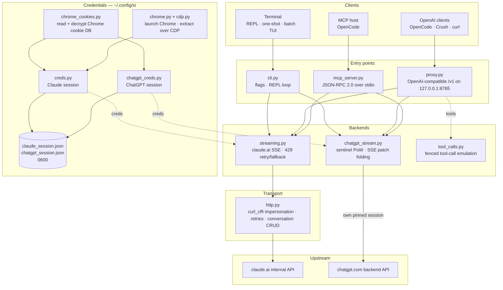

<div align="center">

[English](../../README.md) · [简体中文](README_zh.md) · [繁體中文](README_zh-TW.md) · [日本語](README_ja.md) · [한국어](README_ko.md) · [Türkçe](README_tr.md) · **Русский** · [Tiếng Việt](README_vi.md) · [ไทย](README_th.md) · [Deutsch](README_de.md) · [Español](README_es.md) · [Français](README_fr.md) · [Українська](README_uk.md) · [Polski](README_pl.md) · [Português (Brasil)](README_pt-BR.md) · [العربية](README_ar.md) · [فارسی](README_fa.md) · [Bahasa Indonesia](README_id.md) · [Italiano](README_it.md)
· [Ελληνικά](README_el.md) · [മലയാളം](README_ml.md)

# Reclaude

</div>

Терминальный клиент для Claude.ai и ChatGPT — воспроизводит вашу собственную сессию браузера на их внутренних эндпоинтах и передаёт ответы потоком, токен за токеном. Без API-ключа.

> Инструмент для исследований. Он работает в рамках вашего аккаунта Claude.ai: его лимиты, тарифные уровни и оплата по-прежнему действуют. Он не обходит ограничения скорости или платные барьеры.

> [!WARNING]
> **Не используйте свой основной аккаунт.** si управляет claude.ai и chatgpt.com через вашу собственную сессию браузера — поведение, из-за которого аккаунт могут ограничить или заблокировать. Используйте одноразовый аккаунт, потерей которого вы можете позволить себе рискнуть, и никогда — аккаунт, привязанный к вашей почте, оплате или работе.

## Демо


Когда прокси запущен, `si/haiku` появляется в списке `/models` в OpenCode, как любой другой провайдер. Выберите её, задайте вопрос и смотрите, как ответ поступает потоком — всё через вашу сессию Claude.ai, без API-ключа.

## Архитектура

si — это три тонких слоя: терминальный клиент, OpenAI-совместимый прокси и MCP-сервер — поверх одной пары потоковых бэкендов.



Запрос проходит через четыре слоя:

1. **Учётные данные** — `--from-chrome` читает базу cookie браузера и расшифровывает её через системное хранилище ключей (`chrome_cookies.py`); `--auto-fetch` запускает настоящий Chrome и забирает cookie и org id по CDP (`chrome.py`, `cdp.py`). Сессии сохраняются в `~/.config/si/*.json` (`0600`). MCP-сервер перечитывает их при каждом вызове (перезапуск после повторного входа не нужен); прокси загружает их при старте, поэтому после повторного входа его нужно перезапустить.
2. **Точки входа** — `cli.py` разбирает флаги и запускает режимы REPL/одноразовый/пакетный; `proxy.py` обслуживает `/v1/models` и `/v1/chat/completions`; `mcp_server.py` отвечает на `tools/call` для `claude_ask` / `chatgpt_ask`. Прокси маршрутизирует по id модели (`chatgpt/…` → бэкенд ChatGPT, всё остальное → Claude); MCP-сервер предоставляет один инструмент на бэкенд.
3. **Бэкенды** — `streaming.py` отправляет запросы на эндпоинт генерации Claude.ai и объединяет SSE-дельты, с ограниченными повторами/фолбэком при 429; `chatgpt_stream.py` выполняет рукопожатие sentinel (proof-of-work + Turnstile) и объединяет snapshot/patch SSE от ChatGPT в текст. `tool_calls.py` превращает огороженные блоки `tool_call` в настоящие OpenAI `tool_calls`, потому что нативный канал инструментов Claude.ai блокирует клиентов, которые действуют только по завершённым ответам.
4. **Транспорт** — `http.py` держит одну сессию `curl_cffi`, закреплённую за TLS-отпечатком Chrome, обрабатывает повторы/откат и управляет созданием/удалением разговоров. Бэкенд ChatGPT держит собственную закреплённую сессию, чтобы два отпечатка никогда не смешивались.

Состояние разговора — это один серверный чат на клиентскую сессию: CLI/TUI удаляют его при выходе, если включён режим скрытности, прокси привязывает его к `X-Conversation-Id` (удаляя одноразовые чаты), а MCP-сервер держит по одному на провайдера в течение своего времени жизни.

Вспомогательные модули установки: `opencode.py` регистрирует MCP-сервер через `opencode mcp add`; `service.py` устанавливает macOS LaunchAgent, который следит за прокси.

## Установка

```bash
git clone https://github.com/two35s/reclaude.git && cd reclaude
python3 -m venv .venv && source .venv/bin/activate
pip install -r requirements.txt
python -m si --opencode   # register the MCP tool with OpenCode (see below)
```

## Вход (один раз)

```bash
python -m si --from-chrome   # steal session from your logged-in Chrome (recommended)
python -m si --auto-fetch    # or: launch Chrome, log in, auto-extract over CDP
python -m si --manual        # or: paste org_id + Cookie header by hand
```

Сохраняется в `~/.config/si/claude_session.json` (`600`).

В Linux для cookie, зашифрованных Chrome через хранилище ключей рабочего стола (`v11`), нужны установленный `libsecret-tools` и разблокированное хранилище ключей; без них `--from-chrome` отказывается от профиля вместо сохранения мусора (используйте `--auto-fetch` как запасной вариант).

### Учётные данные ChatGPT

```bash
python -m si --chatgpt --from-chrome   # steal chatgpt.com session from Chrome
python -m si --chatgpt --manual        # or paste the session-token cookie
python -m si --chatgpt --clear-session # delete stored chatgpt creds
```

Сохраняется в `~/.config/si/chatgpt_session.json` (`600`). Прокси и MCP-сервер подхватывают их автоматически; тогда рядом с моделями claude появляется модель с префиксом `chatgpt/`. Перезапустите `--chatgpt --from-chrome`, когда запросы начинают возвращать `401`.

## Чат

```bash
python -m si                 # REPL
python -m si --tui           # full-screen chat
python -m si --prompt "..."  # one shot
python -m si --model haiku   # haiku | sonnet (default) | opus | fable …
```

Команды TUI: `/new` `/model [name]` `/models` `/help` `/quit`.
Команды REPL: те же, плюс `/stealth on|off` `/cleanup` `/clear-session`.

Один серверный разговор на сессию обеспечивает память в многоходовом диалоге; режим скрытности удаляет его при выходе, чтобы он никогда не появлялся в боковой панели браузера (`--no-stealth`, чтобы его сохранить).

## Прокси

```bash
python -m si --proxy                 # OpenAI-compatible API on :8765
python -m si --proxy --port 9000
python -m si --proxy &               # run in the background
```

Прокси должен быть запущен, чтобы клиенты видели модели — если он завершится, каждый запрос будет падать с `ConnectionRefused`. В macOS `python -m si --install-service` устанавливает агент launchd, который запускает его при входе в систему и перезапускает при завершении (`--uninstall-service` удаляет его; журналы пишутся в `~/Library/Logs/si-proxy.log`).

Направьте [Crush](https://github.com/charmbracelet/crush), [OpenCode](https://opencode.ai) или любой OpenAI-клиент на `http://localhost:8765/v1`.

Поддерживаются и потоковые (`text/event-stream`), и непотоковые запросы. Каждый потоковый ответ также записывается в `~/.config/si/last_response.txt` — удобно, когда клиент ничего не показывает. Поток, завершившийся без своего терминального события, сообщается как ошибка вышестоящего сервера, а не выдаётся за полный ответ.

При `429` прокси возвращает ошибку, а не понижает вас до более слабой модели молча — повторы и выбор модели остаются за клиентом (OpenCode повторяет сам).

### Модели ChatGPT

Если учётные данные ChatGPT сохранены (см. выше), `--proxy` также обслуживает модели `chatgpt/<slug>` — `chatgpt/auto`, `chatgpt/gpt-6`, `chatgpt/gpt-6-mini`, … — через тот же эндпоинт `/v1`, наряду с моделями claude. Один прокси обслуживает оба провайдера одновременно; `/v1/models` перечисляет всё.

```bash
curl http://localhost:8765/v1/chat/completions \
  -d '{"model": "chatgpt/auto", "messages": [{"role": "user", "content": "hi"}]}'
```

Память в многоходовом диалоге работает так же: отправьте заголовок `X-Conversation-Id`, и ходы будут использовать один разговор ChatGPT (поле OpenAI `user` не используется — оно идентифицирует конечного пользователя, а не разговор). Состояние разговора привязано к бэкенду, поэтому один и тот же ключ в моделях `si/` и `chatgpt/` хранит их отдельно. Запросы без заголовка независимы, а их серверный разговор после этого удаляется. Вызов инструментов, потоковая передача и поведение, когда `429` возвращается как ошибка, действуют в обоих случаях. Без сохранённых учётных данных ChatGPT запрос `chatgpt/` вместо этого возвращает понятный `400`.

Запросы несут резервный id аккаунта в заголовках sentinel для сессий, где эндпоинт авторизации его не предоставляет. Задайте `SI_CHATGPT_ACCOUNT_ID` своим; он не проверен для других аккаунтов — если новый бесплатный аккаунт получает необъяснимые отказы sentinel, начните с этого. Когда sentinel не выдаёт токен Turnstile, si читает захваченный токен из `SI_CHATGPT_TURNSTILE` или `~/.config/si/chatgpt_turnstile.txt`; токен относится к данным сессии и не коммитится.

**Вызов инструментов работает.** OpenAI `tools` эмулируются в тексте: прокси добавляет спецификации инструментов в промпт, просит модель выводить огороженные блоки `tool_call` и преобразует их в настоящие OpenAI `tool_calls` в ответе. Отправьте результаты обратно сообщениями `tool` в следующем запросе, и модель продолжит. (Нативный канал инструментов Claude.ai держит поток открытым в ожидании результата, что блокирует клиентов, которые действуют только по завершённым ответам, — поэтому прокси его не использует.) Для бэкенда `chatgpt/` блок протокола идёт в начале промпта, поскольку иначе этот интерфейс отвечает «I can't reach that workspace» вместо вывода ограждённого блока; ответ с инструментами, который всё ещё начинается с такого отказа, повторяется один раз в новом разговоре, прежде чем будет показан.

### Использование как обычной модели OpenCode

Когда прокси запущен, `si/sonnet`, `si/haiku` и `si/opus` появляются в списке `/models` в OpenCode, как любой другой провайдер. Выберите одну и общайтесь как обычно — инструменты (read/edit/bash), потоковая передача и многоходовой диалог работают через ваш аккаунт Claude.ai.

`python -m si --opencode` печатает готовый к вставке блок `providers` для вашего глобального конфига. Или вставьте его вручную:

```jsonc
{
  "providers": {
    "si": {
      "name": "si",
      "package": "@opencode/ai/providers/openai-compatible",
      "settings": { "baseURL": "http://localhost:8765/v1" },
      "models": {
        "sonnet": { "name": "Claude Sonnet", "modelID": "si/sonnet" },
        "haiku": { "name": "Claude Haiku", "modelID": "si/haiku" },
        "opus": { "name": "Claude Opus", "modelID": "si/opus" }
      }
    }
  }
}
```

## MCP-сервер OpenCode

Откройте si для [OpenCode](https://opencode.ai) как нативный инструмент (`claude_ask`, `chatgpt_ask`), не делая его своим провайдером моделей — OpenCode сохраняет собственную модель с поддержкой инструментов и может вызывать Claude.ai или ChatGPT через si по вашей просьбе.

Установите одной командой, выполненной из этой копии репозитория:

```bash
python -m si --opencode
```

Она вызывает собственный `opencode mcp add`, поэтому ваш существующий конфиг (включая комментарии) сохраняется. Перезапустите OpenCode, затем проверьте `opencode mcp list`.

После этого ваша модель может вызывать `claude_ask(prompt, model="sonnet")`; `model` принимает псевдонимы (`sonnet`, `haiku`, `opus`) или полный id модели. `chatgpt_ask(prompt, model="auto")` делает то же через ChatGPT (требуются сохранённые учётные данные ChatGPT; `model` принимает slug chatgpt.com, например `auto`, `gpt-6`, `gpt-6-mini`).

<details>
<summary>Или добавьте вручную</summary>

```jsonc
{
  "mcp": {
    "servers": {
      "si": {
        "type": "local",
        "command": ["/absolute/path/to/si/.venv/bin/python", "-m", "si.mcp_server"],
        "environment": { "PYTHONPATH": "/absolute/path/to/si" }
      }
    }
  }
}
```

Именно `PYTHONPATH` делает модуль импортируемым из любого рабочего каталога, поэтому `cwd` не нужен.

</details>

Проверьте рукопожатие отдельно:

```bash
printf '{"jsonrpc":"2.0","id":1,"method":"tools/list"}\n' | .venv/bin/python -m si.mcp_server
```

Примечания:

- **Общие разговоры.** Все вызовы `claude_ask` используют один разговор Claude.ai, а все вызовы `chatgpt_ask` — один разговор ChatGPT, в течение времени жизни сервера, поэтому уточняющие вопросы сохраняют контекст. Ни один из них не удаляется в режиме скрытности, и оба появляются в соответствующей боковой панели, пока вы их не удалите.
- **Диагностика в stderr.** Вывод прогресса/ошибок si идёт в stderr, поэтому он никогда не портит поток протокола MCP в stdout.
- **Ограничения.** Пропускается только текст — нет вывода изображений, и вызовы инструментов не возвращаются. Запросы выполняются под вашими аккаунтами, поэтому действуют лимиты тарифа. Один вызов может занимать до HTTP-таймаута (120 с), дольше при ограничении скорости. `chatgpt_ask` корректно возвращает ошибку, если учётные данные ChatGPT отсутствуют или ход отклонён (квота, ограничение скорости).
- **Устранение неполадок.** `Session invalid or expired` → перезапустите `python -m si --auto-fetch` (Claude) или `--chatgpt --from-chrome` (ChatGPT); следующий вызов подхватит новые учётные данные (перезапуск не нужен). Если инструмент отсутствует, проверьте логи MCP в OpenCode и убедитесь, что путь к venv в `command` абсолютный и правильный.

## Дополнительные флаги

`--batch FILE` один промпт на строку → `~/.config/si/batch_results.json` · `--jailbreak FILE` промпт из файла · `--org-id/--cookie` учётные данные в командной строке · `--clear-session` стереть учётные данные · `--login` сохранить профиль Chrome без извлечения · `--opencode` зарегистрировать MCP-инструмент в OpenCode и напечатать конфиг провайдера.

## Если что-то сломалось

| Симптом | Решение |
|---|---|
| `Session invalid or expired` | повторно запустите `--from-chrome` или `--auto-fetch` |
| ChatGPT `401` / нет accessToken | повторно запустите `--chatgpt --from-chrome` |
| ChatGPT `prepare`/`finalize` failed | рукопожатие sentinel изменилось на стороне сервера; обновите si |
| `429` rate limited | подождите или смените модель (`/model haiku` в CLI/TUI) |
| `ConnectionRefused` на каждой модели | прокси не запущен — запустите `python -m si --proxy` или `--install-service` в macOS |
| запрос Keychain | нажмите **Всегда разрешать**, повторите |

## Безопасность

Ваш `sessionKey` и токен сессии ChatGPT — это пароли: никогда не делитесь, не загружайте и не коммитьте файлы учётных данных. По завершении выполните `--clear-session` (и `--chatgpt --clear-session`); если они раскрыты, выйдите из системы в браузере, чтобы аннулировать их.

Прокси слушает `127.0.0.1` без аутентификации, если не задан `SI_PROXY_TOKEN`. На общем Mac другой локальный пользователь или процесс, имеющий доступ к порту 8765, может расходовать квоту вашего аккаунта; задайте токен (и передайте его клиенту) или держите прокси выключенным, когда он не используется. plist macOS LaunchAgent записывается с правами `600`, потому что содержит токен, когда он задан.

Бэкенд ChatGPT управляет внутренним API chatgpt.com через вашу собственную сессию браузера. Это нарушает условия обслуживания OpenAI и может привести к ограничению или блокировке аккаунта — используйте одноразовый аккаунт на свой страх и риск.

## Разработка

```bash
pip install -r requirements-dev.txt
PYTHONPATH=. .venv/bin/python -m pytest -q   # tests
.venv/bin/python -m ruff check .             # lint
.venv/bin/python -m ruff format --check .    # formatting
```

## Лицензия

Только для исследовательского и образовательного использования. Без каких-либо гарантий.
