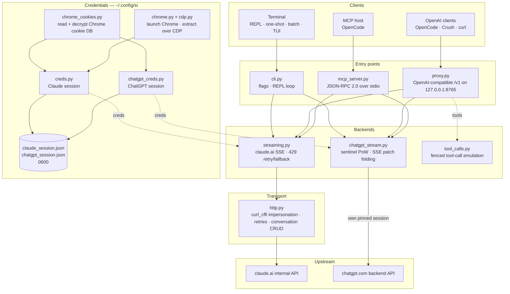

<div align="center">

[English](../../README.md) · [简体中文](README_zh.md) · [繁體中文](README_zh-TW.md) · [日本語](README_ja.md) · [한국어](README_ko.md) · [Türkçe](README_tr.md) · [Русский](README_ru.md) · [Tiếng Việt](README_vi.md) · **ไทย** · [Deutsch](README_de.md) · [Español](README_es.md) · [Français](README_fr.md) · [Українська](README_uk.md) · [Polski](README_pl.md) · [Português (Brasil)](README_pt-BR.md) · [العربية](README_ar.md) · [فارسی](README_fa.md) · [Bahasa Indonesia](README_id.md) · [Italiano](README_it.md)
· [Ελληνικά](README_el.md) · [മലയാളം](README_ml.md)

# Reclaude

</div>

ไคลเอนต์เทอร์มินัลสำหรับ Claude.ai และ ChatGPT — เล่นเซสชันเบราว์เซอร์ของคุณเองซ้ำกับเอนด์พอยต์ภายในของทั้งสองบริการ แล้วสตรีมคำตอบทีละโทเคน ไม่ต้องใช้ API key

> เครื่องมือสำหรับการวิจัย มันทำงานภายใต้บัญชี Claude.ai ของคุณ: ขีดจำกัด ระดับการใช้งาน และการเรียกเก็บเงินยังคงมีผลอยู่ มันไม่ได้ข้ามขีดจำกัดอัตราการใช้งานหรือเพย์วอลล์

> [!WARNING]
> **อย่าใช้บัญชีหลักของคุณ** si ขับเคลื่อน claude.ai และ chatgpt.com ผ่านเซสชันเบราว์เซอร์ของคุณเอง — พฤติกรรมที่อาจทำให้บัญชีถูกจำกัดหรือถูกแบน ใช้บัญชีทิ้งที่คุณยอมเสียได้ และอย่าใช้บัญชีที่ผูกกับอีเมล การเรียกเก็บเงิน หรือการงานของคุณ

## เดโม


เมื่อพร็อกซี่ทำงานอยู่ `si/haiku` จะปรากฏในตัวเลือก `/models` ของ OpenCode เหมือนผู้ให้บริการรายอื่น เลือกมัน ถาม แล้วดูคำตอบสตรีมเข้ามา — ทั้งหมดผ่านเซสชัน Claude.ai ของคุณ ไม่ต้องใช้ API key

## สถาปัตยกรรม

si คือสามพื้นผิวบาง ๆ — ไคลเอนต์เทอร์มินัล พร็อกซี่ที่เข้ากันได้กับ OpenAI และเซิร์ฟเวอร์ MCP — บนแบ็กเอนด์แบบสตรีมมิ่งหนึ่งคู่



คำขอหนึ่งรายการผ่านสี่ชั้น:

1. **ข้อมูลรับรอง** — `--from-chrome` อ่านฐานข้อมูลคุกกี้ของเบราว์เซอร์และถอดรหัสด้วยคีย์ริงของระบบปฏิบัติการ (`chrome_cookies.py`); `--auto-fetch` เปิด Chrome จริงและดึงคุกกี้พร้อม org id ผ่าน CDP (`chrome.py`, `cdp.py`) เซสชันจะถูกเก็บไว้ใน `~/.config/si/*.json` (`0600`) เซิร์ฟเวอร์ MCP อ่านใหม่ทุกครั้งที่เรียก (ไม่ต้องรีสตาร์ทหลังเข้าสู่ระบบใหม่) ส่วนพร็อกซี่โหลดตอนเริ่มทำงาน ดังนั้นให้รีสตาร์ทมันหลังเข้าสู่ระบบใหม่
2. **จุดเข้า** — `cli.py` แยกวิเคราะห์แฟล็กและรันโหมด REPL/คำสั่งครั้งเดียว/แบบกลุ่ม; `proxy.py` ให้บริการ `/v1/models` และ `/v1/chat/completions`; `mcp_server.py` ตอบ `tools/call` สำหรับ `claude_ask` / `chatgpt_ask` พร็อกซี่เลือกเส้นทางตาม id ของโมเดล (`chatgpt/…` → แบ็กเอนด์ ChatGPT, ที่เหลือ → Claude); เซิร์ฟเวอร์ MCP เปิดเผยเครื่องมือหนึ่งรายการต่อแบ็กเอนด์
3. **แบ็กเอนด์** — `streaming.py` ส่ง POST ไปยังเอนด์พอยต์ completion ของ Claude.ai และพับเดลตา SSE โดยมี retry/fallback สำหรับ 429 อย่างมีขอบเขต; `chatgpt_stream.py` ทำแฮนด์เชก sentinel (proof-of-work + Turnstile) และพับ SSE แบบ snapshot/patch ของ ChatGPT ให้เป็นข้อความ จากนั้น `tool_calls.py` เปลี่ยนบล็อก `tool_call` ที่อยู่ในโค้ดบล็อกให้เป็น `tool_calls` ของ OpenAI จริง เพราะช่องทางเครื่องมือแบบเนทีฟของ Claude.ai ทำให้ไคลเอนต์ที่ทำงานเฉพาะเมื่อคำตอบเสร็จแล้วค้าง
4. **การขนส่ง** — `http.py` เก็บเซสชัน `curl_cffi` หนึ่งเซสชันที่ปักหมุดกับ TLS fingerprint ของ Chrome จัดการ retry/backoff และดูแลการสร้าง/ลบการสนทนา แบ็กเอนด์ ChatGPT เก็บเซสชันที่ปักหมุดของตัวเองไว้ เพื่อไม่ให้ fingerprint ทั้งสองปนกัน

สถานะการสนทนาเป็นแชทฝั่งเซิร์ฟเวอร์หนึ่งรายการต่อหนึ่งเซสชันของไคลเอนต์: CLI/TUI ลบมันตอนออกเมื่อโหมดซ่อนตัวเปิดอยู่ พร็อกซี่ใช้ `X-Conversation-Id` เป็นคีย์ (ลบแชทแบบคำสั่งครั้งเดียว) และเซิร์ฟเวอร์ MCP เก็บหนึ่งรายการต่อผู้ให้บริการตลอดอายุการทำงานของมัน

ตัวช่วยตอนติดตั้ง: `opencode.py` ลงทะเบียนเซิร์ฟเวอร์ MCP ผ่าน `opencode mcp add`; `service.py` ติดตั้ง macOS LaunchAgent ที่ดูแลพร็อกซี่

## การติดตั้ง

```bash
git clone https://github.com/two35s/reclaude.git && cd reclaude
python3 -m venv .venv && source .venv/bin/activate
pip install -r requirements.txt
python -m si --opencode   # register the MCP tool with OpenCode (see below)
```

## การเข้าสู่ระบบ (ครั้งเดียว)

```bash
python -m si --from-chrome   # steal session from your logged-in Chrome (recommended)
python -m si --auto-fetch    # or: launch Chrome, log in, auto-extract over CDP
python -m si --manual        # or: paste org_id + Cookie header by hand
```

บันทึกไปที่ `~/.config/si/claude_session.json` (`600`)

บน Linux คุกกี้ที่ Chrome เข้ารหัสด้วยคีย์ริงของเดสก์ท็อป (`v11`) จำเป็นต้องติดตั้ง `libsecret-tools` และปลดล็อกคีย์ริงไว้; หากไม่มี `--from-chrome` จะปฏิเสธโปรไฟล์นั้นแทนที่จะบันทึกข้อมูลขยะ (ใช้ `--auto-fetch` เป็นทางเลือกสำรอง)

### ข้อมูลรับรอง ChatGPT

```bash
python -m si --chatgpt --from-chrome   # steal chatgpt.com session from Chrome
python -m si --chatgpt --manual        # or paste the session-token cookie
python -m si --chatgpt --clear-session # delete stored chatgpt creds
```

บันทึกไปที่ `~/.config/si/chatgpt_session.json` (`600`) พร็อกซี่และเซิร์ฟเวอร์ MCP หยิบข้อมูลเหล่านี้ไปใช้โดยอัตโนมัติ; จากนั้นโมเดลที่ขึ้นต้นด้วย `chatgpt/` จะปรากฏเคียงข้างโมเดล claude รัน `--chatgpt --from-chrome` ใหม่เมื่อคำขอตอบกลับ `401`

## การแชท

```bash
python -m si                 # REPL
python -m si --tui           # full-screen chat
python -m si --prompt "..."  # one shot
python -m si --model haiku   # haiku | sonnet (default) | opus | fable …
```

คำสั่งใน TUI: `/new` `/model [name]` `/models` `/help` `/quit`
คำสั่งใน REPL: เหมือนกัน และเพิ่ม `/stealth on|off` `/cleanup` `/clear-session`

การสนทนาฝั่งเซิร์ฟเวอร์หนึ่งรายการต่อหนึ่งเซสชันให้ความจำแบบหลายรอบ; โหมดซ่อนตัวจะลบมันตอนออก เพื่อไม่ให้มันปรากฏในแถบด้านข้างของเบราว์เซอร์คุณ (`--no-stealth` เพื่อเก็บไว้)

## พร็อกซี่

```bash
python -m si --proxy                 # OpenAI-compatible API on :8765
python -m si --proxy --port 9000
python -m si --proxy &               # run in the background
```

พร็อกซี่ต้องทำงานอยู่เพื่อให้ไคลเอนต์เห็นโมเดล — ถ้ามันออก ทุกคำขอจะล้มเหลวด้วย `ConnectionRefused` บน macOS `python -m si --install-service` จะติดตั้ง launchd agent ที่เริ่มมันตอนเข้าสู่ระบบและรีสตาร์ทมันถ้ามันออก (`--uninstall-service` ลบออก; บันทึกไว้ที่ `~/Library/Logs/si-proxy.log`)

ชี้ [Crush](https://github.com/charmbracelet/crush), [OpenCode](https://opencode.ai) หรือไคลเอนต์ OpenAI ใด ๆ ไปที่ `http://localhost:8765/v1`

รองรับทั้งคำขอแบบสตรีมมิ่ง (`text/event-stream`) และแบบไม่สตรีมมิ่ง คำตอบแบบสตรีมทุกครั้งจะถูกเขียนลง `~/.config/si/last_response.txt` ด้วย — มีประโยชน์เมื่อไคลเอนต์ไม่แสดงอะไรให้คุณเลย สตรีมที่จบลงโดยไม่มีอีเวนต์ปิดท้ายจะถูกรายงานเป็นข้อผิดพลาดจากต้นทาง แทนที่จะถูกส่งต่อราวกับเป็นคำตอบที่สมบูรณ์

เมื่อเจอ `429` พร็อกซี่จะคืนข้อผิดพลาดแทนการลดคุณลงไปใช้โมเดลที่อ่อนกว่าแบบเงียบ ๆ — การลองใหม่และการเลือกโมเดลเป็นหน้าที่ของไคลเอนต์ (OpenCode ลองใหม่ด้วยตัวเอง)

### โมเดล ChatGPT

เมื่อเก็บข้อมูลรับรอง ChatGPT ไว้แล้ว (ดูด้านบน) `--proxy` จะให้บริการโมเดล `chatgpt/<slug>` ด้วย — `chatgpt/auto`, `chatgpt/gpt-6`, `chatgpt/gpt-6-mini`, … — ผ่านเอนด์พอยต์ `/v1` เดียวกัน เคียงข้างโมเดล claude พร็อกซี่ตัวเดียวให้บริการทั้งสองผู้ให้บริการพร้อมกัน; `/v1/models` แสดงทั้งหมด

```bash
curl http://localhost:8765/v1/chat/completions \
  -d '{"model": "chatgpt/auto", "messages": [{"role": "user", "content": "hi"}]}'
```

ความจำแบบหลายรอบทำงานแบบเดียวกัน: ส่งเฮดเดอร์ `X-Conversation-Id` แล้วแต่ละรอบจะใช้การสนทนา ChatGPT ร่วมกัน (ไม่ใช้ฟิลด์ `user` ของ OpenAI — มันระบุผู้ใช้ปลายทาง ไม่ใช่การสนทนา) สถานะการสนทนาถูกคีย์แยกตามแบ็กเอนด์ ดังนั้นการใช้คีย์เดียวกันข้ามโมเดล `si/` และ `chatgpt/` จะแยกจากกัน คำขอที่ไม่มีเฮดเดอร์จะเป็นอิสระต่อกัน และการสนทนาฝั่งเซิร์ฟเวอร์ของมันจะถูกลบในภายหลัง การเรียกใช้เครื่องมือ การสตรีม และพฤติกรรมที่ให้ `429` ปรากฏเป็นข้อผิดพลาด ล้วนมีผล หากไม่มีข้อมูลรับรอง ChatGPT ที่เก็บไว้ คำขอ `chatgpt/` จะคืน `400` ที่ชัดเจนแทน

คำขอจะมี account id สำรองอยู่ในเฮดเดอร์ sentinel สำหรับเซสชันที่เอนด์พอยต์ auth ไม่ได้จัดหาให้ ตั้ง `SI_CHATGPT_ACCOUNT_ID` เป็นของคุณเอง; มันยังไม่ได้รับการยืนยันสำหรับบัญชีอื่น — หากบัญชีฟรีใหม่เจอการปฏิเสธจาก sentinel ที่อธิบายไม่ได้ ให้เริ่มตรวจจากตรงนั้น เมื่อ sentinel ไม่ได้สร้างโทเคน Turnstile si จะอ่านโทเคนที่จับไว้ได้จาก `SI_CHATGPT_TURNSTILE` หรือ `~/.config/si/chatgpt_turnstile.txt`; โทเคนนี้เป็นข้อมูลเซสชันและจะไม่ถูกคอมมิต

**การเรียกใช้เครื่องมือทำงานได้** `tools` ของ OpenAI ถูกจำลองในข้อความ: พร็อกซี่ต่อสเปกเครื่องมือเข้าไปในพรอมต์ ขอให้โมเดลส่งบล็อก `tool_call` ที่อยู่ในโค้ดบล็อก แล้วแปลงเป็น `tool_calls` ของ OpenAI จริงในคำตอบ ส่งผลลัพธ์กลับมาเป็นข้อความ `tool` ในคำขอถัดไป แล้วโมเดลจะทำงานต่อ (ช่องทางเครื่องมือแบบเนทีฟของ Claude.ai เปิดสตรีมค้างไว้รอผลลัพธ์ ซึ่งทำให้ไคลเอนต์ที่ทำงานเฉพาะเมื่อคำตอบเสร็จแล้วค้าง — ดังนั้นพร็อกซี่จึงไม่ใช้มัน) สำหรับแบ็กเอนด์ `chatgpt/` บล็อกโปรโตคอลจะอยู่ที่หัวพรอมต์ เพราะพื้นผิวนั้นมักตอบว่า "I can't reach that workspace" แทนที่จะส่งบล็อกโค้ด; คำตอบที่มีเครื่องมือซึ่งยังขึ้นต้นด้วยการปฏิเสธเช่นนั้นจะถูกลองใหม่หนึ่งครั้งในการสนทนาใหม่ก่อนจะแสดงให้เห็น

### ใช้เป็นโมเดล OpenCode ปกติ

เมื่อพร็อกซี่ทำงานอยู่ `si/sonnet`, `si/haiku` และ `si/opus` จะปรากฏในตัวเลือก `/models` ของ OpenCode เหมือนผู้ให้บริการรายอื่น เลือกหนึ่งตัวแล้วแชทได้ตามปกติ — เครื่องมือ (read/edit/bash) การสตรีม และหลายรอบ ทำงานทั้งหมดผ่านบัญชี Claude.ai ของคุณ

`python -m si --opencode` จะพิมพ์บล็อก `providers` ที่พร้อมวางลงในคอนฟิกโกลบอลของคุณ หรือวางด้วยตัวเอง:

```jsonc
{
  "providers": {
    "si": {
      "name": "si",
      "package": "@opencode/ai/providers/openai-compatible",
      "settings": { "baseURL": "http://localhost:8765/v1" },
      "models": {
        "sonnet": { "name": "Claude Sonnet", "modelID": "si/sonnet" },
        "haiku": { "name": "Claude Haiku", "modelID": "si/haiku" },
        "opus": { "name": "Claude Opus", "modelID": "si/opus" }
      }
    }
  }
}
```

## เซิร์ฟเวอร์ MCP ของ OpenCode

เปิดเผย si ให้ [OpenCode](https://opencode.ai) เป็นเครื่องมือแบบเนทีฟ (`claude_ask`, `chatgpt_ask`) โดยไม่ต้องทำให้มันเป็นผู้ให้บริการโมเดลของคุณ — OpenCode เก็บโมเดลของตัวเองที่รองรับเครื่องมือไว้ และสามารถเรียก Claude.ai หรือ ChatGPT ผ่าน si เมื่อคุณขอ

ติดตั้งด้วยคำสั่งเดียว รันจากเชกเอาต์นี้:

```bash
python -m si --opencode
```

คำสั่งนั้นเรียก `opencode mcp add` ของ OpenCode เอง ดังนั้นคอนฟิกที่มีอยู่ของคุณ (รวมคอมเมนต์) จะถูกคงไว้ รีสตาร์ท OpenCode แล้วตรวจสอบด้วย `opencode mcp list`

จากนั้นโมเดลของคุณสามารถเรียก `claude_ask(prompt, model="sonnet")`; `model` รับนามแฝง (`sonnet`, `haiku`, `opus`) หรือ id โมเดลเต็ม จากนั้น `chatgpt_ask(prompt, model="auto")` ทำแบบเดียวกันผ่าน ChatGPT (ต้องมีข้อมูลรับรอง ChatGPT ที่เก็บไว้; `model` รับ slug ของ chatgpt.com เช่น `auto`, `gpt-6`, `gpt-6-mini`)

<details>
<summary>หรือเพิ่มด้วยตัวเอง</summary>

```jsonc
{
  "mcp": {
    "servers": {
      "si": {
        "type": "local",
        "command": ["/absolute/path/to/si/.venv/bin/python", "-m", "si.mcp_server"],
        "environment": { "PYTHONPATH": "/absolute/path/to/si" }
      }
    }
  }
}
```

`PYTHONPATH` คือสิ่งที่ทำให้มอดูลนำเข้าได้จากไดเรกทอรีทำงานใด ๆ จึงไม่ต้องใช้ `cwd`

</details>

ทดสอบแฮนด์เชกแบบเดี่ยว:

```bash
printf '{"jsonrpc":"2.0","id":1,"method":"tools/list"}\n' | .venv/bin/python -m si.mcp_server
```

หมายเหตุ:

- **การสนทนาที่ใช้ร่วมกัน** การเรียก `claude_ask` ทั้งหมดใช้การสนทนา Claude.ai หนึ่งรายการร่วมกัน และการเรียก `chatgpt_ask` ทั้งหมดใช้การสนทนา ChatGPT หนึ่งรายการ ตลอดอายุการทำงานของเซิร์ฟเวอร์ คำถามต่อเนื่องจึงยังคงบริบท ทั้งสองไม่ถูกลบแบบซ่อนตัว และจะปรากฏในแถบด้านข้างที่เกี่ยวข้องจนกว่าคุณจะลบออก
- **การวินิจฉัยทาง stderr** เอาต์พุตความคืบหน้า/ข้อผิดพลาดของ si ไปที่ stderr จึงไม่ทำให้สตรีมโปรโตคอล MCP บน stdout เสียหาย
- **ข้อจำกัด** ส่งผ่านข้อความเท่านั้น — ไม่มีเอาต์พุตรูปภาพ และไม่มีการเรียกใช้เครื่องมือส่งกลับ คำขอทำงานภายใต้บัญชีของคุณเอง ขีดจำกัดของแพ็กเกจของคุณจึงมีผล การเรียกหนึ่งครั้งอาจใช้เวลาถึง HTTP timeout (120 วินาที) นานกว่านั้นเมื่อติดขีดจำกัดอัตรา `chatgpt_ask` จะรายงานข้อผิดพลาดอย่างชัดเจนเมื่อไม่มีข้อมูลรับรอง ChatGPT หรือรอบนั้นถูกปฏิเสธ (โควตา ขีดจำกัดอัตรา)
- **การแก้ปัญหา** `Session invalid or expired` → รัน `python -m si --auto-fetch` (Claude) หรือ `--chatgpt --from-chrome` (ChatGPT) อีกครั้ง; การเรียกครั้งถัดไปจะหยิบข้อมูลรับรองใหม่ไปใช้ (ไม่ต้องรีสตาร์ท) หากไม่พบเครื่องมือ ให้ตรวจล็อก MCP ของ OpenCode และตรวจว่าเส้นทาง venv ใน `command` เป็น absolute และถูกต้อง

## แฟล็กเพิ่มเติม

`--batch FILE` หนึ่งพรอมต์ต่อบรรทัด → `~/.config/si/batch_results.json` · `--jailbreak FILE` พรอมต์จากไฟล์ · `--org-id/--cookie` ข้อมูลรับรองแบบอินไลน์ · `--clear-session` ล้างข้อมูลรับรอง · `--login` บันทึกโปรไฟล์ Chrome โดยไม่ดึงข้อมูล · `--opencode` ลงทะเบียนเครื่องมือ MCP กับ OpenCode และพิมพ์คอนฟิกผู้ให้บริการ

## ถ้ามีปัญหา

| อาการ | วิธีแก้ |
|---|---|
| `Session invalid or expired` | รัน `--from-chrome` หรือ `--auto-fetch` อีกครั้ง |
| ChatGPT `401` / ไม่มี accessToken | รัน `--chatgpt --from-chrome` อีกครั้ง |
| ChatGPT `prepare`/`finalize` ล้มเหลว | แฮนด์เชก sentinel เปลี่ยนไปทางฝั่ง upstream; อัปเดต si |
| `429` ติดขีดจำกัดอัตรา | รอ หรือเปลี่ยนโมเดล (`/model haiku` ใน CLI/TUI) |
| `ConnectionRefused` ทุกโมเดล | พร็อกซี่ไม่ได้ทำงาน — เริ่ม `python -m si --proxy` หรือ `--install-service` บน macOS |
| พรอมต์ Keychain | คลิก **Always Allow** แล้วลองใหม่ |

## ความปลอดภัย

`sessionKey` และโทเคนเซสชัน ChatGPT ของคุณคือรหัสผ่าน: ห้ามแชร์ อัปโหลด หรือคอมมิตไฟล์ข้อมูลรับรองเด็ดขาด ใช้ `--clear-session` (และ `--chatgpt --clear-session`) เมื่อเสร็จ; หากข้อมูลรั่วไหล ให้ออกจากระบบในเบราว์เซอร์เพื่อทำให้มันใช้ไม่ได้

พร็อกซี่รับฟังบน `127.0.0.1` โดยไม่มีการยืนยันตัวตน เว้นแต่จะตั้ง `SI_PROXY_TOKEN` บน Mac ที่ใช้ร่วมกัน ผู้ใช้หรือโปรเซสอื่นในเครื่องที่เข้าถึงพอร์ต 8765 ได้อาจใช้โควตาบัญชีของคุณ; ให้ตั้งโทเคน (และมอบให้ไคลเอนต์) หรือปิดพร็อกซี่เมื่อไม่ใช้งาน ไฟล์ plist ของ macOS LaunchAgent ถูกเขียนเป็น `600` เพราะมันบรรจุโทเคนเมื่อมีการตั้งค่า

แบ็กเอนด์ ChatGPT ขับเคลื่อน API ภายในของ chatgpt.com ด้วยเซสชันเบราว์เซอร์ของคุณเอง นั่นขัดกับข้อกำหนดการให้บริการของ OpenAI และอาจทำให้บัญชีถูกจำกัดหรือถูกแบน — ใช้บัญชีทิ้ง และคุณรับความเสี่ยงเอง

## การพัฒนา

```bash
pip install -r requirements-dev.txt
PYTHONPATH=. .venv/bin/python -m pytest -q   # tests
.venv/bin/python -m ruff check .             # lint
.venv/bin/python -m ruff format --check .    # formatting
```

## สัญญาอนุญาต

สำหรับการวิจัยและการศึกษาเท่านั้น ไม่มีการรับประกัน
