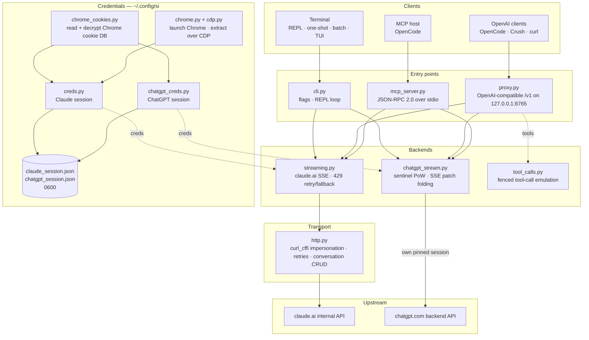

<div align="center">

[English](../../README.md) · [简体中文](README_zh.md) · [繁體中文](README_zh-TW.md) · [日本語](README_ja.md) · [한국어](README_ko.md) · **Türkçe** · [Русский](README_ru.md) · [Tiếng Việt](README_vi.md) · [ไทย](README_th.md) · [Deutsch](README_de.md) · [Español](README_es.md) · [Français](README_fr.md) · [Українська](README_uk.md) · [Polski](README_pl.md) · [Português (Brasil)](README_pt-BR.md) · [العربية](README_ar.md) · [فارسی](README_fa.md) · [Bahasa Indonesia](README_id.md) · [Italiano](README_it.md)
· [Ελληνικά](README_el.md) · [മലയാളം](README_ml.md)

# Reclaude

</div>

Claude.ai ve ChatGPT için terminal istemcisi — kendi tarayıcı oturumunuzu bu hizmetlerin dahili uç noktalarına karşı yeniden oynatır ve yanıtları token token akıtır. API anahtarı gerekmez.

> Araştırma aracı. Claude.ai hesabınız altında çalışır: limitleri, kademeleri ve faturalandırması geçerliliğini korur. Hız limitlerini veya ödeme duvarlarını atlatmaz.

> [!WARNING]
> **Ana hesabınızı kullanmayın.** si, claude.ai ve chatgpt.com'u kendi tarayıcı oturumunuz üzerinden sürer — bu davranış hesabın sınırlanmasına veya yasaklanmasına yol açabilir. Kaybetmeyi göze alabileceğiniz bir geçici hesap kullanın; e-postanıza, faturalandırmanıza veya işinize bağlı bir hesabı asla kullanmayın.

## Demo


Proxy çalışırken `si/haiku`, OpenCode'un `/models` seçicisinde diğer sağlayıcılar gibi görünür. Seçin, sorun, yanıtın akışını izleyin — hepsi Claude.ai oturumunuz üzerinden, API anahtarı olmadan.

## Mimari

si, tek bir çift streaming arka ucunun üzerinde üç ince yüzeyden oluşur — bir terminal istemcisi, OpenAI uyumlu bir proxy ve bir MCP sunucusu.



Bir istek dört katmandan geçer:

1. **Kimlik bilgileri** — `--from-chrome` tarayıcının çerez veritabanını okur ve işletim sistemi anahtarlığıyla şifresini çözer (`chrome_cookies.py`); `--auto-fetch` gerçek Chrome'u başlatır ve çerezleri ve org id'sini CDP üzerinden çeker (`chrome.py`, `cdp.py`). Oturumlar `~/.config/si/*.json` içine (`0600`) kaydedilir. MCP sunucusu bunları her çağrıda yeniden okur (yeniden girişten sonra yeniden başlatma gerekmez); proxy bunları başlangıçta yükler, bu yüzden yeniden girişten sonra proxy'yi yeniden başlatın.
2. **Giriş noktaları** — `cli.py` bayrakları ayrıştırır ve REPL/tek seferlik/toplu modları çalıştırır; `proxy.py` `/v1/models` ve `/v1/chat/completions` sunar; `mcp_server.py` `claude_ask` / `chatgpt_ask` için `tools/call` yanıtlar. Proxy model kimliğine göre yönlendirir (`chatgpt/…` → ChatGPT arka ucu, geri kalan her şey → Claude); MCP sunucusu her arka uç için bir araç sunar.
3. **Arka uçlar** — `streaming.py` Claude.ai'nin tamamlama uç noktasına POST atar ve SSE deltalarını birleştirir, sınırlı 429 yeniden deneme/geri düşme ile; `chatgpt_stream.py` sentinel el sıkışmasını (proof-of-work + Turnstile) yürütür ve ChatGPT'nin snapshot/patch SSE'sini metne katlar. `tool_calls.py`, kod çitiyle işaretlenmiş `tool_call` bloklarını gerçek OpenAI `tool_calls`'a dönüştürür, çünkü Claude.ai'nin yerel araç kanalı yalnızca tamamlanmış yanıtlara göre hareket eden istemcilerde kilitlenmeye yol açar.
4. **Taşıma** — `http.py`, bir Chrome TLS parmak izine sabitlenmiş tek bir `curl_cffi` oturumu tutar, yeniden denemeleri/geri çekilmeyi yönetir ve konuşma oluşturma/silme işlemlerinin sahibidir. ChatGPT arka ucu kendi sabitlenmiş oturumunu tutar, böylece iki parmak izi asla karışmaz.

Konuşma durumu, istemci oturumu başına sunucu tarafında tek bir sohbettir: CLI/TUI gizlilik modu açıkken çıkışta onu siler, proxy onu `X-Conversation-Id` ile anahtarlar (tek seferlik sohbetleri siler) ve MCP sunucusu ömrü boyunca sağlayıcı başına bir tane tutar.

Kurulum zamanı yardımcıları: `opencode.py` MCP sunucusunu `opencode mcp add` aracılığıyla kaydeder; `service.py` proxy'yi denetleyen macOS LaunchAgent'ı kurar.

## Kurulum

```bash
git clone https://github.com/two35s/reclaude.git && cd reclaude
python3 -m venv .venv && source .venv/bin/activate
pip install -r requirements.txt
python -m si --opencode   # register the MCP tool with OpenCode (see below)
```

## Giriş (bir kez)

```bash
python -m si --from-chrome   # steal session from your logged-in Chrome (recommended)
python -m si --auto-fetch    # or: launch Chrome, log in, auto-extract over CDP
python -m si --manual        # or: paste org_id + Cookie header by hand
```

`~/.config/si/claude_session.json` dosyasına kaydeder (`600`).

Linux'ta, Chrome'un masaüstü anahtarlığıyla (`v11`) şifrelediği çerezler için `libsecret-tools` kurulu olmalı ve anahtarlık kilidi açık olmalı; bunlar yoksa `--from-chrome`, çöp veri kaydetmek yerine profili reddeder (geri düşme olarak `--auto-fetch` kullanın).

### ChatGPT kimlik bilgileri

```bash
python -m si --chatgpt --from-chrome   # steal chatgpt.com session from Chrome
python -m si --chatgpt --manual        # or paste the session-token cookie
python -m si --chatgpt --clear-session # delete stored chatgpt creds
```

`~/.config/si/chatgpt_session.json` dosyasına kaydeder (`600`). Proxy ve MCP sunucusu bunları otomatik olarak alır; ardından claude modellerinin yanında `chatgpt/` önekli bir model görünür. İstekler `401` döndüğünde `--chatgpt --from-chrome` komutunu yeniden çalıştırın.

## Sohbet

```bash
python -m si                 # REPL
python -m si --tui           # full-screen chat
python -m si --prompt "..."  # one shot
python -m si --model haiku   # haiku | sonnet (default) | opus | fable …
```

TUI komutları: `/new` `/model [name]` `/models` `/help` `/quit`.
REPL komutları: aynısı, artı `/stealth on|off` `/cleanup` `/clear-session`.

Oturum başına tek bir sunucu tarafı konuşma, çok turlu hafıza sağlar; gizlilik modu çıkışta onu siler, böylece tarayıcı kenar çubuğunuzda asla görünmez (`--no-stealth` ile korunur).

## Proxy

```bash
python -m si --proxy                 # OpenAI-compatible API on :8765
python -m si --proxy --port 9000
python -m si --proxy &               # run in the background
```

İstemcilerin modelleri görmesi için proxy çalışıyor olmalı — kapanırsa her istek `ConnectionRefused` ile başarısız olur. macOS'ta `python -m si --install-service`, oturum açılışında onu başlatan ve kapanırsa yeniden başlatan bir launchd agent kurar (`--uninstall-service` kaldırır; günlükler `~/Library/Logs/si-proxy.log` dosyasına gider).

[Crush](https://github.com/charmbracelet/crush), [OpenCode](https://opencode.ai) veya herhangi bir OpenAI istemcisini `http://localhost:8765/v1` adresine yönlendirin.

Hem akışlı (`text/event-stream`) hem de akışsız istekler desteklenir. Her akışlı yanıt ayrıca `~/.config/si/last_response.txt` dosyasına yazılır — bir istemci size hiçbir şey göstermediğinde işe yarar. Terminal olayı olmadan biten bir akış, eksiksiz bir yanıt gibi sunulmak yerine üst kaynak hatası olarak bildirilir.

`429` durumunda proxy, sizi sessizce daha zayıf bir modele düşürmek yerine hatayı döndürür — yeniden denemeler ve model seçimi istemciye aittir (OpenCode kendi başına yeniden dener).

### ChatGPT modelleri

ChatGPT kimlik bilgileri kayıtlıyken (yukarıya bakın), `--proxy` aynı `/v1` uç noktası üzerinden claude modellerinin yanında `chatgpt/<slug>` modellerini de sunar — `chatgpt/auto`, `chatgpt/gpt-6`, `chatgpt/gpt-6-mini`, … — tek bir proxy iki sağlayıcıya birden hizmet eder; `/v1/models` her şeyi listeler.

```bash
curl http://localhost:8765/v1/chat/completions \
  -d '{"model": "chatgpt/auto", "messages": [{"role": "user", "content": "hi"}]}'
```

Çok turlu hafıza aynı şekilde çalışır: bir `X-Conversation-Id` başlığı gönderin ve turlar tek bir ChatGPT konuşmasını paylaşır (OpenAI `user` alanı kullanılmaz — o, bir son kullanıcıyı tanımlar, bir konuşmayı değil). Konuşma durumu arka uç başına anahtarlanır; bu nedenle aynı anahtarı `si/` ve `chatgpt/` modelleri arasında yeniden kullanmak onları ayrı tutar. Başlık içermeyen istekler bağımsızdır ve bunların sunucu tarafı konuşması sonrasında silinir. Araç çağırma, akış ve `429`'un hata olarak yüzeye çıkma davranışı hepsi geçerlidir. Kayıtlı ChatGPT kimlik bilgileri yoksa `chatgpt/` isteği bunun yerine açık bir `400` döndürür.

İstekler, kimlik doğrulama uç noktasının bir tane sağlamadığı oturumlar için sentinel başlıklarında bir yedek hesap kimliği taşır. `SI_CHATGPT_ACCOUNT_ID` değerini kendi değerinize ayarlayın; diğer hesaplar için doğrulanmamıştır — yeni bir ücretsiz hesap açıklanamayan sentinel retleri alırsa buradan başlayın. Sentinel bir Turnstile token'ı üretmediğinde, si yakalanmış bir token'ı `SI_CHATGPT_TURNSTILE` veya `~/.config/si/chatgpt_turnstile.txt` dosyasından okur; token oturum verisidir ve commit edilmez.

**Araç çağırma çalışır.** OpenAI `tools` metin içinde taklit edilir: proxy araç tanımlarını isteme ekler, modelden kod çitiyle işaretlenmiş `tool_call` blokları üretmesini ister ve bunları yanıtta gerçek OpenAI `tool_calls`'a dönüştürür. Sonuçları bir sonraki istekte `tool` mesajları olarak geri gönderin, model devam eder. (Claude.ai'nin yerel araç kanalı, bir sonuç bekleyerek akışı açık tutar; bu da yalnızca tamamlanmış yanıtlara göre hareket eden istemcilerde kilitlenmeye yol açar — bu yüzden proxy onu kullanmaz.) `chatgpt/` arka ucu için protokol bloğu istemin başına gelir, çünkü o yüzey aksi halde kod çiti üretmek yerine "I can't reach that workspace" yanıtını verir; yine de böyle bir ret ile başlayan araç içeren bir yanıt, gösterilmeden önce yeni bir konuşmada bir kez yeniden denenir.

### Normal bir OpenCode modeli olarak kullanma

Proxy çalışırken `si/sonnet`, `si/haiku` ve `si/opus`, OpenCode'un `/models` seçicisinde diğer sağlayıcılar gibi görünür. Birini seçin ve normal şekilde sohbet edin — araçlar (read/edit/bash), akış ve çok turlu görüşme hepsi Claude.ai hesabınız üzerinden çalışır.

`python -m si --opencode`, genel yapılandırmanız için kopyala-yapıştır hazır `providers` bloğunu yazdırır. Ya da elle yapıştırın:

```jsonc
{
  "providers": {
    "si": {
      "name": "si",
      "package": "@opencode/ai/providers/openai-compatible",
      "settings": { "baseURL": "http://localhost:8765/v1" },
      "models": {
        "sonnet": { "name": "Claude Sonnet", "modelID": "si/sonnet" },
        "haiku": { "name": "Claude Haiku", "modelID": "si/haiku" },
        "opus": { "name": "Claude Opus", "modelID": "si/opus" }
      }
    }
  }
}
```

## OpenCode MCP sunucusu

si'yi, onu model sağlayıcınız yapmadan [OpenCode](https://opencode.ai) için yerel bir araç (`claude_ask`, `chatgpt_ask`) olarak sunun — OpenCode araç çağırabilen kendi modelini korur ve siz istediğinizde si aracılığıyla Claude.ai veya ChatGPT'yi çağırabilir.

Buradaki kopyadan çalıştırılan tek bir komutla kurun:

```bash
python -m si --opencode
```

Bu, OpenCode'un kendi `opencode mcp add` komutunu çağırır, böylece mevcut yapılandırmanız (yorumlar dahil) korunur. OpenCode'u yeniden başlatın, ardından `opencode mcp list` ile kontrol edin.

Modeliniz ardından `claude_ask(prompt, model="sonnet")` çağırabilir; `model` takma adları (`sonnet`, `haiku`, `opus`) veya tam bir model kimliği kabul eder. `chatgpt_ask(prompt, model="auto")` aynısını ChatGPT üzerinden yapar (ChatGPT kimlik bilgilerinin kayıtlı olması gerekir; `model`, `auto`, `gpt-6`, `gpt-6-mini` gibi bir chatgpt.com slug'ı alır).

<details>
<summary>Ya da elle ekleyin</summary>

```jsonc
{
  "mcp": {
    "servers": {
      "si": {
        "type": "local",
        "command": ["/absolute/path/to/si/.venv/bin/python", "-m", "si.mcp_server"],
        "environment": { "PYTHONPATH": "/absolute/path/to/si" }
      }
    }
  }
}
```

`PYTHONPATH`, modülün herhangi bir çalışma dizininden içe aktarılabilir olmasını sağlayan şeydir, bu yüzden `cwd` gerekmez.

</details>

El sıkışmasını tek başına kontrol edin:

```bash
printf '{"jsonrpc":"2.0","id":1,"method":"tools/list"}\n' | .venv/bin/python -m si.mcp_server
```

Notlar:

- **Paylaşılan konuşmalar.** Tüm `claude_ask` çağrıları bir Claude.ai konuşmasını, tüm `chatgpt_ask` çağrıları bir ChatGPT konuşmasını sunucunun ömrü boyunca yeniden kullanır, böylece devam soruları bağlamı korur. Hiçbiri gizlilik modunda silinmez ve siz kaldırana kadar ikisi de ilgili kenar çubuğunda görünür.
- **Tanılama stderr'de.** si'nin ilerleme/hata çıktısı stderr'e gider, böylece stdout'taki MCP protokol akışını asla bozmaz.
- **Sınırlamalar.** Yalnızca metin aktarımı — görsel çıktı yok ve araç çağrıları geri gelmez. İstekler kendi hesaplarınız altında çalışır, bu yüzden plan limitleri geçerlidir. Tek bir çağrı HTTP zaman aşımına (120 sn) kadar sürebilir, hız sınırlaması altında daha da uzun. `chatgpt_ask`, ChatGPT kimlik bilgileri eksik olduğunda veya tur reddedildiğinde (kota, hız limiti) temiz bir şekilde hata verir.
- **Sorun giderme.** `Session invalid or expired` → `python -m si --auto-fetch` (Claude) veya `--chatgpt --from-chrome` (ChatGPT) komutunu yeniden çalıştırın; sonraki çağrı yeni kimlik bilgilerini alır (yeniden başlatma gerekmez). Araç eksikse OpenCode'un MCP günlüklerini ve `command` içindeki venv yolunun mutlak ve doğru olduğunu kontrol edin.

## Diğer bayraklar

`--batch FILE` satır başına bir istem → `~/.config/si/batch_results.json` · `--jailbreak FILE` dosyadan istem · `--org-id/--cookie` satır içi kimlik bilgileri · `--clear-session` kimlik bilgilerini sil · `--login` Chrome profilini çıkarma yapmadan kaydet · `--opencode` MCP aracını OpenCode'a kaydet ve sağlayıcı yapılandırmasını yazdır.

## Bozulursa

| Belirti | Çözüm |
|---|---|
| `Session invalid or expired` | `--from-chrome` veya `--auto-fetch` komutunu yeniden çalıştırın |
| ChatGPT `401` / accessToken yok | `--chatgpt --from-chrome` komutunu yeniden çalıştırın |
| ChatGPT `prepare`/`finalize` başarısız | sentinel el sıkışması üst tarafta değişti; si'yi güncelleyin |
| `429` hız sınırı | bekleyin veya model değiştirin (CLI/TUI'da `/model haiku`) |
| Her modelde `ConnectionRefused` | proxy çalışmıyor — `python -m si --proxy` başlatın veya macOS'ta `--install-service` kullanın |
| Anahtarlık istemi | **Always Allow**'a tıklayın, yeniden deneyin |

## Güvenlik

`sessionKey` ve ChatGPT oturum token'ınız birer paroladır: kimlik bilgisi dosyalarını asla paylaşmayın, yüklemeyin veya commit etmeyin. İşiniz bittiğinde `--clear-session` (ve `--chatgpt --clear-session`) kullanın; açığa çıktılarsa geçersiz kılmak için tarayıcıda oturumu kapatın.

Proxy, `SI_PROXY_TOKEN` ayarlanmadıkça kimlik doğrulama olmadan `127.0.0.1` üzerinde dinler. Paylaşılan bir Mac'te, 8765 portuna erişebilen başka bir yerel kullanıcı veya süreç hesabınızın kotasını harcayabilir; token'ı ayarlayın (ve istemciye verin) veya kullanmadığınızda proxy'yi kapalı tutun. macOS LaunchAgent plist'i `600` olarak yazılır çünkü bir token ayarlandığında onu taşır.

ChatGPT arka ucu, chatgpt.com'un dahili API'sini kendi tarayıcı oturumunuzla sürer. Bu, OpenAI'nin hizmet koşullarına aykırıdır ve hesabın sınırlanmasına veya yasaklanmasına yol açabilir — geçici bir hesap kullanın, risk size aittir.

## Geliştirme

```bash
pip install -r requirements-dev.txt
PYTHONPATH=. .venv/bin/python -m pytest -q   # tests
.venv/bin/python -m ruff check .             # lint
.venv/bin/python -m ruff format --check .    # formatting
```

## Lisans

Yalnızca araştırma ve eğitim amaçlı. Garanti yok.
