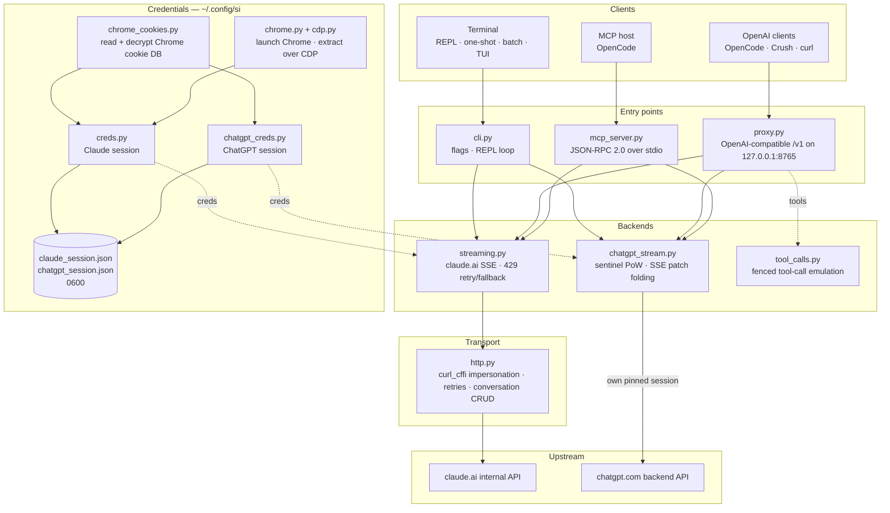

<div align="center">

[English](../../README.md) · [简体中文](README_zh.md) · [繁體中文](README_zh-TW.md) · [日本語](README_ja.md) · [한국어](README_ko.md) · [Türkçe](README_tr.md) · [Русский](README_ru.md) · [Tiếng Việt](README_vi.md) · [ไทย](README_th.md) · [Deutsch](README_de.md) · [Español](README_es.md) · [Français](README_fr.md) · **Українська** · [Polski](README_pl.md) · [Português (Brasil)](README_pt-BR.md) · [العربية](README_ar.md) · [فارسی](README_fa.md) · [Bahasa Indonesia](README_id.md) · [Italiano](README_it.md)
· [Ελληνικά](README_el.md) · [മലയാളം](README_ml.md)

# Reclaude

</div>

Термінальний клієнт для Claude.ai і ChatGPT — відтворює вашу власну сесію браузера на їхніх внутрішніх ендпоінтах і передає відповіді потоком, токен за токеном. Без API-ключа.

> Дослідницький інструмент. Він працює під вашим акаунтом Claude.ai: його ліміти, тарифи й оплата все ще діють. Він не обходить обмеження швидкості чи платні стіни.

> [!WARNING]
> **Не використовуйте свій основний акаунт.** si керує claude.ai і chatgpt.com через вашу власну сесію браузера — поведінка, через яку акаунт можуть обмежити або заблокувати. Використовуйте тимчасовий акаунт, втратою якого ви можете дозволити собі ризикнути, і ніколи — акаунт, прив'язаний до вашої пошти, оплати чи роботи.

## Демо


Коли проксі запущено, `si/haiku` з'являється у списку вибору `/models` в OpenCode, як будь-який інший провайдер. Виберіть її, запитайте й дивіться, як відповідь надходить потоком — усе через вашу сесію Claude.ai, без API-ключа.

## Архітектура

si — це три тонкі поверхні: термінальний клієнт, проксі, сумісний з OpenAI, і MCP-сервер — над однією парою потокових бекендів.



Запит проходить через чотири шари:

1. **Облікові дані** — `--from-chrome` читає базу cookie браузера й розшифровує її за допомогою системного сховища ключів (`chrome_cookies.py`); `--auto-fetch` запускає справжній Chrome і витягує cookie та org id через CDP (`chrome.py`, `cdp.py`). Сесії зберігаються в `~/.config/si/*.json` (`0600`). MCP-сервер перечитує їх під час кожного виклику (без перезапуску після повторного входу); проксі завантажує їх під час запуску, тож перезапустіть його після повторного входу.
2. **Точки входу** — `cli.py` розбирає прапорці та запускає режими REPL/одноразовий/пакетний; `proxy.py` обслуговує `/v1/models` і `/v1/chat/completions`; `mcp_server.py` відповідає на `tools/call` для `claude_ask` / `chatgpt_ask`. Проксі маршрутизує за ідентифікатором моделі (`chatgpt/…` → бекенд ChatGPT, усе інше → Claude); MCP-сервер надає один інструмент на кожен бекенд.
3. **Бекенди** — `streaming.py` надсилає запити на ендпоінт завершення Claude.ai та згортає дельти SSE з обмеженими повторними спробами/резервним варіантом на `429`; `chatgpt_stream.py` виконує рукостискання sentinel (proof-of-work + Turnstile) і згортає SSE зі знімками/патчами ChatGPT у текст. `tool_calls.py` перетворює блоки `tool_call` в огорожах на справжні `tool_calls` OpenAI, оскільки рідний канал інструментів Claude.ai блокує клієнти, які діють лише за завершеними відповідями.
4. **Транспорт** — `http.py` тримає одну сесію `curl_cffi`, закріплену за TLS-відбитком Chrome, обробляє повторні спроби/затримки і керує створенням/видаленням розмов. Бекенд ChatGPT має власну закріплену сесію, тож два відбитки ніколи не змішуються.

Стан розмови — це одна серверна розмова на кожну клієнтську сесію: CLI/TUI видаляють її під час виходу, якщо увімкнено режим невидимості, проксі прив'язує її до `X-Conversation-Id` (видаляючи одноразові розмови), а MCP-сервер зберігає по одній на кожен провайдер протягом свого життєвого циклу.

Допоміжні засоби під час встановлення: `opencode.py` реєструє MCP-сервер через `opencode mcp add`; `service.py` встановлює macOS LaunchAgent, який наглядає за проксі.

## Встановлення

```bash
git clone https://github.com/two35s/reclaude.git && cd reclaude
python3 -m venv .venv && source .venv/bin/activate
pip install -r requirements.txt
python -m si --opencode   # register the MCP tool with OpenCode (see below)
```

## Вхід (один раз)

```bash
python -m si --from-chrome   # steal session from your logged-in Chrome (recommended)
python -m si --auto-fetch    # or: launch Chrome, log in, auto-extract over CDP
python -m si --manual        # or: paste org_id + Cookie header by hand
```

Зберігається в `~/.config/si/claude_session.json` (`600`).

У Linux файли cookie, зашифровані Chrome за допомогою сховища ключів робочого столу (`v11`), потребують встановленого `libsecret-tools` і розблокованого сховища ключів; без них `--from-chrome` відмовляється від профілю, а не зберігає сміття (використовуйте `--auto-fetch` як запасний варіант).

### Облікові дані ChatGPT

```bash
python -m si --chatgpt --from-chrome   # steal chatgpt.com session from Chrome
python -m si --chatgpt --manual        # or paste the session-token cookie
python -m si --chatgpt --clear-session # delete stored chatgpt creds
```

Зберігається в `~/.config/si/chatgpt_session.json` (`600`). Проксі та MCP-сервер підхоплюють їх автоматично; тоді поруч із моделями claude з'являється модель із префіксом `chatgpt/`. Повторно запустіть `--chatgpt --from-chrome`, коли запити повертаються з `401`.

## Чат

```bash
python -m si                 # REPL
python -m si --tui           # full-screen chat
python -m si --prompt "..."  # one shot
python -m si --model haiku   # haiku | sonnet (default) | opus | fable …
```

Команди TUI: `/new` `/model [name]` `/models` `/help` `/quit`.
Команди REPL: ті самі, плюс `/stealth on|off` `/cleanup` `/clear-session`.

Одна серверна розмова на сесію забезпечує багатоходову пам'ять; режим невидимості видаляє її під час виходу, тож вона ніколи не з'являється в бічній панелі вашого браузера (`--no-stealth`, щоб зберегти її).

## Проксі

```bash
python -m si --proxy                 # OpenAI-compatible API on :8765
python -m si --proxy --port 9000
python -m si --proxy &               # run in the background
```

Проксі має бути запущеним, щоб клієнти бачили моделі — якщо він завершиться, кожен запит падатиме з `ConnectionRefused`. У macOS `python -m si --install-service` встановлює агент launchd, який запускає його під час входу та перезапускає в разі завершення (`--uninstall-service` видаляє його; журнали пишуться в `~/Library/Logs/si-proxy.log`).

Спрямуйте [Crush](https://github.com/charmbracelet/crush), [OpenCode](https://opencode.ai) або будь-який клієнт OpenAI на `http://localhost:8765/v1`.

Потокові (`text/event-stream`) і непотокові запити підтримуються обидва. Кожна потокова відповідь також записується в `~/.config/si/last_response.txt` — зручно, коли клієнт не показує вам нічого. Потік, що завершується без своєї термінальної події, повідомляється як помилка вищого рівня, а не видається за повну відповідь.

На `429` проксі повертає помилку, а не тихо перемикає вас на слабшу модель — повторні спроби та вибір моделі належать клієнту (OpenCode повторює самостійно).

### Моделі ChatGPT

Зі збереженими обліковими даними ChatGPT (див. вище) `--proxy` також обслуговує моделі `chatgpt/<slug>` — `chatgpt/auto`, `chatgpt/gpt-6`, `chatgpt/gpt-6-mini`, … — через той самий ендпоінт `/v1`, поруч із моделями claude. Один проксі обслуговує обидва провайдери одночасно; `/v1/models` перелічує все.

```bash
curl http://localhost:8765/v1/chat/completions \
  -d '{"model": "chatgpt/auto", "messages": [{"role": "user", "content": "hi"}]}'
```

Багатоходова пам'ять працює так само: надішліть заголовок `X-Conversation-Id`, і ходи ділитимуть одну розмову ChatGPT (поле `user` в OpenAI не використовується — воно ідентифікує кінцевого користувача, а не розмову). Стан розмови прив'язаний до бекенду, тож повторне використання одного ключа для моделей `si/` і `chatgpt/` зберігає їх окремо. Запити без заголовка є незалежними, а їхня серверна розмова видаляється після цього. Виклик інструментів, потокова передача та поведінка «`429` як помилка» застосовуються. Без збережених облікових даних ChatGPT запит `chatgpt/` натомість повертає чіткий `400`.

Запити містять резервний ідентифікатор акаунта в заголовках sentinel для сесій, де ендпоінт авторизації його не надає. Установіть `SI_CHATGPT_ACCOUNT_ID` на свій; він неперевірений для інших акаунтів — якщо новий безкоштовний акаунт отримує незрозумілі відмови sentinel, почніть із цього. Коли sentinel не створює токен Turnstile, si читає захоплений із `SI_CHATGPT_TURNSTILE` або `~/.config/si/chatgpt_turnstile.txt`; токен є даними сесії й не комітиться.

**Виклик інструментів працює.** `tools` OpenAI емулюються в тексті: проксі додає специфікації інструментів до запиту, просить модель видавати блоки `tool_call` в огорожах і перетворює їх на справжні `tool_calls` OpenAI у відповіді. Надішліть результати назад як повідомлення `tool` у наступному запиті, і модель продовжить. (Рідний канал інструментів Claude.ai тримає потік відкритим в очікуванні результату, що блокує клієнти, які діють лише за завершеними відповідями — тому проксі його не використовує.) Для бекенду `chatgpt/` блок протоколу веде запит, оскільки інакше ця поверхня відповідає «I can't reach that workspace» замість того, щоб видати огорожу; відповідь з інструментами, яка все ще починається з такої відмови, повторюється один раз у новій розмові, перш ніж її показати.

### Використання як звичайної моделі OpenCode

Коли проксі запущено, `si/sonnet`, `si/haiku` і `si/opus` з'являються у списку вибору `/models` в OpenCode, як будь-який інший провайдер. Виберіть одну й спілкуйтеся звичайно — інструменти (read/edit/bash), потокова передача та багатоходовість працюють через ваш акаунт Claude.ai.

`python -m si --opencode` друкує готовий до вставлення блок `providers` для вашого глобального конфігу. Або вставте вручну:

```jsonc
{
  "providers": {
    "si": {
      "name": "si",
      "package": "@opencode/ai/providers/openai-compatible",
      "settings": { "baseURL": "http://localhost:8765/v1" },
      "models": {
        "sonnet": { "name": "Claude Sonnet", "modelID": "si/sonnet" },
        "haiku": { "name": "Claude Haiku", "modelID": "si/haiku" },
        "opus": { "name": "Claude Opus", "modelID": "si/opus" }
      }
    }
  }
}
```

## MCP-сервер OpenCode

Відкрийте si для [OpenCode](https://opencode.ai) як рідний інструмент (`claude_ask`, `chatgpt_ask`), не роблячи його своїм провайдером моделей — OpenCode зберігає власну модель із підтримкою інструментів і може викликати Claude.ai або ChatGPT через si, коли ви попросите.

Встановіть однією командою, запущеною з цієї копії репозиторію:

```bash
python -m si --opencode
```

Це викликає власну команду OpenCode `opencode mcp add`, тож ваш наявний конфіг (разом із коментарями) зберігається. Перезапустіть OpenCode, потім перевірте `opencode mcp list`.

Ваша модель може потім викликати `claude_ask(prompt, model="sonnet")`; `model` приймає псевдоніми (`sonnet`, `haiku`, `opus`) або повний id моделі. `chatgpt_ask(prompt, model="auto")` робить те саме через ChatGPT (потрібні збережені облікові дані ChatGPT; `model` приймає slug chatgpt.com, як-от `auto`, `gpt-6`, `gpt-6-mini`).

<details>
<summary>Або додайте вручну</summary>

```jsonc
{
  "mcp": {
    "servers": {
      "si": {
        "type": "local",
        "command": ["/absolute/path/to/si/.venv/bin/python", "-m", "si.mcp_server"],
        "environment": { "PYTHONPATH": "/absolute/path/to/si" }
      }
    }
  }
}
```

`PYTHONPATH` — це те, що робить модуль імпортованим із будь-якої робочої директорії, тож `cwd` не потрібен.

</details>

Перевірте рукостискання окремо:

```bash
printf '{"jsonrpc":"2.0","id":1,"method":"tools/list"}\n' | .venv/bin/python -m si.mcp_server
```

Примітки:

- **Спільні розмови.** Усі виклики `claude_ask` використовують одну розмову Claude.ai, а всі виклики `chatgpt_ask` — одну розмову ChatGPT, протягом життєвого циклу сервера, тож подальші запити зберігають контекст. Жодна не видаляється режимом невидимості, і обидві з'являються у відповідній бічній панелі, доки ви їх не видалите.
- **Діагностика в stderr.** Вивід прогресу/помилок si йде в stderr, тож він ніколи не псує потік протоколу MCP у stdout.
- **Обмеження.** Наскрізна передача лише тексту — без виводу зображень і без повернення викликів інструментів. Запити виконуються під вашими власними акаунтами, тож ліміти тарифу діють. Один виклик може тривати до таймауту HTTP (120 с), а за обмеження швидкості — довше. `chatgpt_ask` коректно повертає помилку, коли облікові дані ChatGPT відсутні або хід відхилено (квота, обмеження швидкості).
- **Усунення несправностей.** `Session invalid or expired` → повторно запустіть `python -m si --auto-fetch` (Claude) або `--chatgpt --from-chrome` (ChatGPT); наступний виклик підхопить нові облікові дані (перезапуск не потрібен). Якщо інструмент відсутній, перевірте журнали MCP в OpenCode та що шлях venv у `command` абсолютний і правильний.

## Більше прапорців

`--batch FILE` один запит на рядок → `~/.config/si/batch_results.json` · `--jailbreak FILE` запит із файлу · `--org-id/--cookie` вбудовані облікові дані · `--clear-session` стерти облікові дані · `--login` зберегти профіль Chrome без витягування · `--opencode` зареєструвати MCP-інструмент в OpenCode і надрукувати конфіг провайдера.

## Якщо щось зламалося

| Симптом | Виправлення |
|---|---|
| `Session invalid or expired` | повторно запустіть `--from-chrome` або `--auto-fetch` |
| ChatGPT `401` / немає accessToken | повторно запустіть `--chatgpt --from-chrome` |
| ChatGPT `prepare`/`finalize` не вдалося | рукостискання sentinel змінилося в upstream; оновіть si |
| `429` обмеження швидкості | зачекайте або змініть модель (`/model haiku` у CLI/TUI) |
| `ConnectionRefused` на кожній моделі | проксі не запущено — запустіть `python -m si --proxy`, або `--install-service` у macOS |
| Запит Keychain | натисніть **Always Allow**, повторіть |

## Безпека

Ваш `sessionKey` і токен сесії ChatGPT — це паролі: ніколи не діліться файлами облікових даних, не завантажуйте й не комітьте їх. Виконайте `--clear-session` (і `--chatgpt --clear-session`), коли закінчите; якщо їх викрито, вийдіть із браузера, щоб анулювати їх.

Проксі слухає `127.0.0.1` без автентифікації, якщо не встановлено `SI_PROXY_TOKEN`. На спільному Mac інший локальний користувач або процес, який може досягти порту 8765, може витрачати квоту вашого акаунта; установіть токен (і передайте його клієнту) або тримайте проксі вимкненим, коли він не використовується. Plist macOS LaunchAgent записується з правами `600`, оскільки містить токен, коли його встановлено.

Бекенд ChatGPT керує внутрішнім API chatgpt.com через вашу власну сесію браузера. Це порушує умови надання послуг OpenAI і може призвести до обмеження або блокування акаунта — використовуйте тимчасовий акаунт, на свій ризик.

## Розробка

```bash
pip install -r requirements-dev.txt
PYTHONPATH=. .venv/bin/python -m pytest -q   # tests
.venv/bin/python -m ruff check .             # lint
.venv/bin/python -m ruff format --check .    # formatting
```

## Ліцензія

Лише для дослідницького та освітнього використання. Без гарантій.
