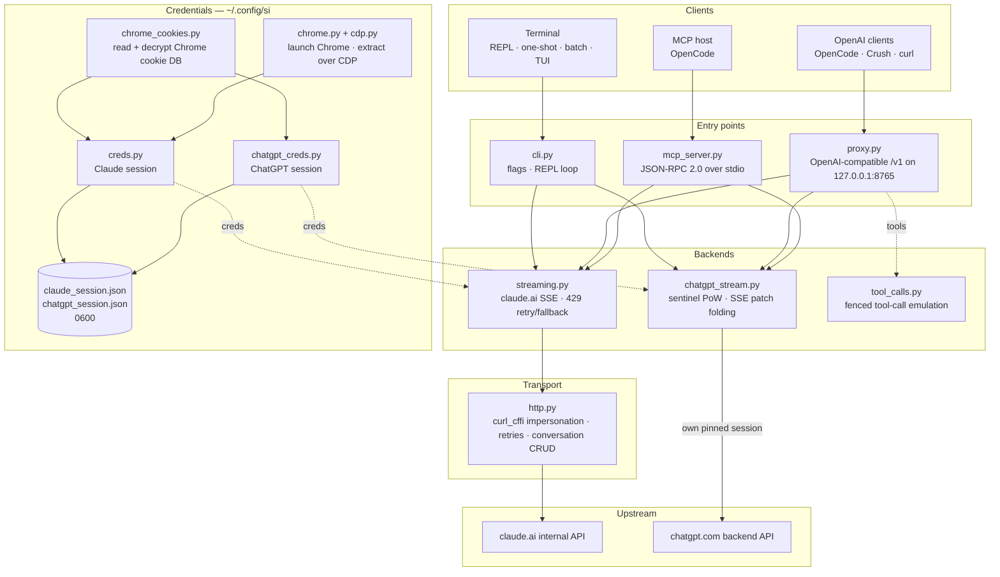

<div align="center">

[English](../../README.md) · [简体中文](README_zh.md) · [繁體中文](README_zh-TW.md) · [日本語](README_ja.md) · [한국어](README_ko.md) · [Türkçe](README_tr.md) · [Русский](README_ru.md) · **Tiếng Việt** · [ไทย](README_th.md) · [Deutsch](README_de.md) · [Español](README_es.md) · [Français](README_fr.md) · [Українська](README_uk.md) · [Polski](README_pl.md) · [Português (Brasil)](README_pt-BR.md) · [العربية](README_ar.md) · [فارسی](README_fa.md) · [Bahasa Indonesia](README_id.md) · [Italiano](README_it.md)
· [Ελληνικά](README_el.md) · [മലയാളം](README_ml.md)

# Reclaude

</div>

Client terminal cho Claude.ai và ChatGPT — phát lại phiên trình duyệt của chính bạn trên các endpoint nội bộ của họ và truyền phát phản hồi theo từng token. Không cần API key.

> Công cụ nghiên cứu. Nó chạy dưới tài khoản Claude.ai của bạn: các giới hạn, gói dịch vụ và việc tính phí vẫn áp dụng. Nó không vượt qua giới hạn tốc độ hay paywall.

> [!WARNING]
> **Không dùng tài khoản chính của bạn.** si điều khiển claude.ai và chatgpt.com thông qua phiên trình duyệt của chính bạn — hành vi có thể khiến tài khoản bị giới hạn hoặc bị khóa. Hãy dùng một tài khoản dùng-một-lần mà bạn sẵn sàng mất, tuyệt đối không dùng tài khoản gắn với email, thanh toán hay công việc của bạn.

## Bản demo


Khi proxy đang chạy, `si/haiku` xuất hiện trong bộ chọn `/models` của OpenCode như bất kỳ nhà cung cấp nào khác. Chọn nó, đặt câu hỏi, xem phản hồi hiện ra theo từng token — tất cả qua phiên Claude.ai của bạn, không cần API key.

## Kiến trúc

si gồm ba bề mặt mỏng — một client terminal, một proxy tương thích OpenAI và một máy chủ MCP — trên một cặp backend streaming.



Một yêu cầu đi qua bốn lớp:

1. **Thông tin đăng nhập** — `--from-chrome` đọc cơ sở dữ liệu cookie của trình duyệt và giải mã nó bằng keyring của hệ điều hành (`chrome_cookies.py`); `--auto-fetch` khởi chạy Chrome thật và lấy cookie cùng org id qua CDP (`chrome.py`, `cdp.py`). Phiên được lưu vào `~/.config/si/*.json` (`0600`). Máy chủ MCP đọc lại chúng mỗi lần gọi (không cần khởi động lại sau khi đăng nhập lại); proxy tải chúng khi khởi động, nên hãy khởi động lại proxy sau khi đăng nhập lại.
2. **Điểm vào** — `cli.py` phân tích các cờ và chạy chế độ REPL/one-shot/batch; `proxy.py` phục vụ `/v1/models` và `/v1/chat/completions`; `mcp_server.py` trả lời `tools/call` cho `claude_ask` / `chatgpt_ask`. Proxy định tuyến theo id mô hình (`chatgpt/…` → backend ChatGPT, mọi thứ còn lại → Claude); máy chủ MCP cung cấp một công cụ cho mỗi backend.
3. **Backend** — `streaming.py` gửi POST tới endpoint completion của Claude.ai và gộp các delta SSE, với cơ chế thử lại/fallback 429 có giới hạn; `chatgpt_stream.py` thực hiện handshake sentinel (proof-of-work + Turnstile) và gộp SSE dạng snapshot/patch của ChatGPT thành văn bản. `tool_calls.py` biến các khối `tool_call` dạng fenced thành `tool_calls` thật của OpenAI, vì kênh công cụ gốc của Claude.ai khiến các client chỉ phản ứng với phản hồi đã hoàn tất bị deadlock.
4. **Truyền tải** — `http.py` giữ một phiên `curl_cffi` được ghim vào vân tay TLS của Chrome, xử lý thử lại/backoff và quản lý việc tạo/xóa cuộc hội thoại. Backend ChatGPT giữ phiên được ghim riêng để hai vân tay không bao giờ trộn lẫn.

Trạng thái hội thoại là một cuộc trò chuyện phía máy chủ cho mỗi phiên client: CLI/TUI xóa nó khi thoát nếu stealth bật, proxy khóa nó theo `X-Conversation-Id` (xóa các cuộc trò chuyện one-shot), và máy chủ MCP giữ một cuộc cho mỗi nhà cung cấp trong suốt vòng đời của nó.

Các tiện ích lúc cài đặt: `opencode.py` đăng ký máy chủ MCP qua `opencode mcp add`; `service.py` cài LaunchAgent trên macOS để giám sát proxy.

## Cài đặt

```bash
git clone https://github.com/two35s/reclaude.git && cd reclaude
python3 -m venv .venv && source .venv/bin/activate
pip install -r requirements.txt
python -m si --opencode   # register the MCP tool with OpenCode (see below)
```

## Đăng nhập (một lần)

```bash
python -m si --from-chrome   # steal session from your logged-in Chrome (recommended)
python -m si --auto-fetch    # or: launch Chrome, log in, auto-extract over CDP
python -m si --manual        # or: paste org_id + Cookie header by hand
```

Lưu vào `~/.config/si/claude_session.json` (`600`).

Trên Linux, cookie mà Chrome mã hóa bằng keyring của môi trường desktop (`v11`) cần cài `libsecret-tools` và keyring phải được mở khóa; nếu không có, `--from-chrome` sẽ từ chối profile thay vì lưu dữ liệu rác (dùng `--auto-fetch` làm phương án dự phòng).

### Thông tin đăng nhập ChatGPT

```bash
python -m si --chatgpt --from-chrome   # steal chatgpt.com session from Chrome
python -m si --chatgpt --manual        # or paste the session-token cookie
python -m si --chatgpt --clear-session # delete stored chatgpt creds
```

Lưu vào `~/.config/si/chatgpt_session.json` (`600`). Proxy và máy chủ MCP tự động nhận các thông tin này; khi đó một mô hình có tiền tố `chatgpt/` sẽ xuất hiện bên cạnh các mô hình claude. Chạy lại `--chatgpt --from-chrome` khi các yêu cầu trả về `401`.

## Trò chuyện

```bash
python -m si                 # REPL
python -m si --tui           # full-screen chat
python -m si --prompt "..."  # one shot
python -m si --model haiku   # haiku | sonnet (default) | opus | fable …
```

Lệnh TUI: `/new` `/model [name]` `/models` `/help` `/quit`.
Lệnh REPL: tương tự, cộng thêm `/stealth on|off` `/cleanup` `/clear-session`.

Mỗi phiên có một cuộc hội thoại phía máy chủ để có bộ nhớ nhiều lượt; chế độ stealth xóa nó khi thoát để nó không bao giờ xuất hiện trong thanh bên trình duyệt của bạn (`--no-stealth` để giữ lại).

## Proxy

```bash
python -m si --proxy                 # OpenAI-compatible API on :8765
python -m si --proxy --port 9000
python -m si --proxy &               # run in the background
```

Proxy phải đang chạy để client thấy các mô hình — nếu nó thoát, mọi yêu cầu sẽ thất bại với `ConnectionRefused`. Trên macOS, `python -m si --install-service` cài một launchd agent khởi động nó khi đăng nhập và khởi động lại nếu nó thoát (`--uninstall-service` để gỡ; log ghi vào `~/Library/Logs/si-proxy.log`).

Trỏ [Crush](https://github.com/charmbracelet/crush), [OpenCode](https://opencode.ai) hoặc bất kỳ client OpenAI nào tới `http://localhost:8765/v1`.

Cả yêu cầu streaming (`text/event-stream`) và không streaming đều được hỗ trợ. Mọi phản hồi streaming cũng được ghi vào `~/.config/si/last_response.txt` — hữu ích khi client không hiển thị gì. Một luồng kết thúc mà không có sự kiện kết thúc sẽ được báo là lỗi upstream thay vì bị coi là phản hồi hoàn chỉnh.

Khi gặp `429`, proxy trả về lỗi thay vì âm thầm hạ cấp bạn xuống một mô hình yếu hơn — việc thử lại và chọn mô hình thuộc về client (OpenCode tự thử lại).

### Các mô hình ChatGPT

Khi đã lưu thông tin đăng nhập ChatGPT (xem ở trên), `--proxy` cũng phục vụ các mô hình `chatgpt/<slug>` — `chatgpt/auto`, `chatgpt/gpt-6`, `chatgpt/gpt-6-mini`, … — qua cùng endpoint `/v1`, bên cạnh các mô hình claude. Một proxy phục vụ cả hai nhà cung cấp cùng lúc; `/v1/models` liệt kê tất cả.

```bash
curl http://localhost:8765/v1/chat/completions \
  -d '{"model": "chatgpt/auto", "messages": [{"role": "user", "content": "hi"}]}'
```

Bộ nhớ nhiều lượt hoạt động theo cùng cách: gửi header `X-Conversation-Id` và các lượt chia sẻ một cuộc hội thoại ChatGPT (trường `user` của OpenAI không được dùng — nó xác định người dùng cuối, không phải cuộc hội thoại). Trạng thái hội thoại được khóa theo từng backend, nên dùng lại cùng một khóa cho các mô hình `si/` và `chatgpt/` vẫn giữ chúng tách biệt. Các yêu cầu không có header là độc lập, và cuộc hội thoại phía máy chủ của chúng sẽ bị xóa sau đó. Gọi công cụ, streaming và hành vi `429` hiện ra dưới dạng lỗi đều áp dụng. Nếu chưa lưu thông tin đăng nhập ChatGPT, một yêu cầu `chatgpt/` sẽ trả về `400` rõ ràng thay vào đó.

Các yêu cầu mang một account id dự phòng trong header sentinel cho những phiên mà endpoint auth không cung cấp. Đặt `SI_CHATGPT_ACCOUNT_ID` thành của bạn; nó chưa được xác minh cho các tài khoản khác — nếu một tài khoản miễn phí mới bị từ chối sentinel không rõ lý do, hãy bắt đầu từ đó. Khi sentinel không tạo được token Turnstile, si đọc một token đã bắt từ `SI_CHATGPT_TURNSTILE` hoặc `~/.config/si/chatgpt_turnstile.txt`; token là dữ liệu phiên và không được commit.

**Gọi công cụ hoạt động.** `tools` của OpenAI được mô phỏng bằng văn bản: proxy nối các đặc tả công cụ vào prompt, yêu cầu mô hình phát ra các khối `tool_call` dạng fenced, rồi chuyển chúng thành `tool_calls` thật của OpenAI trong phản hồi. Gửi kết quả trở lại dưới dạng thông điệp `tool` trong yêu cầu tiếp theo và mô hình sẽ tiếp tục. (Kênh công cụ gốc của Claude.ai giữ luồng mở để chờ kết quả, khiến các client chỉ hành động trên phản hồi đã hoàn tất bị deadlock — nên proxy không dùng nó.) Với backend `chatgpt/`, khối giao thức đứng đầu prompt, vì bề mặt đó nếu không sẽ trả lời "I can't reach that workspace" thay vì phát ra fence; một phản hồi có công cụ mà vẫn mở đầu bằng lời từ chối như vậy sẽ được thử lại một lần trong một cuộc hội thoại mới trước khi được hiển thị.

### Dùng như một mô hình OpenCode thông thường

Với proxy đang chạy, `si/sonnet`, `si/haiku` và `si/opus` xuất hiện trong bộ chọn `/models` của OpenCode như bất kỳ nhà cung cấp nào khác. Chọn một mô hình và trò chuyện bình thường — công cụ (read/edit/bash), streaming và nhiều lượt đều hoạt động qua tài khoản Claude.ai của bạn.

`python -m si --opencode` in ra khối `providers` sẵn sàng để dán cho cấu hình toàn cục của bạn. Hoặc dán thủ công:

```jsonc
{
  "providers": {
    "si": {
      "name": "si",
      "package": "@opencode/ai/providers/openai-compatible",
      "settings": { "baseURL": "http://localhost:8765/v1" },
      "models": {
        "sonnet": { "name": "Claude Sonnet", "modelID": "si/sonnet" },
        "haiku": { "name": "Claude Haiku", "modelID": "si/haiku" },
        "opus": { "name": "Claude Opus", "modelID": "si/opus" }
      }
    }
  }
}
```

## Máy chủ MCP cho OpenCode

Cung cấp si cho [OpenCode](https://opencode.ai) như một công cụ gốc (`claude_ask`, `chatgpt_ask`) mà không cần biến nó thành nhà cung cấp mô hình của bạn — OpenCode giữ mô hình có khả năng dùng công cụ của riêng nó và có thể gọi Claude.ai hoặc ChatGPT qua si khi bạn yêu cầu.

Cài đặt bằng một lệnh, chạy từ thư mục checkout này:

```bash
python -m si --opencode
```

Lệnh đó gọi `opencode mcp add` của chính OpenCode, nên cấu hình hiện có của bạn (kể cả chú thích) được giữ nguyên. Khởi động lại OpenCode, rồi kiểm tra `opencode mcp list`.

Mô hình của bạn sau đó có thể gọi `claude_ask(prompt, model="sonnet")`; `model` chấp nhận các bí danh (`sonnet`, `haiku`, `opus`) hoặc một model id đầy đủ. `chatgpt_ask(prompt, model="auto")` làm điều tương tự qua ChatGPT (cần lưu thông tin đăng nhập ChatGPT; `model` nhận slug của chatgpt.com như `auto`, `gpt-6`, `gpt-6-mini`).

<details>
<summary>Hoặc thêm thủ công</summary>

```jsonc
{
  "mcp": {
    "servers": {
      "si": {
        "type": "local",
        "command": ["/absolute/path/to/si/.venv/bin/python", "-m", "si.mcp_server"],
        "environment": { "PYTHONPATH": "/absolute/path/to/si" }
      }
    }
  }
}
```

`PYTHONPATH` là thứ khiến module có thể import từ bất kỳ thư mục làm việc nào, nên không cần `cwd`.

</details>

Kiểm tra handshake độc lập:

```bash
printf '{"jsonrpc":"2.0","id":1,"method":"tools/list"}\n' | .venv/bin/python -m si.mcp_server
```

Ghi chú:

- **Hội thoại chia sẻ.** Tất cả các lệnh gọi `claude_ask` dùng lại một cuộc hội thoại Claude.ai, và tất cả các lệnh gọi `chatgpt_ask` dùng một cuộc hội thoại ChatGPT, trong suốt vòng đời của máy chủ, nên các câu hỏi tiếp theo giữ được ngữ cảnh. Cả hai đều không bị xóa bởi stealth và đều xuất hiện trong thanh bên tương ứng cho đến khi bạn xóa chúng.
- **Chẩn đoán trên stderr.** Đầu ra tiến trình/lỗi của si đi tới stderr, nên nó không bao giờ làm hỏng luồng giao thức MCP trên stdout.
- **Hạn chế.** Chỉ chuyển tiếp văn bản — không có đầu ra hình ảnh và không có lệnh gọi công cụ trả về. Yêu cầu chạy dưới tài khoản của chính bạn, nên giới hạn gói dịch vụ vẫn áp dụng. Một lệnh gọi có thể mất tới thời gian chờ HTTP (120 s), lâu hơn khi bị giới hạn tốc độ. `chatgpt_ask` báo lỗi gọn gàng khi thiếu thông tin đăng nhập ChatGPT hoặc lượt bị từ chối (hạn mức, giới hạn tốc độ).
- **Khắc phục sự cố.** `Session invalid or expired` → chạy lại `python -m si --auto-fetch` (Claude) hoặc `--chatgpt --from-chrome` (ChatGPT); lần gọi tiếp theo sẽ nhận thông tin đăng nhập mới (không cần khởi động lại). Nếu thiếu công cụ, hãy kiểm tra log MCP của OpenCode và đảm bảo đường dẫn venv trong `command` là tuyệt đối và đúng.

## Các cờ khác

`--batch FILE` một prompt mỗi dòng → `~/.config/si/batch_results.json` · `--jailbreak FILE` prompt từ tệp · `--org-id/--cookie` thông tin đăng nhập nội tuyến · `--clear-session` xóa thông tin đăng nhập · `--login` lưu profile Chrome mà không trích xuất · `--opencode` đăng ký công cụ MCP với OpenCode và in cấu hình provider.

## Nếu có sự cố

| Triệu chứng | Cách khắc phục |
|---|---|
| `Session invalid or expired` | chạy lại `--from-chrome` hoặc `--auto-fetch` |
| ChatGPT `401` / no accessToken | chạy lại `--chatgpt --from-chrome` |
| ChatGPT `prepare`/`finalize` failed | handshake sentinel đã thay đổi ở upstream; cập nhật si |
| `429` rate limited | chờ, hoặc đổi mô hình (`/model haiku` trong CLI/TUI) |
| `ConnectionRefused` on every model | proxy chưa chạy — khởi động `python -m si --proxy`, hoặc `--install-service` trên macOS |
| Keychain prompt | bấm **Always Allow**, thử lại |

## Bảo mật

`sessionKey` và token phiên ChatGPT của bạn là mật khẩu: không bao giờ chia sẻ, tải lên hay commit các tệp thông tin đăng nhập. Dùng `--clear-session` (và `--chatgpt --clear-session`) khi xong; nếu bị lộ, hãy đăng xuất trong trình duyệt để vô hiệu hóa chúng.

Proxy lắng nghe trên `127.0.0.1` mà không có xác thực trừ khi `SI_PROXY_TOKEN` được đặt. Trên một máy Mac dùng chung, người dùng cục bộ hoặc tiến trình khác có thể tới cổng 8765 có thể tiêu hạn mức tài khoản của bạn; hãy đặt token (và cung cấp nó cho client) hoặc tắt proxy khi không dùng. Tệp plist của LaunchAgent trên macOS được ghi với quyền `600` vì nó mang token khi token được đặt.

Backend ChatGPT điều khiển API nội bộ của chatgpt.com bằng phiên trình duyệt của chính bạn. Điều đó vi phạm điều khoản dịch vụ của OpenAI và có thể khiến tài khoản bị giới hạn hoặc khóa — hãy dùng tài khoản dùng-một-lần, tự chịu rủi ro.

## Phát triển

```bash
pip install -r requirements-dev.txt
PYTHONPATH=. .venv/bin/python -m pytest -q   # tests
.venv/bin/python -m ruff check .             # lint
.venv/bin/python -m ruff format --check .    # formatting
```

## Giấy phép

Chỉ dùng cho mục đích nghiên cứu và giáo dục. Không có bảo hành.
