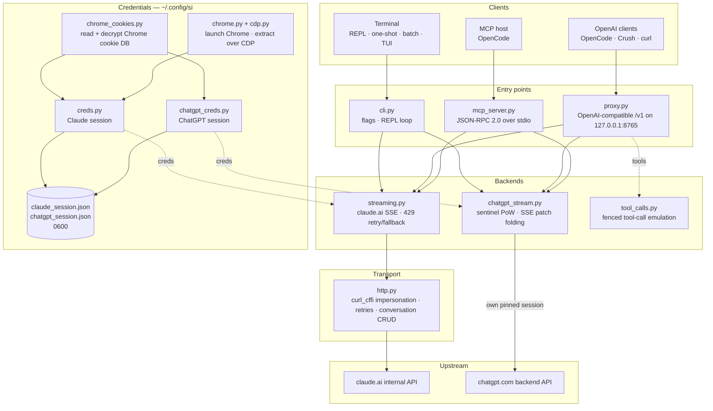

<div align="center">

[English](../../README.md) · [简体中文](README_zh.md) · **繁體中文** · [日本語](README_ja.md) · [한국어](README_ko.md) · [Türkçe](README_tr.md) · [Русский](README_ru.md) · [Tiếng Việt](README_vi.md) · [ไทย](README_th.md) · [Deutsch](README_de.md) · [Español](README_es.md) · [Français](README_fr.md) · [Українська](README_uk.md) · [Polski](README_pl.md) · [Português (Brasil)](README_pt-BR.md) · [العربية](README_ar.md) · [فارسی](README_fa.md) · [Bahasa Indonesia](README_id.md) · [Italiano](README_it.md)
· [Ελληνικά](README_el.md) · [മലയാളം](README_ml.md)

# Reclaude

</div>

Claude.ai 與 ChatGPT 的終端機用戶端——重播你自己的瀏覽器工作階段，向其內部端點發出請求，並逐字串流回覆。不需要 API 金鑰。

> 研究工具。它在你自己的 Claude.ai 帳號下運作：其限制、方案層級與計費仍然適用。它不會繞過速率限制或付費牆。

> [!WARNING]
> **請勿使用你的主帳號。** si 透過你自己的瀏覽器工作階段驅動 claude.ai 與 chatgpt.com——這種行為可能導致帳號被限制或停用。請使用一個你承擔得起損失的拋棄式帳號，絕不要使用與你的電子郵件、帳單或工作綁定的帳號。

## 示範


在代理伺服器運作時，`si/haiku` 會像其他任何提供者一樣出現在 OpenCode 的 `/models` 選擇器中。選取它、提問，然後看著回覆逐步串流進來——全程透過你的 Claude.ai 工作階段，不需要 API 金鑰。

## 架構

si 是三個輕薄的介面層——終端機用戶端、OpenAI 相容代理伺服器，以及 MCP 伺服器——建構在一對串流後端之上。



一個請求會經過四層：

1. **憑證**——`--from-chrome` 讀取瀏覽器的 cookie 資料庫，並用作業系統的金鑰環解密（`chrome_cookies.py`）；`--auto-fetch` 啟動真實的 Chrome，並透過 CDP 取得 cookie 與 org id（`chrome.py`、`cdp.py`）。工作階段會存到 `~/.config/si/*.json`（`0600`）。MCP 伺服器每次呼叫都會重新讀取它們（重新登入後無需重啟）；代理伺服器則在啟動時載入，因此重新登入後請重啟代理伺服器。
2. **進入點**——`cli.py` 解析旗標並執行 REPL／單次／批次模式；`proxy.py` 提供 `/v1/models` 與 `/v1/chat/completions`；`mcp_server.py` 回應 `claude_ask` / `chatgpt_ask` 的 `tools/call`。代理伺服器依據模型 id 路由（`chatgpt/…` → ChatGPT 後端，其餘全部 → Claude）；MCP 伺服器為每個後端各暴露一個工具。
3. **後端**——`streaming.py` 向 Claude.ai 的完成端點發出 POST，並折疊 SSE 增量，具備有上限的 429 重試／回退；`chatgpt_stream.py` 執行 sentinel 握手（工作量證明 + Turnstile），並將 ChatGPT 的快照／修補 SSE 折疊成文字。`tool_calls.py` 將圍欄式 `tool_call` 區塊轉換成真正的 OpenAI `tool_calls`，因為 Claude.ai 的原生工具通道會讓只對完成回應採取行動的用戶端死鎖。
4. **傳輸**——`http.py` 維持一個固定使用 Chrome TLS 指紋的 `curl_cffi` 工作階段，處理重試／退避，並負責對話的建立／刪除。ChatGPT 後端保有自己的固定工作階段，讓兩個指紋永遠不會混用。

對話狀態是每個用戶端工作階段對應一個伺服器端聊天：當隱匿模式開啟時，CLI／TUI 會在結束時刪除它；代理伺服器以 `X-Conversation-Id` 區分（並刪除單次聊天）；MCP 伺服器則在其生命週期內為每個提供者各保留一個。

安裝時輔助工具：`opencode.py` 透過 `opencode mcp add` 註冊 MCP 伺服器；`service.py` 安裝負責監督代理伺服器的 macOS LaunchAgent。

## 安裝

```bash
git clone https://github.com/two35s/reclaude.git && cd reclaude
python3 -m venv .venv && source .venv/bin/activate
pip install -r requirements.txt
python -m si --opencode   # register the MCP tool with OpenCode (see below)
```

## 登入（一次）

```bash
python -m si --from-chrome   # steal session from your logged-in Chrome (recommended)
python -m si --auto-fetch    # or: launch Chrome, log in, auto-extract over CDP
python -m si --manual        # or: paste org_id + Cookie header by hand
```

儲存到 `~/.config/si/claude_session.json`（`600`）。

在 Linux 上，Chrome 以桌面金鑰環加密的 cookie（`v11`）需要安裝 `libsecret-tools` 並解鎖金鑰環；缺少這些條件時，`--from-chrome` 會拒絕該設定檔，而不是儲存垃圾資料（請改用 `--auto-fetch` 作為備援）。

### ChatGPT 憑證

```bash
python -m si --chatgpt --from-chrome   # steal chatgpt.com session from Chrome
python -m si --chatgpt --manual        # or paste the session-token cookie
python -m si --chatgpt --clear-session # delete stored chatgpt creds
```

儲存到 `~/.config/si/chatgpt_session.json`（`600`）。代理伺服器與 MCP 伺服器會自動採用這些憑證；接著，帶有 `chatgpt/` 前綴的模型就會與 claude 模型一同出現。當請求回傳 `401` 時，請重新執行 `--chatgpt --from-chrome`。

## 聊天

```bash
python -m si                 # REPL
python -m si --tui           # full-screen chat
python -m si --prompt "..."  # one shot
python -m si --model haiku   # haiku | sonnet (default) | opus | fable …
```

TUI 指令：`/new` `/model [name]` `/models` `/help` `/quit`。
REPL 指令：同上，另加 `/stealth on|off` `/cleanup` `/clear-session`。

每個工作階段對應一個伺服器端對話，提供多輪記憶；隱匿模式會在結束時刪除它，因此它永遠不會出現在你的瀏覽器側邊欄（`--no-stealth` 可保留它）。

## 代理伺服器

```bash
python -m si --proxy                 # OpenAI-compatible API on :8765
python -m si --proxy --port 9000
python -m si --proxy &               # run in the background
```

代理伺服器必須在運作，用戶端才能看到模型——如果它結束，每個請求都會以 `ConnectionRefused` 失敗。在 macOS 上，`python -m si --install-service` 會安裝一個 launchd 代理程式，在登入時啟動它，並在其結束時重新啟動（`--uninstall-service` 可移除；日誌會寫到 `~/Library/Logs/si-proxy.log`）。

將 [Crush](https://github.com/charmbracelet/crush)、[OpenCode](https://opencode.ai) 或任何 OpenAI 用戶端指向 `http://localhost:8765/v1`。

同時支援串流（`text/event-stream`）與非串流請求。每個串流回覆也會寫入 `~/.config/si/last_response.txt`——當用戶端什麼都不顯示時很方便。若串流在缺少終止事件的情況下結束，會回報為上游錯誤，而不是被當成完整回覆。

遇到 `429` 時，代理伺服器會回傳錯誤，而不是默默將你降級到較弱的模型——重試與模型選擇屬於用戶端的職責（OpenCode 會自行重試）。

### ChatGPT 模型

在已儲存 ChatGPT 憑證的情況下（見上文），`--proxy` 也會透過相同的 `/v1` 端點提供 `chatgpt/<slug>` 模型——`chatgpt/auto`、`chatgpt/gpt-6`、`chatgpt/gpt-6-mini`、…——與 claude 模型並列。一個代理伺服器可同時服務兩個提供者；`/v1/models` 會列出所有模型。

```bash
curl http://localhost:8765/v1/chat/completions \
  -d '{"model": "chatgpt/auto", "messages": [{"role": "user", "content": "hi"}]}'
```

多輪記憶的運作方式相同：送出 `X-Conversation-Id` 標頭，各輪就會共用同一個 ChatGPT 對話（不使用 OpenAI 的 `user` 欄位——它識別的是終端使用者，而不是對話）。對話狀態會依後端各自以鍵區分，因此在 `si/` 與 `chatgpt/` 模型之間重複使用同一個鍵，仍會保持各自獨立。沒有該標頭的請求彼此獨立，其伺服器端對話會在之後被刪除。工具呼叫、串流，以及 `429` 會以錯誤形式呈現的行為，全都適用。若未儲存 ChatGPT 憑證，`chatgpt/` 請求則會改為回傳明確的 `400`。

針對認證端點未提供帳號 id 的工作階段，請求會在 sentinel 標頭中攜帶一個備援帳號 id。將 `SI_CHATGPT_ACCOUNT_ID` 設為你自己的；它未經其他帳號驗證——如果全新的免費帳號遇到無法解釋的 sentinel 拒絕，請從那裡開始排查。當 sentinel 未產生 Turnstile 權杖時，si 會從 `SI_CHATGPT_TURNSTILE` 或 `~/.config/si/chatgpt_turnstile.txt` 讀取擷取到的權杖；該權杖屬於工作階段資料，不會被提交。

**工具呼叫可正常運作。** OpenAI 的 `tools` 以文字方式模擬：代理伺服器會將工具規格附加到提示中，要求模型輸出圍欄式 `tool_call` 區塊，並在回應中將其轉換成真正的 OpenAI `tool_calls`。在下一個請求中將結果以 `tool` 訊息送回，模型就會繼續。（Claude.ai 的原生工具通道會讓串流保持開啟以等待結果，這會讓只對完成回應採取行動的用戶端死鎖——因此代理伺服器不使用它。）對於 `chatgpt/` 後端，協定區塊會放在提示的開頭，因為該介面若不如此，就會回答「我無法存取該工作區」，而不是輸出圍欄；若帶有工具的回覆仍以這類拒絕開頭，會在全新對話中重試一次後才顯示。

### 當作一般 OpenCode 模型使用

在代理伺服器運作時，`si/sonnet`、`si/haiku` 與 `si/opus` 會像其他任何提供者一樣出現在 OpenCode 的 `/models` 選擇器中。選取一個並正常聊天——工具（read/edit/bash）、串流與多輪對話全都透過你的 Claude.ai 帳號運作。

`python -m si --opencode` 會印出可直接貼上的 `providers` 區塊，供你的全域設定使用。或者手動貼上：

```jsonc
{
  "providers": {
    "si": {
      "name": "si",
      "package": "@opencode/ai/providers/openai-compatible",
      "settings": { "baseURL": "http://localhost:8765/v1" },
      "models": {
        "sonnet": { "name": "Claude Sonnet", "modelID": "si/sonnet" },
        "haiku": { "name": "Claude Haiku", "modelID": "si/haiku" },
        "opus": { "name": "Claude Opus", "modelID": "si/opus" }
      }
    }
  }
}
```

## OpenCode MCP 伺服器

將 si 以原生工具（`claude_ask`、`chatgpt_ask`）的形式暴露給 [OpenCode](https://opencode.ai)，而不必讓它成為你的模型提供者——OpenCode 會保留自己具備工具能力的模型，並在你要求時透過 si 呼叫 Claude.ai 或 ChatGPT。

在此檢出的目錄中執行一個指令即可安裝：

```bash
python -m si --opencode
```

它會呼叫 OpenCode 自己的 `opencode mcp add`，因此你現有的設定（包含註解）會被保留。重新啟動 OpenCode，然後檢查 `opencode mcp list`。

你的模型接著可以呼叫 `claude_ask(prompt, model="sonnet")`；`model` 接受別名（`sonnet`、`haiku`、`opus`）或完整的模型 id。`chatgpt_ask(prompt, model="auto")` 會透過 ChatGPT 做同樣的事（需要已儲存 ChatGPT 憑證；`model` 接受像 `auto`、`gpt-6`、`gpt-6-mini` 這樣的 chatgpt.com slug）。

<details>
<summary>或手動新增</summary>

```jsonc
{
  "mcp": {
    "servers": {
      "si": {
        "type": "local",
        "command": ["/absolute/path/to/si/.venv/bin/python", "-m", "si.mcp_server"],
        "environment": { "PYTHONPATH": "/absolute/path/to/si" }
      }
    }
  }
}
```

`PYTHONPATH` 讓該模組可從任何工作目錄匯入，因此不需要 `cwd`。

</details>

單獨檢查握手：

```bash
printf '{"jsonrpc":"2.0","id":1,"method":"tools/list"}\n' | .venv/bin/python -m si.mcp_server
```

注意事項：

- **共用對話。** 在伺服器的生命週期內，所有 `claude_ask` 呼叫會重複使用同一個 Claude.ai 對話，所有 `chatgpt_ask` 呼叫會重複使用同一個 ChatGPT 對話，因此後續追問能保留上下文。兩者都不會被隱匿刪除，且在你移除之前都會出現在各自的側邊欄中。
- **診斷輸出到 stderr。** si 的進度／錯誤輸出會送到 stderr，因此永遠不會破壞 stdout 上的 MCP 協定串流。
- **限制。** 僅限文字直通——沒有影像輸出，也不會回傳工具呼叫。請求會在你的帳號下執行，因此方案限制仍然適用。一次呼叫最多可能耗時到 HTTP 逾時（120 秒），在速率限制下會更久。當缺少 ChatGPT 憑證或該輪被拒絕（配額、速率限制）時，`chatgpt_ask` 會乾淨地回報錯誤。
- **疑難排解。** `Session invalid or expired` → 重新執行 `python -m si --auto-fetch`（Claude）或 `--chatgpt --from-chrome`（ChatGPT）；下一次呼叫就會採用新的憑證（無需重啟）。如果工具不見了，請檢查 OpenCode 的 MCP 日誌，以及 `command` 中的 venv 路徑是否為絕對路徑且正確。

## 更多旗標

`--batch FILE` 每行一個提示詞 → `~/.config/si/batch_results.json` · `--jailbreak FILE` 從檔案讀取提示詞 · `--org-id/--cookie` 內嵌憑證 · `--clear-session` 清除憑證 · `--login` 儲存 Chrome 設定檔而不擷取 · `--opencode` 向 OpenCode 註冊 MCP 工具並印出提供者設定。

## 如果出問題

| 症狀 | 修正方式 |
|---|---|
| `Session invalid or expired` | 重新執行 `--from-chrome` 或 `--auto-fetch` |
| ChatGPT `401` / 沒有 accessToken | 重新執行 `--chatgpt --from-chrome` |
| ChatGPT `prepare`/`finalize` 失敗 | sentinel 握手已在上游變更；請更新 si |
| `429` 受到速率限制 | 稍候，或切換模型（在 CLI/TUI 中使用 `/model haiku`） |
| 每個模型都出現 `ConnectionRefused` | 代理伺服器未運作——啟動 `python -m si --proxy`，或在 macOS 上使用 `--install-service` |
| 出現鑰匙串提示 | 點擊 **永遠允許**，然後重試 |

## 安全性

你的 `sessionKey` 與 ChatGPT 工作階段權杖就是密碼：絕不要分享、上傳或提交這些憑證檔案。完成後請執行 `--clear-session`（以及 `--chatgpt --clear-session`）；若已洩露，請在瀏覽器中登出以使其失效。

除非設定了 `SI_PROXY_TOKEN`，否則代理伺服器會監聽 `127.0.0.1` 且不進行任何驗證。在共用的 Mac 上，其他能存取 8765 埠的本機使用者或程序可以消耗你帳號的配額；請設定權杖（並提供給用戶端），或是在不使用時關閉代理伺服器。macOS LaunchAgent 的 plist 會以 `600` 權限寫入，因為設定權杖時它會攜帶該權杖。

ChatGPT 後端會以你自己的瀏覽器工作階段驅動 chatgpt.com 的內部 API。這違反 OpenAI 的服務條款，可能導致帳號被限制或停用——請使用拋棄式帳號，風險自負。

## 開發

```bash
pip install -r requirements-dev.txt
PYTHONPATH=. .venv/bin/python -m pytest -q   # tests
.venv/bin/python -m ruff check .             # lint
.venv/bin/python -m ruff format --check .    # formatting
```

## 授權

僅供研究與教育用途。不提供任何保證。
