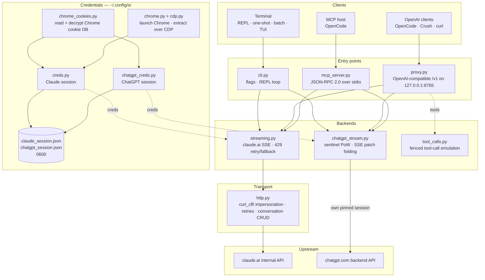

<div align="center">

[English](../../README.md) · **简体中文** · [繁體中文](README_zh-TW.md) · [日本語](README_ja.md) · [한국어](README_ko.md) · [Türkçe](README_tr.md) · [Русский](README_ru.md) · [Tiếng Việt](README_vi.md) · [ไทย](README_th.md) · [Deutsch](README_de.md) · [Español](README_es.md) · [Français](README_fr.md) · [Українська](README_uk.md) · [Polski](README_pl.md) · [Português (Brasil)](README_pt-BR.md) · [العربية](README_ar.md) · [فارسی](README_fa.md) · [Bahasa Indonesia](README_id.md) · [Italiano](README_it.md)
· [Ελληνικά](README_el.md) · [മലയാളം](README_ml.md)

# Reclaude

</div>

Claude.ai 与 ChatGPT 的终端客户端——复用你自己的浏览器会话请求它们的内部端点，并逐 token 流式输出回复。无需 API key。

> 研究工具。它在你的 Claude.ai 账户下运行：其限额、套餐等级和计费仍然适用。它不会绕过速率限制或付费墙。

> [!WARNING]
> **不要使用你的主账户。** si 通过你自己的浏览器会话驱动 claude.ai 和 chatgpt.com——这种行为可能导致账户被限制或封禁。请使用一个你输得起的临时账户，绝不要使用与你的邮箱、账单或工作绑定的账户。

## 演示


代理运行后，`si/haiku` 会像其他任何 provider 一样出现在 OpenCode 的 `/models` 选择器中。选中它、提问，然后看着回复流式返回——全程通过你的 Claude.ai 会话完成，无需 API key。

## 架构

si 是三个轻量界面——终端客户端、OpenAI 兼容代理和 MCP 服务器——建立在同一对流式后端之上。



一个请求会穿过四层：

1. **凭证** — `--from-chrome` 读取浏览器的 cookie 数据库并用操作系统钥匙串解密（`chrome_cookies.py`）；`--auto-fetch` 启动真正的 Chrome 并通过 CDP 提取 cookie 和 org id（`chrome.py`、`cdp.py`）。会话保存到 `~/.config/si/*.json`（`0600`）。MCP 服务器在每次调用时重新读取它们（重新登录后无需重启）；代理在启动时加载它们，因此重新登录后需要重启。
2. **入口** — `cli.py` 解析 flag 并运行 REPL/单次/批处理模式；`proxy.py` 提供 `/v1/models` 和 `/v1/chat/completions`；`mcp_server.py` 响应针对 `claude_ask` / `chatgpt_ask` 的 `tools/call`。代理根据 model id 路由（`chatgpt/…` → ChatGPT 后端，其他一切 → Claude）；MCP 服务器为每个后端暴露一个工具。
3. **后端** — `streaming.py` 向 Claude.ai 的 completion 端点发送请求并合并 SSE delta，带有有界的 429 重试/回退；`chatgpt_stream.py` 执行 sentinel 握手（proof-of-work + Turnstile）并将 ChatGPT 的 snapshot/patch SSE 合并为文本。`tool_calls.py` 将围栏 `tool_call` 块转换为真正的 OpenAI `tool_calls`，因为 Claude.ai 的原生工具通道会让仅在响应完成后才行动的客户端死锁。
4. **传输** — `http.py` 维护一个固定使用 Chrome TLS 指纹的 `curl_cffi` 会话，处理重试/退避，并负责会话的创建/删除。ChatGPT 后端保留自己固定的会话，因此两种指纹永远不会混用。

会话状态是每个客户端会话对应一个服务端聊天：当 stealth 开启时，CLI/TUI 在退出时删除它；代理用 `X-Conversation-Id` 作为键（并删除一次性聊天）；MCP 服务器在其生命周期内为每个 provider 保留一个。

安装辅助：`opencode.py` 通过 `opencode mcp add` 注册 MCP 服务器；`service.py` 安装监督代理的 macOS LaunchAgent。

## 安装

```bash
git clone https://github.com/two35s/reclaude.git && cd reclaude
python3 -m venv .venv && source .venv/bin/activate
pip install -r requirements.txt
python -m si --opencode   # register the MCP tool with OpenCode (see below)
```

## 登录（一次）

```bash
python -m si --from-chrome   # steal session from your logged-in Chrome (recommended)
python -m si --auto-fetch    # or: launch Chrome, log in, auto-extract over CDP
python -m si --manual        # or: paste org_id + Cookie header by hand
```

保存到 `~/.config/si/claude_session.json`（`600`）。

在 Linux 上，Chrome 用桌面钥匙串加密的 cookie（`v11`）需要安装 `libsecret-tools` 并解锁钥匙串；否则 `--from-chrome` 会拒绝该 profile，而不是保存垃圾数据（可用 `--auto-fetch` 作为回退方案）。

### ChatGPT 凭证

```bash
python -m si --chatgpt --from-chrome   # steal chatgpt.com session from Chrome
python -m si --chatgpt --manual        # or paste the session-token cookie
python -m si --chatgpt --clear-session # delete stored chatgpt creds
```

保存到 `~/.config/si/chatgpt_session.json`（`600`）。代理和 MCP 服务器会自动读取它们；随后一个带 `chatgpt/` 前缀的模型会与 claude 模型一起出现。当请求返回 `401` 时，重新运行 `--chatgpt --from-chrome`。

## 聊天

```bash
python -m si                 # REPL
python -m si --tui           # full-screen chat
python -m si --prompt "..."  # one shot
python -m si --model haiku   # haiku | sonnet (default) | opus | fable …
```

TUI 命令：`/new` `/model [name]` `/models` `/help` `/quit`。
REPL 命令：相同，外加 `/stealth on|off` `/cleanup` `/clear-session`。

每个会话一个服务端对话，从而提供多轮记忆；stealth 模式会在退出时删除它，因此它永远不会出现在你的浏览器侧边栏中（`--no-stealth` 可保留它）。

## 代理

```bash
python -m si --proxy                 # OpenAI-compatible API on :8765
python -m si --proxy --port 9000
python -m si --proxy &               # run in the background
```

代理必须处于运行状态，客户端才能看到模型——如果它退出，每个请求都会以 `ConnectionRefused` 失败。在 macOS 上，`python -m si --install-service` 会安装一个 launchd agent，在登录时启动它，并在它退出时重启（`--uninstall-service` 将其移除；日志写入 `~/Library/Logs/si-proxy.log`）。

将 [Crush](https://github.com/charmbracelet/crush)、[OpenCode](https://opencode.ai) 或任何 OpenAI 客户端指向 `http://localhost:8765/v1`。

同时支持流式（`text/event-stream`）和非流式请求。每个流式回复也会写入 `~/.config/si/last_response.txt`——当客户端什么都不显示时很有用。没有终止事件就结束的流会被报告为上游错误，而不是被当作完整回复。

遇到 `429` 时，代理会返回错误，而不是悄悄将你降级到更弱的模型——重试和模型选择属于客户端（OpenCode 会自行重试）。

### ChatGPT 模型

存储 ChatGPT 凭证后（见上文），`--proxy` 还会通过同一个 `/v1` 端点提供 `chatgpt/<slug>` 模型——`chatgpt/auto`、`chatgpt/gpt-6`、`chatgpt/gpt-6-mini`、……——与 claude 模型并列。一个代理同时服务两个 provider；`/v1/models` 会列出所有模型。

```bash
curl http://localhost:8765/v1/chat/completions \
  -d '{"model": "chatgpt/auto", "messages": [{"role": "user", "content": "hi"}]}'
```

多轮记忆的工作方式相同：发送 `X-Conversation-Id` 头，各轮就会共享同一个 ChatGPT 对话（不使用 OpenAI 的 `user` 字段——它标识的是最终用户，而不是对话）。会话状态按后端分别作为键，因此在 `si/` 和 `chatgpt/` 模型之间复用同一个键仍会让它们保持隔离。没有该头的请求彼此独立，其服务端对话会在之后被删除。工具调用、流式传输以及 `429` 表现为错误的行为都同样适用。如果没有存储 ChatGPT 凭证，`chatgpt/` 请求会改为返回一个明确的 `400`。

对于认证端点未提供账户 id 的会话，请求会在 sentinel 头中携带一个回退账户 id。将 `SI_CHATGPT_ACCOUNT_ID` 设置为你自己的；它对其他账户未经验证——如果一个新的免费账户遇到无法解释的 sentinel 拒绝，请从这里开始排查。当 sentinel 不铸造 Turnstile token 时，si 会从 `SI_CHATGPT_TURNSTILE` 或 `~/.config/si/chatgpt_turnstile.txt` 读取捕获的 token；该 token 属于会话数据，不会被提交。

**工具调用可用。** OpenAI 的 `tools` 在文本中被模拟：代理将工具规范附加到 prompt，要求模型输出围栏 `tool_call` 块，并在响应中把它们转换为真正的 OpenAI `tool_calls`。将结果作为 `tool` 消息在下一个请求中发回，模型便会继续。（Claude.ai 的原生工具通道会保持流打开以等待结果，这会让仅在响应完成后才行动的客户端死锁——因此代理不使用它。）对于 `chatgpt/` 后端，协议块会放在 prompt 开头，因为该界面否则会回答“我无法访问那个工作区”而不是输出围栏；一个仍以这种拒绝开头的带工具回复，会在新对话中重试一次后再显示。

### 作为普通 OpenCode 模型使用

代理运行后，`si/sonnet`、`si/haiku` 和 `si/opus` 会像其他任何 provider 一样出现在 OpenCode 的 `/models` 选择器中。选择一个并正常聊天——工具（read/edit/bash）、流式传输和多轮对话都能通过你的 Claude.ai 账户工作。

`python -m si --opencode` 会打印可直接粘贴到你全局配置中的 `providers` 块。或者手动粘贴：

```jsonc
{
  "providers": {
    "si": {
      "name": "si",
      "package": "@opencode/ai/providers/openai-compatible",
      "settings": { "baseURL": "http://localhost:8765/v1" },
      "models": {
        "sonnet": { "name": "Claude Sonnet", "modelID": "si/sonnet" },
        "haiku": { "name": "Claude Haiku", "modelID": "si/haiku" },
        "opus": { "name": "Claude Opus", "modelID": "si/opus" }
      }
    }
  }
}
```

## OpenCode MCP 服务器

将 si 作为原生工具（`claude_ask`、`chatgpt_ask`）暴露给 [OpenCode](https://opencode.ai)，而无需让它成为你的模型 provider——OpenCode 保留自己具备工具能力的模型，并在你要求时通过 si 调用 Claude.ai 或 ChatGPT。

在此检出目录中运行一条命令即可安装：

```bash
python -m si --opencode
```

它会调用 OpenCode 自己的 `opencode mcp add`，因此你现有的配置（包括注释）会被保留。重启 OpenCode，然后检查 `opencode mcp list`。

之后你的模型可以调用 `claude_ask(prompt, model="sonnet")`；`model` 接受别名（`sonnet`、`haiku`、`opus`）或完整 model id。`chatgpt_ask(prompt, model="auto")` 通过 ChatGPT 做同样的事（需要存储 ChatGPT 凭证；`model` 接受 `auto`、`gpt-6`、`gpt-6-mini` 这样的 chatgpt.com slug）。

<details>
<summary>或手动添加</summary>

```jsonc
{
  "mcp": {
    "servers": {
      "si": {
        "type": "local",
        "command": ["/absolute/path/to/si/.venv/bin/python", "-m", "si.mcp_server"],
        "environment": { "PYTHONPATH": "/absolute/path/to/si" }
      }
    }
  }
}
```

`PYTHONPATH` 让该模块可以从任何工作目录导入，因此不需要 `cwd`。

</details>

单独检查握手：

```bash
printf '{"jsonrpc":"2.0","id":1,"method":"tools/list"}\n' | .venv/bin/python -m si.mcp_server
```

说明：

- **共享对话。** 在服务器生命周期内，所有 `claude_ask` 调用复用一个 Claude.ai 对话，所有 `chatgpt_ask` 调用复用一个 ChatGPT 对话，因此后续追问会保留上下文。两者都不会被 stealth 删除，并且在你移除它们之前都会出现在各自的侧边栏中。
- **诊断信息输出到 stderr。** si 的进度/错误输出会写到 stderr，因此它永远不会破坏 stdout 上的 MCP 协议流。
- **限制。** 仅文本透传——没有图像输出，也不会返回工具调用。请求在你自己的账户下运行，因此适用计划限额。一次调用最多可能耗时达到 HTTP 超时（120 秒），在速率限制下会更长。当缺少 ChatGPT 凭证或该轮被拒绝（配额、速率限制）时，`chatgpt_ask` 会干净地报错。
- **故障排查。** `Session invalid or expired` → 重新运行 `python -m si --auto-fetch`（Claude）或 `--chatgpt --from-chrome`（ChatGPT）；下一次调用会使用新的凭证（无需重启）。如果工具缺失，请检查 OpenCode 的 MCP 日志，以及 `command` 中的 venv 路径是否为绝对路径且正确。

## 更多 flag

`--batch FILE` 每行一个 prompt → `~/.config/si/batch_results.json` · `--jailbreak FILE` 从文件读取 prompt · `--org-id/--cookie` 内联凭证 · `--clear-session` 清除凭证 · `--login` 保存 Chrome profile 而不提取 · `--opencode` 向 OpenCode 注册 MCP 工具并打印 provider 配置。

## 出问题时

| 症状 | 修复 |
|---|---|
| `Session invalid or expired` | 重新运行 `--from-chrome` 或 `--auto-fetch` |
| ChatGPT `401` / 没有 accessToken | 重新运行 `--chatgpt --from-chrome` |
| ChatGPT `prepare`/`finalize` failed | sentinel 握手在上游发生了变化；更新 si |
| `429` 速率受限 | 等待，或切换模型（在 CLI/TUI 中 `/model haiku`） |
| 每个模型都出现 `ConnectionRefused` | 代理未运行——启动 `python -m si --proxy`，或在 macOS 上使用 `--install-service` |
| 钥匙串提示 | 点击 **始终允许**，然后重试 |

## 安全

你的 `sessionKey` 和 ChatGPT session token 就是密码：绝不要分享、上传或提交凭证文件。完成后使用 `--clear-session`（以及 `--chatgpt --clear-session`）；如果已泄露，请在浏览器中登出以使它们失效。

除非设置了 `SI_PROXY_TOKEN`，否则代理在 `127.0.0.1` 上监听且没有身份验证。在共享的 Mac 上，其他能访问 8765 端口的本地用户或进程可以消耗你账户的配额；请设置 token（并将其提供给客户端），或者在不使用时关闭代理。macOS LaunchAgent plist 被写为 `600`，因为当设置了 token 时它会携带该 token。

ChatGPT 后端使用你自己的浏览器会话驱动 chatgpt.com 的内部 API。这违反了 OpenAI 的服务条款，可能导致账户被限制或封禁——请使用临时账户，风险自负。

## 开发

```bash
pip install -r requirements-dev.txt
PYTHONPATH=. .venv/bin/python -m pytest -q   # tests
.venv/bin/python -m ruff check .             # lint
.venv/bin/python -m ruff format --check .    # formatting
```

## 许可证

仅限研究与教育用途。不提供任何担保。
